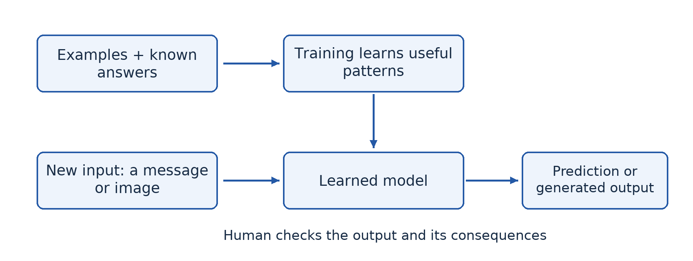
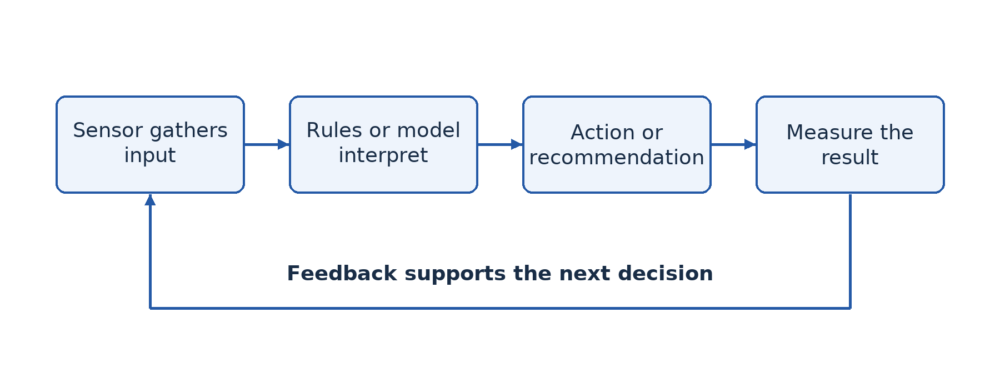
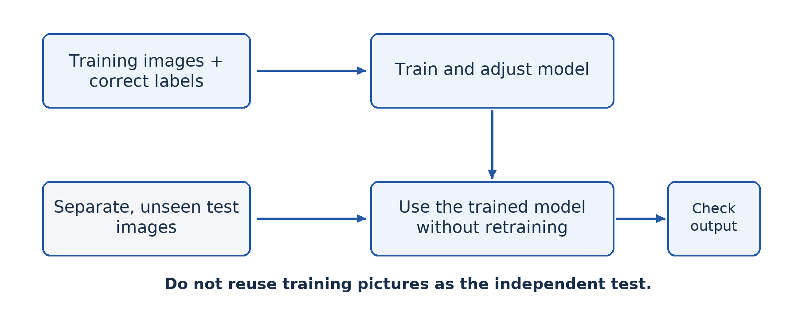
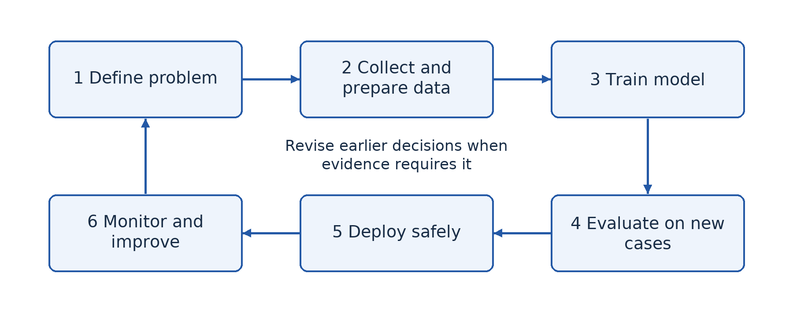

# Part 1 — Applying artificial intelligence

## Lesson 1 — The concept of artificial intelligence

### Begin with a familiar situation

When Amina types a message, her phone suggests the next word. When she uses a calculator, it follows the arithmetic operation she selects. Both programs process data, but the word predictor tackles a task associated with human language. What makes that task an example of artificial intelligence? The answer concerns the kind of task and the method used, not whether the device looks like a person.

### 1.1 What artificial intelligence means

**Artificial intelligence (AI)** is the field of computing concerned with creating systems that perform tasks associated with human intelligence, such as recognising patterns, understanding language, reasoning, planning and making decisions. An AI system takes input from its environment, processes that input using a model or a set of rules, and produces an output. The output may be a prediction, a recommendation, generated content or an action.

Consider an e-mail spam filter. Its input includes properties of a message, such as words, links and the sender's address. Its output is a classification such as “spam” or “not spam”. A person can also make this judgement, but the computer can process many messages quickly. This does not mean that it understands the sender's intentions in the same way a human does.

Some AI systems use explicitly written rules; others use patterns learned from data. Therefore, “AI always teaches itself” is not a correct definition. Equally, not every automatic action is AI. A lamp controlled by a fixed timer is ordinary automation. A system that analyses camera images to identify an obstruction is performing a perception task. The distinction can be a matter of degree, so explain the task rather than merely labelling a product “smart”.

### 1.2 How AI developed

In 1950, Alan Turing discussed whether a machine's conversational behaviour could be distinguished from a person's. His imitation game encouraged researchers to study observable performance rather than simply assume that machines could never display intelligent behaviour. The term “artificial intelligence” became associated with the Dartmouth research workshop in 1956.

Early researchers built programs that manipulated symbols and followed logical rules. Later, **expert systems** used knowledge supplied by human specialists: for instance, rules linking symptoms to possible causes. These systems could be useful in narrow fields, but collecting and maintaining all the necessary rules was difficult. Periods of exaggerated promises followed by disappointment and reduced funding are often called **AI winters**.

Machine learning became increasingly useful as computers became faster and more digital data became available. In 1997, IBM's Deep Blue defeated world chess champion Garry Kasparov in a match. In the 2010s, improvements in neural networks, graphics processors and large datasets produced major gains in image and speech recognition. Generative AI then made systems that produce text, images and other content widely accessible; ChatGPT's public launch in 2022 is one well-known milestone.

These events do not show a smooth march towards a human mind. They show changing methods, resources and capabilities. Progress depends on computing power, useful data, algorithms, investment and human choices. A small school with little relevant data cannot assume that buying an AI application will solve every local problem.

### 1.3 Main types and useful distinctions

**Narrow AI** is designed or trained for a particular range of tasks. A crop-image classifier and a chess program are examples. A system may perform many language tasks yet still have important limits and make basic mistakes. Strong performance in one area does not establish unrestricted human-level competence.

**Artificial general intelligence (AGI)** refers to the proposed ability to perform a very wide range of intellectual tasks with human-like flexibility. **Artificial superintelligence** describes a hypothetical system exceeding human intellectual capabilities very broadly. These terms describe proposed capability levels; they should not be confused with ordinary product names or taken as evidence of consciousness.

Another classification describes functionality. A **reactive** system acts on current input without using a stored account of previous interactions. A **limited-memory** system uses stored or recent information in making decisions. “Theory of mind” and “self-aware AI” are sometimes discussed as further categories, but they are conceptual ideas, not capabilities to assume whenever a chatbot uses emotional language.

A different distinction concerns output. A **classification** system assigns an input to a category, such as identifying a message as spam. A **generative** system produces new content, such as a draft letter. These categories answer a different question from narrow versus general: one concerns what the system produces, the other concerns the breadth of its capabilities.

### 1.4 Applications and their limits

In health, AI can assist a professional by highlighting suspicious areas in a medical image. The benefit is support for detection; the limitation is that inaccurate or unrepresentative training data may produce errors. Remote medical communication alone is not necessarily AI: transmitting a patient's measurements to a doctor is telemedicine, even if no intelligent prediction is made.

In agriculture, a farmer might photograph a leaf so a model can suggest a possible disease. In banking, an AI system may flag unusual transactions for investigation. In education, a tutor may adapt practice questions to earlier responses. In transport, a route-planning system can use traffic data to suggest a journey. In each case, identify the input, the intelligent task, the output and the responsible human user.

### Worked example — Is the clinic using AI?

A fictional clinic sends a patient's heart recording to a doctor in another town. This is an ICT application because it stores and communicates information. It is not enough evidence of AI. If a trained model also analyses the recording and flags a possible abnormality, that additional function is AI. The input is the recording; the task is pattern recognition; the output is a warning; the doctor checks the result before deciding on treatment. The explanation is stronger than calling the entire clinic “intelligent”.

### Guided activity

Choose three familiar systems: a calculator, predictive text and an online recommendation feed. For each, write a paragraph identifying its input, processing task and output. Explain which task provides evidence of AI. If you cannot know the internal method, state that uncertainty instead of inventing one. With no device, use descriptions supplied by the teacher.

### Check your understanding

1. Define AI and explain why an automatic door is not necessarily evidence of AI.
2. Explain two changes that helped machine learning become more practical.
3. Distinguish narrow AI from generative AI. Can a system fit both descriptions?
4. Suggest an AI application for a farming cooperative and one limitation that must be considered.

### Answer guidance

1. AI concerns tasks associated with intelligence. A door opening whenever a simple sensor is triggered may use a fixed control rule without image recognition, learning or complex reasoning.
2. Faster processors reduce training time; larger relevant datasets provide more examples from which patterns can be learned. Explain the connection rather than only naming the changes.
3. Narrow describes the range of capabilities; generative describes producing content. A task-focused text generator can be both.
4. A leaf classifier could suggest disease categories, but it must be tested on local crops and conditions. It should not replace expert advice when the cost of a wrong answer is high.

## Lesson 2 — AI ethics and responsible use

### Begin with a decision, not a slogan

Mboa Community College considers using AI to rank scholarship applicants. The system is fast, but its training examples mostly describe learners from well-equipped urban schools. Could a mathematically calculated ranking still be unfair? Yes. A calculation can reproduce unfair choices already present in its data. **AI ethics** examines what ought to be done when AI affects people, including who benefits, who may be harmed and who is responsible.

### 2.1 Bias, fairness and unequal consequences

**Bias** is a systematic tendency in data, methods or decisions that can distort results. If past scholarship winners mostly attended schools with strong internet access, a model may learn to associate online-course certificates with merit. A rural learner without connectivity may then be disadvantaged even if equally capable. The problem is not that every use of past data is wrong; it is that the data may contain disadvantages unrelated to the purpose of the decision.

Fairness requires asking whether the system performs acceptably for different relevant groups and whether its criteria are justified. Collecting more data helps only if the additional data addresses the actual weakness. Human reviewers can also be biased, so “a person checked it” is not a complete safeguard. Reviewers need clear criteria, authority to disagree and a way to investigate complaints.

### 2.2 Privacy, transparency and accountability

**Privacy** concerns appropriate control over information about a person. A tutoring application may collect useful learning responses, but it does not automatically need the learner's home address, identity document or private messages. Collect only necessary information, explain its purpose, control access and decide when it will be deleted. Do not upload classmates' records to a public chatbot merely because doing so is convenient.

**Transparency** means making relevant facts about a system and its use clear. People should know when AI materially affects a decision. **Explainability** concerns whether useful reasons for a particular result can be given. In a scholarship process, “the computer said no” does not help an applicant correct an error or appeal an unfair decision.

**Accountability** means that identifiable people or organisations remain answerable for the system's use. Responsibility cannot be transferred to software. A school needs someone to investigate inaccurate results, correct records and decide whether the system should continue operating. Human oversight must be meaningful, not a ceremonial approval of every machine output.

### 2.3 Other important ethical issues

Generative AI can produce plausible misinformation, including invented references and false images. A **deepfake** is manipulated or generated media that convincingly represents someone saying or doing something they did not. A voice-clone payment request could harm a family even when the audio sounds familiar. Verification through an independent, trusted channel is therefore more useful than judging realism alone.

AI also raises questions about copyright, consent and academic honesty. Copying an AI-generated essay without disclosure can misrepresent a learner's own achievement. AI assistance may be permitted for brainstorming but prohibited for an assessed final answer; follow the teacher's stated rules. A system's ability to reproduce content does not establish a legal right to use it.

Automation can remove some tasks while creating others. Evaluate effects on workers, training needs and working conditions rather than saying simply “AI takes all jobs” or “AI creates jobs”. Running large systems also uses energy and other resources. A useful application should be assessed against its costs and against simpler alternatives that might achieve the same goal.

### 2.4 Weighing benefits against risks

A risk has both a possible harmful outcome and a chance of occurring. Consider **likelihood**, **severity**, the number and vulnerability of affected people, and the ability to detect and correct a mistake. A wrong music recommendation is not equivalent to a wrong medical recommendation. Efficiency alone cannot justify removing safeguards from a high-stakes decision.

For the scholarship system, faster processing is a benefit. Unfair exclusion is a potentially serious harm. The school can lower risk by using relevant criteria, testing results across groups, protecting records, publishing the decision process, allowing appeals and keeping final responsibility with a trained panel. If it cannot provide these safeguards, delaying deployment may be more responsible than using an unsuitable system.

### Worked example — Explain a principle through an action

Question: “Explain how a school can apply privacy and accountability when using an AI tutor.” A weak answer merely lists “privacy, accountability”. A developed answer states: “The school should use fictional or minimal learner identifiers and restrict access to progress records, reducing unnecessary exposure of personal information. It should appoint a teacher to review incorrect advice and complaints, so learners have someone who can correct harm.” Each principle is linked to an action and a consequence.

### Guided activity — A classroom AI charter

In groups, write five rules for using AI in schoolwork. Include verification of factual claims, permitted and prohibited assistance, disclosure, protection of other people's information, and how to report harmful output. For every rule, add the harm it aims to prevent. Test the charter against a learner using AI to translate a self-written paragraph and another submitting an entirely generated assignment. With no internet, use printed examples; no personal information is needed.

### Check your understanding

1. Explain how biased training data could disadvantage a group even if no developer intended discrimination.
2. Distinguish transparency from accountability using the scholarship example.
3. Evaluate AI-assisted medical screening by explaining one benefit, two risks and two safeguards.
4. Why is checking a chatbot's answer against another chatbot not always adequate verification?

### Answer guidance

1. The model may learn correlations reflecting past unequal opportunities. Applying those correlations to new applicants repeats that disadvantage.
2. Transparency reveals the use and basis of ranking; accountability identifies who investigates errors and corrects decisions. A transparent but uncorrectable process is still inadequate.
3. Faster review may support clinicians. False results and exposed medical records can harm patients. Use validated performance tests, professional review, access restrictions and appropriate consent; connect each safeguard to its risk.
4. Systems may rely on similar data or repeat the same error. Consult a trustworthy independent source, an original document or an appropriate expert.

## Lesson 3 — AI techniques and intelligent systems

### From a technique to a complete system

A school installs a camera at its gate. The camera alone records images; it does not make the school intelligent. An intelligent system needs input, processing, a decision or recommendation and an appropriate response. It also needs a purpose. This lesson connects individual AI techniques to the larger systems in which they operate.

### 3.1 Common techniques

A **rule-based system** applies explicit rules to known facts. For example, a troubleshooting program may ask whether a printer has power and whether paper is loaded. If the answers match a rule, it recommends a possible remedy. Rules are relatively easy to inspect, but maintaining a large set becomes difficult when cases overlap or conditions change.

An **expert system** uses a knowledge base of specialist facts and rules together with an inference engine that applies them to a problem. A user interface gathers facts and presents advice; some systems also explain which rules led to the conclusion. Such a system can support a worker in a narrow domain, but it cannot be assumed to possess all the judgement of the specialist whose knowledge was encoded.

**Machine learning** derives useful patterns from training examples rather than requiring a person to write every decision rule. It can help when recognising a pattern is difficult to express as a short rule. A model trained on images of different leaves can learn features useful for classification, but its success depends on representative examples and meaningful testing.

**Computer vision** extracts information from images or video. Reading text in a photographed document and recognising an object are vision tasks. **Natural language processing (NLP)** handles human language, for example translating text, identifying topics or responding to a question. Speech recognition turns spoken audio into text; speech synthesis produces speech from text. These are different operations, and confusing one with the other makes an explanation inaccurate.

**Search and optimisation** explore possible choices to find a satisfactory or good solution. A route planner considers roads and costs such as distance or travel time. **Robotics** combines sensing, control and physical action. A robot may use vision to locate an object and planning to move an arm, but a chatbot does not become a robot merely because it performs language tasks. Modern systems often combine several techniques rather than use only one.

### 3.2 The structure of an intelligent system

A **sensor** gathers information from the environment. A camera senses light; a temperature sensor measures temperature. A processing component interprets that information using rules or a model. The system then recommends or selects an action. An **actuator** is a device that produces a physical action, such as a motor opening a vent. A display can present advice for a person to act on instead.

**Feedback** returns information about the result so that later actions can be adjusted. A room controller measures the new temperature after operating a fan. Feedback is not the same as machine learning: a simple thermostat uses feedback without learning a model from examples. This distinction prevents us from calling every feedback controller an AI system.

### 3.3 Smart school, city, health and home

In a **smart school**, an adaptive learning application may select practice based on earlier answers. Inputs are learner responses; processing identifies areas of difficulty; output is recommended practice; feedback comes from later results. The teacher checks whether those recommendations actually help. Privacy and unequal access are design concerns, not optional additions.

A **smart city** might combine traffic sensors and models to recommend signal timing. The objective is safer and more efficient movement, not simply installing many cameras. A **smart-health** system might identify an unusual trend in monitored measurements and alert a clinician. A **smart home** might interpret a spoken request and control a light. Each system combines connectivity, software and sometimes AI; not every component needs to be intelligent.

Compare systems using their purpose, input, technique, output, users and consequences of error. A school tutor and a medical warning system may both use machine learning, yet medical errors can carry different risks. The appropriate level of human oversight depends on the task, not merely the brand of software.

### Worked example — Choose techniques for a library

The library wants to digitise printed titles and answer routine opening-hour questions. Optical character recognition, a computer-vision application, can turn photographed titles into text. A small rule-based question-answer system may be sufficient for fixed opening hours. A large generative model is not automatically necessary. The decision starts from the task; it then considers accuracy, cost, connectivity and the consequences of wrong answers.

### Guided activity

Design a paper diagram for a smart classroom that reduces wasted lighting. Identify the sensor, processing rule or model, output, actuator and feedback. Then explain whether AI is actually necessary. For an extension, replace the simple occupancy sensor with a camera that must distinguish people from moving curtains. Explain why image recognition changes both the technical problem and the privacy risk. Do not install cameras or collect photographs of classmates.

### Check your understanding

1. Explain the roles of a knowledge base and an inference engine in an expert system.
2. Distinguish speech recognition, NLP and speech synthesis using a voice assistant.
3. Give an example of feedback that does not involve machine learning.
4. Compare an intelligent health warning system with a smart-home voice controller on input, output and risk.

### Answer guidance

1. The knowledge base stores specialist facts and rules; the inference engine applies them to the current facts to reach a conclusion or recommendation.
2. Recognition converts the request's audio into text; language processing interprets or formulates the response; synthesis converts response text into spoken audio.
3. A thermostat repeatedly comparing measured temperature with a fixed target uses feedback. It need not learn its rule from data.
4. Health measurements produce a clinical alert requiring careful professional review; microphone input may produce a lighting action. Both need security, but the likely severity of a wrong output differs.

## Lesson 4 — Machine learning

### Why examples matter

Suppose the library wants a computer to distinguish pictures of a notebook from pictures of a calculator. Writing a rule for every possible colour, angle and background is difficult. Instead, we can supply labelled examples and train a model to recognise useful patterns. **Machine learning (ML)** is a branch of AI in which a system learns patterns from data to perform a task, rather than having every decision rule explicitly programmed.

### 4.1 Inputs, labels, training and prediction

A **dataset** is a collection of examples. In **supervised learning**, examples have known target answers called **labels**. An image labelled “calculator” supplies both input and target output. During **training**, an algorithm adjusts a model so that its predictions better match training labels according to a chosen measure of error. A **model** is the learned representation used to make predictions.

When the trained model receives a new image, it performs **inference**: it uses what was learned to produce an output. Training and inference are different stages. A deployed model does not necessarily retrain itself whenever a user shows it another object. Someone must decide whether and how new data will be used for future training.

In **unsupervised learning**, data has no supplied target labels and the method looks for patterns such as groups of similar records. In **reinforcement learning**, an agent learns a strategy through actions and feedback represented by rewards. These approaches solve different problems; they are not interchangeable names for the same training process.

### 4.2 Testing honestly

A model that succeeds on examples it has already seen may fail on new ones. **Generalisation** is the ability to perform usefully on new examples from the intended setting. **Overfitting** occurs when a model fits details of training data so closely that it performs poorly on new data. A learner memorising an answer sheet without understanding provides a useful analogy.

Keep **test data** separate from training data. If the same photograph appears in both, the test is less informative. Collect variety: different angles, distances, lighting conditions and backgrounds. If every notebook is photographed on a blue desk and every calculator on a white desk, the model may learn the desk colour rather than the object. A balanced number of examples is helpful, but balance alone does not remove this hidden shortcut.

A displayed confidence score indicates the model's output strength according to its method. It is not a promise that the answer is correct, and it need not be a well-calibrated real-world probability. Try an unfamiliar object; a two-class model may still force it into one of its two known categories. An “unknown” category or a cautious human interpretation may therefore be needed.

### 4.3 Guided practical — Build with Teachable Machine

Teachable Machine is a web-based learning tool that lets you train small models without writing the training code. The teacher should check access and browser camera permissions before the lesson. Use objects, not faces, and follow school rules about data collection. An interface may change, but the training-and-testing process remains the same.

1. Open the teacher-approved Teachable Machine site and choose an image project with standard image classification. Rename the two classes “Notebook” and “Calculator”. Add a third “Neither” class if the teacher wants to investigate unknown inputs.
2. Collect at least 30 training images per class. Vary the object's angle, distance and position. Use similar background variety for each class so that the background does not reveal the answer. If using a webcam, capture only the objects and the work surface.
3. Before training, reserve at least ten **different** test images for each class. Do not upload these to the training classes. Another group can provide them, helping avoid accidental reuse.
4. Train the model using the tool's training control. Observe that the program uses examples to build a model; it is not being given a hand-written rule saying exactly what every calculator looks like.
5. Present each test image, record its true label and the predicted label, and count the correct predictions. Also test a new background, an awkward angle and an unrelated object. Record a failure rather than repeatedly changing the input until the output looks correct.
6. Identify one likely cause of error, add suitable **training** examples, and train again. For a fair final comparison, use a fresh held-out test set rather than repeatedly tuning the model to the same test pictures. Save the permitted project or screenshots and write a short conclusion about its limits.

If devices are unavailable, the teacher can provide image cards with object and background features. Learners propose a rule from training cards and then test it on unseen cards. This illustrates generalisation; it does not replace later hands-on model training.

### Worked example — Measure a result

A model correctly classifies 17 of 20 held-out images. Its accuracy on that test is correct predictions divided by all predictions: 17 ÷ 20 × 100 = **85%**. This does not show that it is 85% accurate for all future users. Twenty images are a small sample, and they may not represent new conditions. If all three errors involve dark rooms, the next question concerns lighting, not merely how to raise the displayed number.

### Check your understanding

1. Distinguish a training example, a label, a model and inference.
2. A model gets every training image right but only half of new images right. Explain a likely problem.
3. Calculate test accuracy when 36 of 45 predictions are correct.
4. Why should each class be photographed against several of the same backgrounds?

### Answer guidance

1. The example is an input case; its label is the known target answer; the model is the learned representation; inference applies that model to input to produce a prediction.
2. It may have overfitted or learned irrelevant shortcuts. Examine variety and separation of data rather than claiming it is ready because training performance is high.
3. 36 ÷ 45 × 100 = **80%**. State that this describes the specified test set.
4. Shared background variety reduces the chance that background alone predicts the label. The aim is to learn the intended object-related pattern.

## Lesson 5 — Developing AI systems

### A model is only one part of a solution

The farming cooperative asks for an AI service that identifies unhealthy leaves. A developer immediately starts choosing software. What has been missed? The cooperative's real need might be early referral to an agricultural adviser, and some photographs may be too poor for any reliable decision. Building an AI system begins with understanding the problem, not selecting a fashionable language.

### 5.1 Define the problem and success criteria

State who will use the system, what input they can realistically provide, what output is needed and how that output will be used. For leaf photographs, specify the crops and diseases covered. Decide what happens when the image is unclear or the disease is outside that scope. A useful success criterion might require acceptable performance on locally collected test images and an explicit “seek expert advice” pathway.

Also decide whether AI is appropriate. If farmers mainly need a directory of nearby advisers, a simple searchable directory may be cheaper and more dependable than a predictive model. A good ICT professional can justify not using AI when it does not solve the actual problem.

### 5.2 Obtain and prepare suitable data

Collect relevant examples with permission and accurate labels. A photograph labelled by an agricultural expert is generally more useful than an unverified caption copied from the internet. Check image quality, remove duplicates, correct inconsistent labels and document where data came from. Personal information in photographs should be avoided or removed where appropriate.

Divide data so that model development and final testing remain meaningfully separate. If multiple near-identical pictures of the same leaf appear in both sets, performance can be misleading. Training data teaches the model; validation data can guide choices during development; a final held-out test estimates performance after those choices. For a simple classroom project, the teacher may use a training/test split while explaining the purpose of the additional validation stage.

### 5.3 Build, evaluate and integrate

Choose an appropriate method and tools, train the model, and compare its output with known answers. Evaluate not only overall accuracy but the types of mistake. A missed serious disease and an unnecessary referral may carry different costs. Check performance for the users, devices and conditions that matter, including poorer lighting or lower-quality phone cameras.

**Deployment** means putting the system into real use. The model must be connected to an interface, storage and any required communication services. It needs access control, error handling and understandable output. A warning should tell a farmer what action is sensible; a mysterious score alone may be useless. Users need instructions and a way to report problems.

**Monitoring and maintenance** continue after deployment. New crops, changing disease patterns and different camera conditions may reduce performance. Record failures safely, review them and retrain or withdraw the model when necessary. A development process is therefore iterative: evaluation can send the team back to data collection or even to redefining the problem.

### 5.4 Languages and tools

**Python** is widely used because its syntax is relatively readable and it has extensive libraries for data processing, numerical computation and machine learning. A library is reusable code that saves developers from writing every operation themselves. Examples include NumPy for numerical arrays, pandas for structured data, scikit-learn for many learning methods, and TensorFlow or PyTorch for neural-network work. Naming a library is not the same as explaining its purpose.

Python also has tutorials, a large community and tools such as notebooks that combine explanation, code and output. Many performance-intensive operations are executed by underlying compiled libraries, so “Python is popular because it is always the fastest language” is misleading. **R** is useful for statistics, **C/C++** for performance-sensitive components, and **JavaScript** for web interfaces and some browser-based models. Tools such as Teachable Machine lower the entry barrier for demonstrations, but they do not remove the need for good data and testing.

### Worked example — Write a development plan

For a leaf-screening assistant, begin with the purpose “suggest whether an adviser should inspect a photographed leaf”, not “diagnose every disease”. Obtain labelled, permitted images from relevant crops. Train a suitable classifier and test it on new farms' images. Present tentative results with a referral message. Before pilot use, check privacy, connectivity and error consequences. During the pilot, collect feedback and stop using the system if errors make it unsafe. This sequence connects technical work with a responsible real-world service.

### Guided activity

Write a one-page proposal for an AI tool that helps the fictional school library. Include the problem, a simpler non-AI alternative, required data, preparation, method, test, user interface, privacy safeguard and maintenance plan. A classmate must find one assumption that would need checking before money was spent. No coding or internet is required; this activity tests planning rather than programming fluency.

### Check your understanding

1. Why should problem definition come before model selection?
2. Explain two data-preparation activities and their effect on reliability.
3. Give three reasons for Python's popularity without claiming it is inherently fastest.
4. Distinguish deployment from monitoring and explain why both are necessary.

### Answer guidance

1. The required task, users and consequences determine whether AI is appropriate and which methods could solve the problem.
2. Removing duplicates reduces misleading reuse; correcting labels stops the model learning incorrect associations. Other justified quality improvements are acceptable.
3. Readable syntax, extensive relevant libraries and community support reduce development effort. Link each reason to the developer's task.
4. Deployment makes the system available to users; monitoring checks its continuing behaviour. A successfully installed system can later become unreliable or inappropriate.

## Lesson 6 — Integration: Apply AI responsibly

### The situation

A fictional cooperative near Mboa Community College wants to help farmers recognise damaged leaves. It has two shared smartphones and unreliable connectivity. Its members include users who cannot easily read long English explanations. The committee has heard that AI is always accurate and wants to replace visits from an agricultural adviser. Your team must respond with a realistic proposal, not a sales advertisement.

This integration task combines Lessons 1–5. The progression sheet names an integration lesson but does not prescribe this scenario or the criteria below. The task and scoring guidance are locally authored.

### What you must produce

Prepare a two-page proposal and a five-minute demonstration or paper simulation. Explain the proposed intelligent task by identifying its input, processing and output. State the system's scope and distinguish AI analysis from the separate communication service that sends a question to an adviser. Identify at least one useful non-AI alternative.

Describe the examples needed for training and how an independent test would be organised. If equipment is available, adapt the harmless object-classification practical from Lesson 4; do not pretend that an unvalidated classroom model can diagnose crop disease. If equipment is unavailable, use clearly labelled training cards and separate test cards to demonstrate the same reasoning.

Explain how the proposal addresses bias, privacy, uncertainty and accountability. Include what the cooperative should do when the system gives no reliable answer. Consider local-language instructions, shared devices, data costs and offline access. State which claims still need expert verification before a real service could operate.

### A route through the problem

First agree on a narrow goal, such as helping a user decide when to request expert inspection. Next list available resources and constraints. Then select a technique and explain why it fits the task. Plan the data and test before designing an attractive interface. Finally ask another group to challenge a weak point: What happens with a different crop? Who corrects an error? Does the system expose another person's information? Revise the proposal in response.

The teacher should ensure that every group member can explain one design choice. A polished poster with no understanding is not adequate evidence of competence. Equally, a modest paper prototype can show sound planning, provided it is honestly described as a prototype rather than a working deployment.

### Assessment criteria — 20 marks

**Problem and scope, 4 marks:** identify users, a specific task, inputs and outputs, and a clear limit. **Technical plan, 6 marks:** choose a suitable method, describe representative data, separate training from testing and interpret a test result without overclaiming. **Responsible use, 6 marks:** explain relevant risks and practical safeguards, including human responsibility and an escalation route. **Communication and reflection, 4 marks:** present an understandable proposal, share the work and explain at least one improvement made after criticism.

### Guidance for review

A strong proposal does not promise perfect diagnosis or assume constant internet access. It gives a reasoned choice, recognises uncertainty and explains how users obtain help. For example, a low-confidence result could lead to a saved photograph and a later adviser consultation rather than an automatic treatment recommendation. If the group finds that data or validation is inadequate, recommending a non-AI information service is a defensible conclusion.

After presentations, write an individual paragraph answering: “Which part of our proposal would most likely fail in real use, and what evidence would help us improve it?” This reflection makes the difference between repeating AI vocabulary and applying the ideas responsibly.
