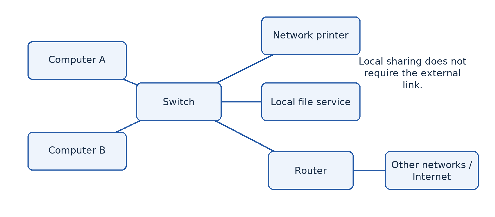
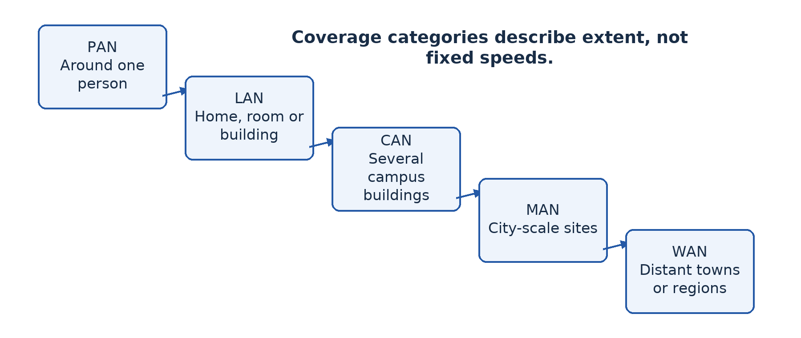
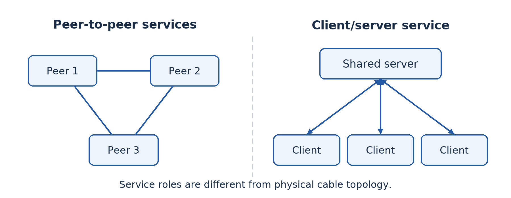
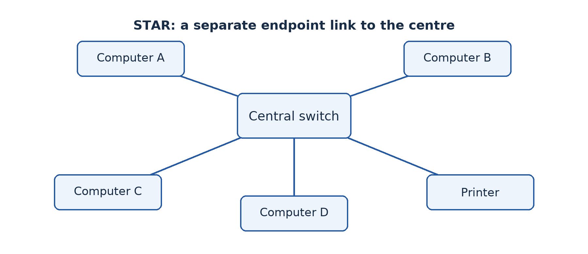
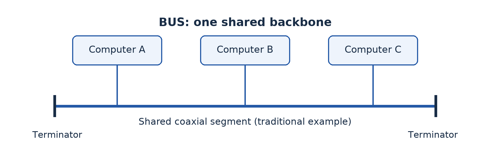
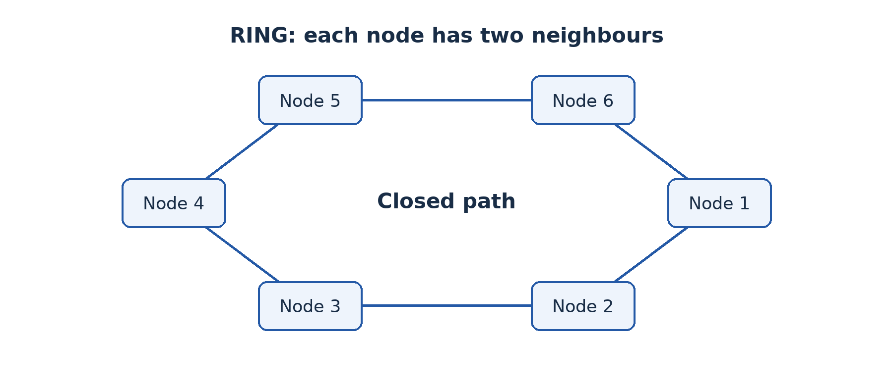
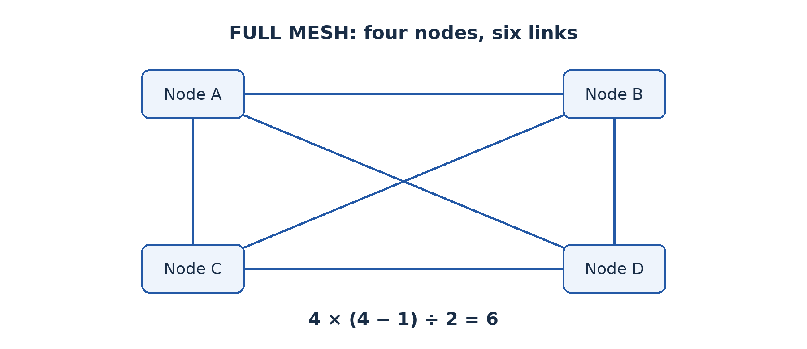
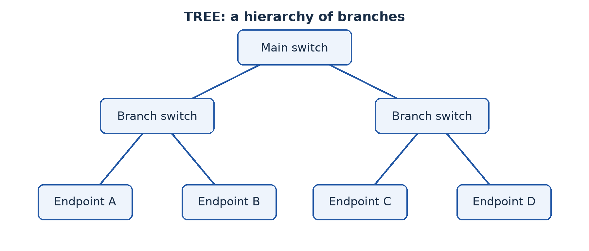

# Part 2 — Understanding and designing networks

## Lesson 7 — Fundamentals of computer networks

### Start with a resource-sharing problem

The fictional school office has a printer connected to one computer. A secretary carries files from other computers on a flash drive whenever someone wants to print. This takes time and can spread malware. What changes if the computers and printer can communicate directly? They become part of a network, allowing the printer to be offered as a shared resource.

### 7.1 What makes a computer network?

A **computer network** is a collection of connected devices that can communicate and share data or resources using agreed rules. The devices may be computers, phones, printers, servers or other equipment. A **node** is a device or connection point in the network. A **link** carries communication between nodes through a cable or wireless medium. A **protocol** is an agreed set of communication rules; later lessons examine particular protocols.

Connection alone is not sufficient. Two devices may have cables attached but still be unable to exchange useful information because their settings or protocols are incompatible. A working network therefore needs devices, an appropriate communication medium, suitable interfaces, software and correct configuration. A **network interface** provides a device's connection, such as Ethernet or Wi-Fi.

**Data communication** is the transfer of data from a source to a destination. A sender prepares a message, the medium carries its signal and a receiver interprets it. In most practical networks, the same device can be a sender at one moment and a receiver at another. When a learner requests a web page, the computer sends a request and later receives the server's response.

### 7.2 Networked and stand-alone computers

A **stand-alone computer** works independently of a network for its current tasks. It can create a document, run local applications and print to a directly connected printer without communicating with other computers. It may still transfer data using removable media. Stand-alone does not mean useless, old or necessarily free from malware.

A networked computer can share files, use common printers, access services and communicate with other users. Several learners can retrieve teaching materials from one server rather than receiving separate flash drives. Staff can maintain a shared record instead of several inconsistent copies. However, access rights and working procedures must prevent accidental overwriting and unauthorised disclosure.

Networking introduces dependencies. If a shared file server fails, many users may lose access at once. If one stand-alone computer fails, other independent computers may continue unaffected. A stand-alone machine may offer adequate privacy for a local task, but it lacks the convenience of controlled sharing and central management. The appropriate choice depends on the job and the risks.

### 7.3 Networks in everyday life

A home Wi-Fi network may connect phones, a laptop and a printer to a router. The local connections form a network even when the internet service is temporarily unavailable. The router can connect that local network to other networks through an internet provider. Thus, **a network is not the same thing as the Internet**.

A school laboratory can use a wired network to distribute learning materials locally. A business can connect offices in different towns. The Internet is a very large interconnection of many independently operated networks. It is not one computer, one website or one company's equipment.

**Resource sharing** includes more than hardware. A database, storage space, an application service and an internet connection can all be shared resources. Sharing should be purposeful and controlled: the ability to communicate does not mean every user should have access to every file.

### Worked example — Choose a sensible improvement

The office has three computers and prints ten documents each day. Connecting them to a small local network could allow all three to use one printer and a controlled shared folder. This reduces carrying flash drives and maintaining duplicate files. The explanation must also mention permission settings, a backup and the effect of printer failure. Buying internet service is not a prerequisite for local printing, although it may be useful for other tasks.

### Guided activity

Draw a stand-alone setup and a small network for the same three users. Label the devices, links and shared resource. Under the drawings, explain the path followed by a print request. With equipment, identify the actual network interface and connection indicator on a supervised computer; do not change settings. Without equipment, use device cards and string to represent links.

### Check your understanding

1. Define a computer network using devices, communication and rules in your answer.
2. Explain two differences between a networked laboratory and stand-alone computers receiving files on flash drives.
3. Can a school's local network work when its Internet subscription expires? Explain.

### Answer guidance

1. Connected devices communicate and share data or resources according to agreed protocols. Merely naming cables is insufficient because wireless networks also exist.
2. Network distribution can update a shared file once and allow controlled access; flash-drive distribution requires separate transfers and can create inconsistent copies. Networks also introduce shared-service dependencies and management needs.
3. Yes, local services can continue if their equipment and configuration remain operational. External Internet services will not be reachable through that expired connection.

## Lesson 8 — Network complexity and operational challenges

### Why does adding devices create work?

Mboa's first three connected computers work well. The school now wants forty computers, teachers' laptops, wireless access and a shared records system. Extending a network is not simply buying more cable. Each new device introduces questions about addressing, capacity, permissions, compatibility, support and security.

### 8.1 Benefits and limitations

Networks improve communication by allowing messages and shared documents to move quickly between users. They support collaboration because authorised users can work on common information. Sharing a printer or storage service may reduce unnecessary duplication. Central administration can make account management, updates and backups more consistent.

Each benefit creates conditions to manage. Shared documents need agreed ownership and access rights. A central backup is useful only if it runs successfully and can be restored. A network can reduce the number of printers but create queues at the remaining printer. A congested connection can make a fast computer appear slow because the delay is outside that computer.

Networks also make it easier for an infection or stolen account to affect multiple systems. Security controls, segmentation, updates and user training reduce this risk but do not eliminate it. Costs include installation, equipment replacement, electricity, subscriptions, technical support and staff time. Compare total running costs rather than only the initial purchase price.

### 8.2 Complexity during installation

A designer begins by identifying users and services, measuring distances and checking the building. Cables need safe routes, protection and labels. Wireless coverage depends on walls, interference and access-point placement, not just the strength printed on a box. Long runs or links between buildings may require different media from short desktop connections.

Devices need suitable network addresses and compatible settings. If two computers are accidentally assigned the same IP address, communication can become unreliable. Servers must have sufficient processing, memory and storage for the expected workload. Shared services need permissions that match users' duties. Equipment also needs reliable power and appropriate physical protection.

Documentation reduces future confusion. Record the intended layout, device names, address plan, cable labels, configuration responsibilities and recovery procedures. Keep secret material such as passwords separately in approved secure storage rather than writing it on a public network diagram.

### 8.3 Complexity during operation

A network requires monitoring, updates, backup testing and fault diagnosis. **Scalability** is the ability to expand to meet increased demand without unacceptable loss of service or disproportionate redesign. Reserving spare switch ports helps with physical growth; planning account management and storage capacity helps with organisational growth.

**Availability** concerns access to services when needed. A single inexpensive device that connects everyone can become a single point of failure. A **bottleneck** is a part whose limited capacity restricts overall performance. Forty users sharing one external link cannot each assume exclusive use of its advertised capacity. Real traffic also includes protocol overhead and changing demand.

Good troubleshooting isolates the cause. If one computer cannot print, test its cable, address, permissions and printer selection. If no computer can print, investigate the printer and shared service before replacing every computer. Change one suspected factor at a time and record the result so that a lucky temporary recovery is not mistaken for an explained repair.

### 8.4 Interoperability in heterogeneous systems

**Heterogeneous systems** differ in hardware, operating systems, applications or data formats. **Interoperability** is their ability to exchange and use information effectively. A Windows computer and a Linux computer may communicate using TCP/IP, but a file produced by one application might still open incorrectly in another. Connectivity and useful compatibility are related but distinct.

Shared standards reduce barriers. Common protocols allow different devices to communicate; widely supported document formats improve exchange. Yet drivers, authentication methods, application versions, character encoding and permissions can still create problems. A printer needs a suitable driver or supported printing method, not merely a reachable address. Test the actual task before concluding that two systems are interoperable.

### Worked example — Explain, then recommend

Teachers can open a shared folder but some cannot edit its spreadsheet. The connection itself is working. Possible causes include read-only permissions, an incompatible file format or a document lock. A sensible investigation checks the exact error, permissions and application support before buying another switch. A recommendation might use a supported common format and role-based edit rights, followed by testing from both operating systems.

### Guided activity

Use the school-network diagram from Lesson 7 and expand it to twenty learners and three staff. Annotate one possible bottleneck, one shared-service failure, one security concern and one compatibility concern. For each, explain an appropriate control. In a supervised lab, compare how the same harmless document opens on available applications; record differences instead of assuming identical appearance.

### Check your understanding

1. Explain why a network can lower hardware costs but increase support costs.
2. Distinguish scalability, availability and a bottleneck.
3. Two computers can exchange messages but cannot use each other's specialised files. Explain why communication alone does not prove full interoperability.

### Answer guidance

1. Sharing reduces duplicate resources, but accounts, security, updates and shared-service faults require continuing administration.
2. Scalability concerns growth; availability concerns access when required; a bottleneck restricts the rate or capacity of the overall system. Give an appropriate example of each.
3. They share a communication method, but file formats or applications may be incompatible. Test the intended file operation and choose supported formats or software.

## Lesson 9 — Integration: Describe a real organisation's networking needs

### The situation

A fictional community clinic has a reception computer, a consulting-room computer and a laboratory computer. Staff currently move paper results between rooms. A committee suggests networking the computers, sharing a printer and keeping one appointment list. The clinic has occasional power cuts and no full-time network administrator.

Your group is the advisory team. Explain the proposal to a manager who does not know networking vocabulary. Combine the basic concepts from Lesson 7 with the operational reasoning from Lesson 8. This is a locally authored scenario for the progression's integration lesson.

### Your task

Draw the existing stand-alone arrangement and a proposed network. Label the devices, communication links and services. Explain how a result could move from the laboratory to an authorised clinician. Identify what can work locally without Internet access and what would require an external connection.

Write a short report explaining three benefits and three limitations. Every point must include a consequence for the clinic. “Resource sharing” alone is not enough; explain which resource is shared and how that changes the staff's work. Protect confidentiality by keeping the scenario fictional and not collecting real patient records.

Now identify four questions the clinic must answer before installation. Include the number of users, the type of information, a power or recovery issue, and compatibility between the existing systems. State an initial safeguard for each important risk. Distinguish facts given in the question from assumptions that require investigation.

### Review and evidence

Exchange reports. Ask the other group to follow a result through your diagram and point out one failure that could interrupt the journey. Revise the diagram or explanation in response. Each learner should then explain the difference between a connected device and a usable shared service.

A strong report recognises that networking can improve access to a result while also increasing the consequences of an unauthorised account. It recommends controlled sharing rather than making all records visible to everyone. It also budgets for maintenance and backup instead of assuming that installation finishes the job.

### Assessment criteria — 20 marks

Award **5 marks** for accurate network and stand-alone explanations with labelled drawings; **5 marks** for benefits and limitations developed in the clinic context; **6 marks** for realistic requirements, interoperability concerns and safeguards; and **4 marks** for clear communication, justified assumptions and revision after review. These are classroom criteria, not an official examination rubric.

### Individual follow-up

Write one paragraph answering: “Why would buying an Internet subscription alone not solve this clinic's information-sharing problem?” A good answer discusses the local connections, suitable services, compatible software and access rules that the subscription does not automatically supply.

## Lesson 10 — Types of networks by coverage area

### Classify the extent, not the brand

A phone connects to wireless earphones; a school connects its computer room; a bank links branches in different regions. These arrangements differ in geographical extent and purpose. Coverage categories provide a useful first description, but they do not tell us every detail about speed, cost, ownership or security.

### 10.1 PAN and LAN

A **personal area network (PAN)** connects devices around an individual, usually over a short distance. A phone communicating with a smartwatch or Bluetooth earphones is a familiar example. It commonly supports a small number of personal devices and modest power use. Its exact range and data rate depend on the technology and environment.

A **local area network (LAN)** connects devices within a limited area such as a home, office, laboratory or building. Ethernet and Wi-Fi are common LAN technologies. A school laboratory can form a LAN without public Internet access. LAN ownership and administration are often under one organisation, allowing that organisation to decide its internal equipment and access rules.

A **wireless LAN (WLAN)** is a LAN that uses wireless links for at least part of its local access. Wi-Fi is a technology, not a geographical coverage category equivalent to WAN. A LAN may combine wired desktop connections with wireless laptop connections. Likewise, a phone can participate in a PAN through Bluetooth and in a WLAN through Wi-Fi at different times or simultaneously.

### 10.2 CAN, MAN and WAN

A **campus area network (CAN)** links LANs across the buildings of a campus or similar organisation. A university might connect its library, laboratories and administration blocks. Here CAN means campus area network; in another field the same abbreviation can mean controller area network, so always interpret it in context.

A **metropolitan area network (MAN)** connects sites across a town or city-scale area. A council might connect several offices through metropolitan links. A **wide area network (WAN)** spans a broad geographical area, such as different towns, regions or countries. A bank's inter-town branch network is a WAN. Its links often depend on telecommunications providers rather than cables owned entirely by the bank.

The Internet interconnects networks globally and is commonly discussed as the largest example of wide-area networking. A private company WAN is not therefore “the Internet”. These descriptions concern extent, not whether the information is public.

### 10.3 Compare without inventing fixed limits

A PAN generally has fewer devices and lower installation cost than an organisation-wide network because its purpose and extent are small. A LAN may support tens, hundreds or more devices depending on design. A campus or wide-area system can join many local networks and users. No single device count defines a category: a small business can have a WAN linking only two distant offices.

LANs often provide high local capacity at relatively low cost per connection because distances are limited and one organisation controls the equipment. WAN links may have higher recurring costs and greater delay because they cross larger distances and provider networks. However, a modern fibre WAN link can be faster than an old LAN. “A WAN is always slower” is not a reliable rule.

**Bandwidth** describes a communication capacity in a specified context; **latency** is delay. A link can have high capacity but noticeable delay over a long route. When comparing options, discuss extent, technology, subscription and installation costs, delay, reliability and expected users. Avoid claiming an exact speed from the coverage label alone.

### Worked example — One university, several descriptions

Within the library, computers and a printer form a LAN. The university links the library LAN to LANs in three other campus buildings, forming a CAN. A university office in another town connects through a provider, adding a WAN link. A student's phone and earphones form a PAN. The answer identifies the level being described rather than forcing the whole situation into one exclusive category.

### Guided activity

Classify five situations supplied by the teacher: a home network, a smartwatch link, several campus buildings, council offices across a city and a business linking two countries. For each, justify the category using the extent. Then state two properties that still cannot be known without more information. Draw the university example and label its individual LANs and the links between them.

### Check your understanding

1. Distinguish LAN, CAN and WAN using one institution with multiple sites.
2. Why is “Wi-Fi” not a sufficient answer to a question asking for a coverage category?
3. Explain why two distant offices can form a WAN even with only six computers.
4. Compare likely costs and performance of a laboratory LAN and an inter-town WAN without using absolute speed claims.

### Answer guidance

1. A building's LAN connects local devices; a CAN links campus buildings; a WAN links distant sites. Explain the geographical level in each case.
2. Wi-Fi describes a wireless access technology. It is commonly used inside a LAN but does not by itself describe every network connected beyond that access point.
3. Wide geographical extent, not a minimum number of computers, makes the inter-site connection wide-area.
4. The LAN usually offers low local delay and controlled installation; the WAN often adds provider fees and greater route delay. Actual capacity depends on the selected technology and service.

## Lesson 11 — Choosing the right network for an organisation

### Begin with requirements

A trader with two laptops and a university with several campuses both need connectivity, but they do not need identical systems. A defensible choice starts by asking what users must accomplish. The word “best” has no useful meaning until the criteria are clear.

### 11.1 Understand organisational needs

Identify the number of users, their locations and the applications they use. An office sharing small documents has different traffic from a media department transferring large videos. Count simultaneous use rather than only registered users. A school with forty learners may have twenty computers, but a shared wireless network can add many staff and personal devices.

Ask which services must remain available. A clinic may need local records even during an Internet outage; a shop may need payment and stock services during business hours. Identify sensitive data and who should access it. Consider whether staff have the skills and time to maintain accounts, updates and backups. A sophisticated design with no realistic support plan can be worse than a simpler maintainable solution.

Measure physical distances and examine power, buildings and provider availability. An existing conduit may make a cable practical; a public road between buildings may make installation difficult or require permission. Do not assume that a listed commercial service reaches the actual site or performs as advertised there.

### 11.2 Choose coverage and then implementation

First choose the extent. One office normally needs a LAN. Several buildings under one campus may need a CAN of interconnected LANs. Sites in different towns require WAN connectivity. The organisation may need more than one category, so a complete recommendation can include a LAN at every branch and a WAN joining branches.

Next choose appropriate access technologies, devices and services. A coverage label does not specify whether desktops use Ethernet, laptops use Wi-Fi or sites use a leased or encrypted Internet-based link. Those choices come from capacity, distance, mobility, cost and security requirements. Later lessons develop the equipment and media decisions in detail.

Evaluate **total cost of ownership**: purchase, installation, subscriptions, electricity, maintenance, training, replacement and downtime. A cheap device that cannot support the necessary users or security can be expensive to replace. Conversely, buying maximum specifications without a genuine need wastes resources that might be better spent on reliable power or backup.

### 11.3 Weigh trade-offs and explain a conclusion

A recommendation should compare at least one reasonable alternative using the same criteria. Wired connections can provide stable capacity for fixed computers, while wireless access supports mobility and avoids a cable to each moving device. A combination often fits better than treating wired and wireless as mutually exclusive. Greater coverage can increase complexity, and redundancy costs money but can reduce disruption.

State assumptions explicitly. “Assuming the provider can deliver a reliable connection at both sites” is more honest than pretending availability has been checked. Specify how important assumptions will be verified, such as a site survey, provider quotation or practical performance test. A design is a reasoned proposal, not a guarantee made without evidence.

### Worked example — A school in two buildings

Mboa has a laboratory and administration block on the same campus. It needs local file sharing, controlled access to staff records and Internet access for research. Recommend a LAN within each block and a campus connection between them. Fixed laboratory computers can use wired access; supervised staff mobility may justify Wi-Fi. Staff records require permissions regardless of whether a connection is wired or wireless.

If the school later opens a centre in another town, add WAN connectivity rather than stretching the definition of the campus link. Compare subscription costs, outages and secure remote access before choosing the external service. The original local design should still allow essential local services to work during provider failure.

### Guided activity

Interview a classmate role-playing a shop manager. Ask six questions before suggesting equipment. Write a recommendation with a coverage category, expected users, two priorities, one alternative and a justified conclusion. Exchange roles using a clinic or council. No computer is required. In a lab, identify the actual local service and external connection as evidence, without changing configuration.

### Check your understanding

1. List four requirements that must be established before selecting a network, and explain why each matters.
2. A firm has one office in Yaoundé and one in another region. Recommend a coverage arrangement and justify it.
3. Explain why the cheapest purchase price may not produce the lowest total cost.
4. What makes a recommendation an evaluation rather than an unsupported preference?

### Answer guidance

1. User count affects capacity; location affects coverage; applications affect traffic; sensitivity affects access controls. Power, budget and support are also relevant when explained.
2. Use local networks within each office and a WAN link between the geographically separated offices. Choose the implementation after checking service and security needs.
3. Recurring fees, replacement, maintenance, training and downtime contribute to the full cost. Relate a particular cost to a realistic design weakness.
4. It weighs alternatives against stated criteria and reaches a conclusion connected to the organisation's needs, including limitations and assumptions.

## Lesson 12 — Integration: Select coverage for three organisations

### The situation

Your advisory group receives three requests. A tailor uses a phone, payment terminal and laptop at one stall. A college wants to connect a laboratory, library and office on one campus. A cooperative has offices in three different towns. Each wants “a network” but has not described its requirements clearly.

Use Lessons 10–11 to develop a recommendation for each. These are fictional classroom cases, and the criteria below are teaching guidance for the integration lesson.

### Tasks and evidence

For each organisation, identify users, locations, shared services and two questions still requiring investigation. Propose the relevant coverage category or combination. Explain why it fits the geographical extent. Do not name a product as if that answered the coverage question.

Next compare the three cases on likely costs, capacity, management and external-service dependence. Discuss tendencies rather than fixed speed or device-count rules. A cooperative with only nine computers can still require a WAN because the offices are distant. A college's many computers do not automatically make its single-campus network a WAN.

Draw one clear sketch for each request and write a manager-friendly recommendation of about 150 words per case. Include a lower-cost alternative and a reason for accepting or rejecting it. State assumptions about connectivity, power and technical support. Identify a local service that should keep working if the external Internet link fails.

### Review process

Give the recommendations to another group. Their role is to challenge an unexplained claim such as “WAN is faster” or “wireless has no maintenance”. Answer with a correction or evidence-based justification. Keep the first and revised versions so the teacher can see the improvement.

### Assessment criteria — 20 marks

Use **6 marks** for correct, justified coverage classifications; **6 marks** for requirements and meaningful comparisons; **4 marks** for feasible alternatives and explicit assumptions; and **4 marks** for labelled sketches, clarity and individual explanation. Do not award full credit to a correct acronym with no reasoning.

### Guidance for a strong answer

The tailor may need a small local network, with a PAN for a particular short-range personal link if the equipment supports it. The campus needs local networks joined across its buildings. The inter-town cooperative needs WAN connectivity between local networks. These are starting points, not complete installation specifications. A strong answer still investigates compatibility, privacy, actual service availability and the people who will maintain the system.

Finish individually: explain why a network category cannot tell a buyer its exact speed or security level. Use one of your three recommendations to illustrate the missing information.

## Lesson 13 — Network architecture: Peer-to-peer and client/server

### Who provides the service?

Coverage tells us where a network extends. **Network architecture** in this lesson concerns how devices take the roles of requesting and providing services. A **client** requests a service; a **server** provides a service. These are roles, not simply sizes of computer cases. A server can provide files, authentication, printing, web content or database access.

### 13.1 Peer-to-peer architecture

In a **peer-to-peer (P2P)** arrangement, participating computers can provide resources directly to one another without depending on a dedicated central server for those shared resources. One user's computer might share a folder; another might share a printer. Each can be a client for one operation and a server for another.

P2P can suit a small, trusted group because it needs little dedicated infrastructure and can be inexpensive to start. Users retain control of their own shared resources. However, each resource depends on its host being switched on, connected and correctly configured. Backup and permissions can become inconsistent when every owner manages them separately.

As the network grows, locating the correct version of a file and managing accounts across many computers becomes difficult. A learner should not conclude that P2P has “no security”; security settings exist, but consistent administration can be harder. Nor does peer-to-peer describe a physical shape. The computers can be physically connected through a central switch while sharing resources as peers.

### 13.2 Client/server architecture

In a **client/server** arrangement, one or more dedicated or centrally managed servers provide services to client devices. A file server can maintain a central shared folder; an authentication service can manage user identities; a database server can process authorised requests. Users do not need every classmate's computer to remain on to reach a central file service.

Central management can make access rights, backups and updates more consistent. A server can be selected for the expected workload and protected in a secure location. Yet centralisation creates an important dependency: if an essential server fails, many clients may be affected. Backups, recovery procedures and sometimes redundant services are needed.

Costs include server resources, administration skills and possibly software licences or support. Free software can reduce some purchase costs but not the need for knowledge, maintenance or reliable power. A small installation does not automatically need expensive server hardware; a busy installation should not depend on an unsuitable desktop without a recovery plan.

### 13.3 Compare on the same criteria

For cost, P2P often has a lower starting cost, while client/server adds central-service resources and administration. For management, P2P distributes responsibility and client/server centralises it. For availability, a P2P resource depends on its individual host; a central server can be engineered for availability but may become a shared failure point. For growth, central account and file management are usually easier to scale than many separately configured shares.

Real organisations combine patterns. A school can use a central records service while two authorised teachers share a temporary file directly. The useful question is which architecture fits the particular service and management needs. Architecture should not be confused with a **topology**, which concerns the connection arrangement explored next.

### Worked example — Choose for two contexts

Two teachers need to share a temporary planning folder. A carefully configured P2P share may be adequate, provided its owner keeps the host available and backups exist. A school with hundreds of user accounts and protected records has stronger reasons for centrally managed client/server services: consistent access control, organised backup and a clear administrator. The recommendation must also fund reliable power and recovery rather than treating centralisation as automatic reliability.

### Guided activity

Role-play a P2P file request using three learners as resource owners. Then repeat with one learner as a central file server and the others as clients. Remove a resource owner or the server and describe exactly which service disappears. In a supervised lab, identify a real service provider and client; do not assume the computer nearest the switch is the server.

### Check your understanding

1. Define client, server and peer-to-peer using roles rather than physical appearance.
2. Explain two advantages and two limitations of centralising a file service.
3. Can a physical star network use peer-to-peer sharing? Explain.
4. Recommend an architecture for a small temporary workgroup and for a large school records system.

### Answer guidance

1. Clients request services, servers provide them, and peers can provide resources directly to one another without a dedicated central provider for those resources.
2. Central rights and backups improve consistency; costs and server failure dependence must be managed. Develop each point through its effect on users.
3. Yes. Star describes physical connections to a central device; P2P describes the computers' service roles.
4. A small trusted workgroup may reasonably use P2P; a managed records system usually benefits from central services. Other answers need defensible requirements and safeguards.

## Lesson 14 — Types of physical network topologies

### Read the connections carefully

A **physical topology** is the arrangement of devices and the physical links between them. It answers “what is connected to what?” A **logical topology** concerns how communication proceeds, which may differ from the physical arrangement. A neat drawing is useful only when its connection pattern and failure consequences are understood.

### 14.1 Star topology

In a **star**, each endpoint has a separate link to a central device, commonly a switch in a wired LAN. A computer sends a frame through its link to that device, which forwards it as appropriate. A failure in one endpoint's cable normally disconnects that endpoint, not all the others. Adding an endpoint is straightforward if a suitable port and cable route are available.

The central device is important. If it fails or loses power, the attached endpoints cannot communicate through it. More cable is usually needed than for a shared linear bus because each endpoint has its own run. Modern switched Ethernet commonly uses star or extended-star physical arrangements, but the central device must be suitable for the workload.

### 14.2 Bus topology

In a traditional **bus**, devices attach to a shared backbone cable. Signals travel along that common medium. Traditional coaxial Ethernet buses need correct termination to absorb signals and avoid reflections. All devices depend on the shared path, and a backbone fault can disrupt the segment.

A bus can use less cable in a simple linear arrangement, but fault location, expansion and shared-medium contention can be troublesome. It is important historically and conceptually; it is not normally the preferred choice for a new general-purpose school Ethernet LAN. Do not draw separate cables from every computer to a switch and label that drawing a bus.

### 14.3 Ring topology

In a **ring**, each node connects to two neighbours so that the links form a closed loop. Data in a simple ring follows the ring's path. Some implementations use a token to control transmission: a station transmits when it holds the token. Token passing is a particular access method, not a requirement of every network that looks circular.

An orderly access method can make use of a shared path predictable. However, a break or failed node in a simple unprotected ring can interrupt service, and changing connections can disrupt the ring. Practical resilient ring technologies may use protection mechanisms or additional paths, so distinguish a simple textbook ring from an engineered redundant implementation.

### 14.4 Mesh topology

In a **mesh**, nodes have multiple interconnections. A **full mesh** connects every node directly to every other node. A **partial mesh** provides multiple paths without every possible direct link. Alternative paths can improve resilience if routing and other controls can use them when a link fails.

The cost is more links, ports and management. For a full mesh with n nodes, the number of undirected links is n(n − 1) ÷ 2: every node connects to n − 1 others, and dividing by two prevents counting each link twice. Four nodes need 4 × 3 ÷ 2 = **6 links**. Ten nodes need **45**, showing why full mesh becomes costly as size increases.

### 14.5 Tree topology

A **tree** uses a hierarchy of connections, often with groups of endpoints connected to local switches and those switches connected upwards. It can organise a growing network into manageable branches. An extended star with a clear hierarchy is a familiar practical form.

Failure effects depend on position. A failed endpoint link affects one endpoint; a failed branch switch affects its branch; a failed higher-level connection can isolate several branches. A tree is not automatically resilient merely because it has many cables. Higher-level capacity and failure protection require deliberate planning.

### Worked example — Reason from a failure

Five computers connect separately to a switch. One cable is unplugged and only its computer loses connection. This is consistent with a star. If the switch is then powered off and all five lose communication, that shows dependence on the centre. It does not mean the earlier one-cable test was wrong. The component that fails determines the extent of disruption.

### Guided activity

Build each topology using labelled device cards and string. Remove one endpoint link, then an important shared component. For each case, trace which pairs still have a physical route. Mark the failure on a drawing and explain its consequence. Do not assume that a surviving physical route guarantees usable communication: suitable configuration is still required.

### Check your understanding

1. Draw and label star, bus, ring, mesh and tree layouts.
2. Explain why a star can tolerate an endpoint cable failure but not necessarily a central-switch failure.
3. Calculate the links needed for a full mesh of five nodes.
4. Explain one strength and one limitation of a hierarchical tree.

### Answer guidance

1. Show the actual connection pattern: separate centre links, a shared backbone, a closed loop, multiple interconnections and hierarchical branches respectively.
2. Separate endpoint links isolate many cable faults; the common switch is needed for traffic passing through the centre.
3. 5 × 4 ÷ 2 = **10 links**. State the full-mesh and undirected-link assumptions.
4. Branching supports organised expansion; dependence on higher-level links can isolate multiple branches. Explain which users are affected.

## Lesson 15 — Comparing and choosing network topologies

### A choice needs a stated purpose

The school asks which topology is “the best”. There is no answer independent of needs. A topology is suitable when its connection pattern, costs, failure behaviour and capacity fit the users and site. This lesson uses the facts from Lesson 14 to make a justified design decision rather than repeat five definitions.

### 15.1 Choose comparison criteria

Begin with **cost**, including cables, ports, central devices, installation and support. A bus may appear to use less cable, but maintenance and outdated equipment can remove that apparent saving. A full mesh provides many routes but requires rapidly increasing numbers of links. A star is usually practical for desktop access, though it needs an appropriate central switch.

Consider **reliability** and the effect of failure. Ask which component is shared and how many users depend on it. A separate link in a star protects other endpoints from that particular cable failure, but the centre remains important. A mesh offers possible alternate routes; those routes help only if the network can actually use them. A tree can isolate faults by branch while also concentrating dependencies near its root.

Consider **scalability**, **ease of maintenance** and **performance**. A labelled star can make endpoint faults easier to locate. A hierarchical arrangement can extend across rooms, but links carrying several rooms' traffic need enough capacity. Physical layout alone does not determine speed: switch capacity, media, traffic and protocols also matter. A circular drawing is not evidence that data will move faster.

### 15.2 Connect the criteria to the organisation

For a school laboratory of twenty fixed computers, switched star access is usually a sensible proposal. Each computer has a manageable individual connection, additions are straightforward within spare capacity, and one workstation cable fault need not disconnect the class. Protect the switch and provide adequate ports and power. Explain the central dependency instead of hiding it.

For several buildings, an extended star or tree can connect local access switches to a main distribution point. The design must examine the inter-building medium, uplink capacity and the impact of losing that central point. A critical organisation may justify additional links or equipment, creating a partially meshed or redundant design. A small school may reasonably accept some downtime rather than pay for a full mesh of every computer.

### Worked example — Evaluate a proposal

Mboa has twelve laboratory computers and a shared printer. A supplier proposes full mesh between all thirteen endpoints, claiming it is the only reliable choice. A full mesh would require 13 × 12 ÷ 2 = **78 direct links**, plus suitable interfaces and management. That is disproportionate for ordinary desktop access.

A switched star needs one endpoint link per device and suitable switch capacity. It provides simpler installation and endpoint fault isolation, but its central switch is a failure point. A reasoned conclusion recommends the star, appropriate physical protection, backup of configurations and a realistic replacement or recovery plan. If high availability is later required, investigate targeted redundancy rather than automatically meshing every endpoint.

### Guided activity

Compare star, tree and full mesh for a fictional campus with three buildings. Write one paragraph per option using the same criteria: installation, likely failure impact, expansion and maintenance. Make a final recommendation that mentions one limitation of your chosen option and how you would reduce it. Ask a classmate to remove one link from your drawing and explain the result.

### Check your understanding

1. Why is “star is best because it is fastest” an inadequate evaluation?
2. Recommend a physical layout for a laboratory and explain two relevant reasons and one limitation.
3. A tree's upper link fails. Why might many users be affected even though their local cables are intact?
4. How can a designer improve resilience without fully meshing every desktop?

### Answer guidance

1. It gives no evidence about equipment or workload and ignores other criteria. Topology alone does not determine throughput.
2. A switched star can support manageable individual connections and fault isolation. Its central switch needs protection and a recovery plan.
3. Several branches rely on that common route to other services. Intact endpoint links do not replace the missing upstream connection.
4. Add suitable redundant uplinks or central equipment where needed, with appropriate loop-prevention or routing design and testing. A second cable alone is not a complete resilience strategy.

## Lesson 16 — Integration: Design architecture and topology

### The situation

A fictional college has eighteen laboratory computers, four administration computers and six library computers in three nearby buildings. Learners need teaching files and printing. Administrative records must not be freely available to learners. The college expects a second laboratory next year and has a modest maintenance budget.

Produce a design that combines coverage, architecture and topology. These are different decisions. “LAN” describes local extent, “client/server” describes service roles, and “star” describes a connection arrangement. A strong proposal uses each term to answer the right question.

### Required work

Draw a labelled physical design with endpoints grouped into buildings, suitable central devices and inter-building links. Use a key for symbols. Show where teaching files and administrative services are provided, but do not mistake a server for the central switch. Write a separate explanation of which devices request services and which provide them.

Compare P2P with centrally managed services for this college. Then compare a simple switched-star arrangement within each room with an overall hierarchical campus arrangement. Explain the effect of one endpoint cable failure, one branch-switch failure and one main-link failure. State how expansion could occur without replacing every connection.

Do not yet invent exact product specifications or prices. Instead identify the required port counts, likely traffic priorities, information requiring restricted access and assumptions that need a site survey. The detailed equipment choice comes in the next part of the book. A network drawing is a design proposal, not evidence that the installation has been built.

### Peer review and improvement

Another group acts as the school's management committee. They ask why a cheaper alternative was rejected, what happens during a power cut and how staff records remain private. Answer with reasoning, not “because the diagram says so”. Revise one weak point and keep a brief record of the change.

### Assessment criteria — 20 marks

Use **5 marks** for accurate coverage and architecture reasoning; **5 marks** for a coherent, labelled physical topology; **6 marks** for failure analysis, privacy requirements and growth planning; and **4 marks** for comparing alternatives and explaining the revised design. These locally authored criteria assess understanding rather than drawing neatness alone.

### Review guidance

A defensible solution may use local switched stars, a campus hierarchy and central services for accounts or files. It should recognise the main distribution point's importance and separate staff permissions from physical connection choices. Other feasible solutions can earn credit if the constraints are met and the trade-offs are explained. Finish by writing individually one sentence that distinguishes coverage, architecture and topology without using them as synonyms.
