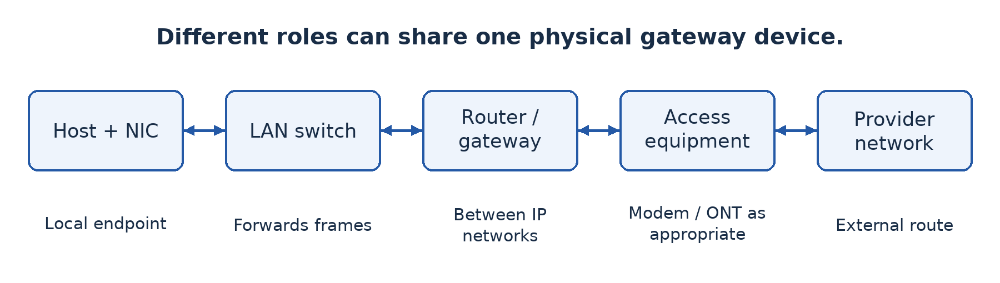
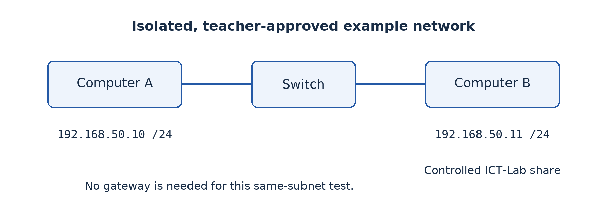
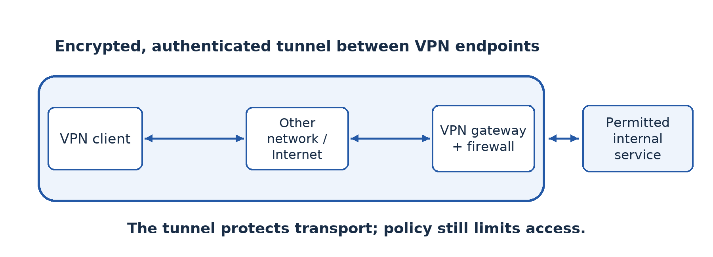
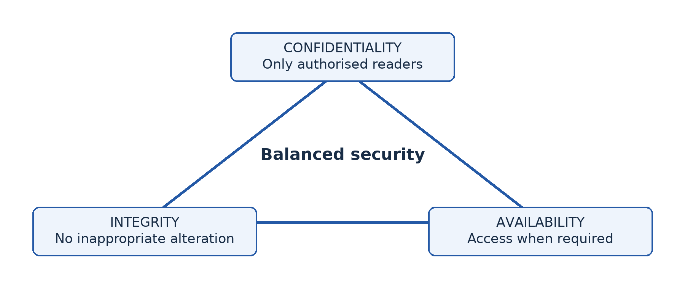
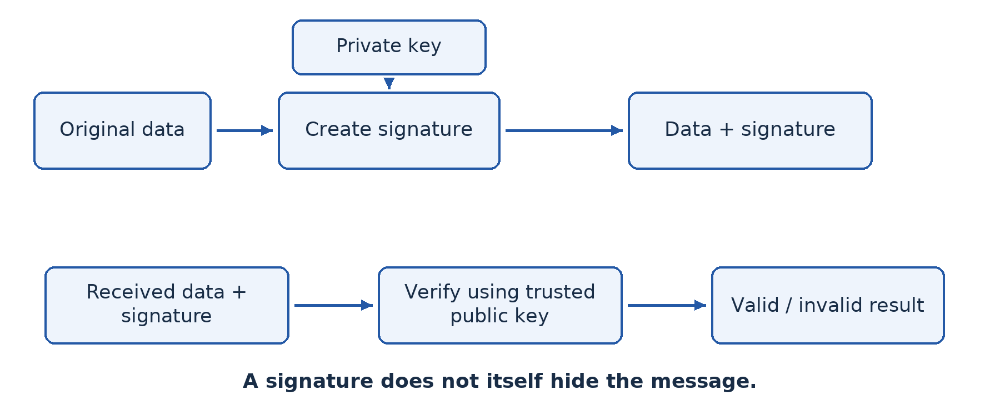
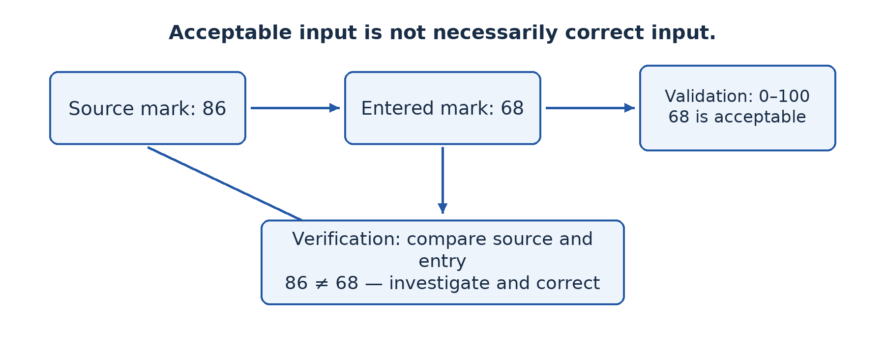

# Part 3 — Building and protecting networks

## Lesson 17 — Network equipment

### Follow a message through the equipment

A learner clicks a web link. Data leaves the computer through its network interface, crosses a local connection and may pass through a switch, router and provider equipment before reaching another network. These devices perform different jobs. A useful explanation follows the message instead of describing every box as something that “connects the Internet”.

### 17.1 Interfaces, hubs and switches

A **network interface card or controller (NIC)** provides a device's network connection. It may be built into the motherboard or added separately. An Ethernet interface connects to a suitable cable; a wireless interface communicates using radio. The interface has link-level identification, commonly a **MAC address**, used in local frame delivery. The computer's IP address performs a different addressing role across IP networks.

A traditional **hub** repeats incoming electrical signals to its other ports without learning which destination is on which port. Attached devices share the medium, and older half-duplex Ethernet with hubs must manage collisions. Hubs are important for comparison but are not the normal choice for a new general-purpose wired LAN.

A **switch** connects devices within a LAN and learns which source MAC addresses are reachable through its ports. It uses its forwarding information to send many frames towards the appropriate port rather than repeating every ordinary frame everywhere. Unknown destinations and broadcast traffic require different handling; a switch does not guarantee that absolutely every frame goes to only one port. Switched Ethernet normally gives separate full-duplex links to endpoints.

### 17.2 Routers, modems and access points

A **router** forwards packets between IP networks according to addressing and routing information. A computer sending to a different network commonly uses a router as its **default gateway**. In a small installation, one combined home gateway may also offer switching, wireless access, address assignment and firewall functions. Those functions remain conceptually different even when housed in one case.

A **modem** adapts signals for a particular access technology, historically modulating and demodulating signals such as those used over telephone lines. A fibre connection commonly uses an **optical network terminal (ONT)** to terminate the provider's optical service. Do not assume every external connection uses the same type of modem. The access equipment must match the service supplied.

A **wireless access point (AP)** connects wireless clients to the local network. It provides Wi-Fi access; it does not by itself guarantee an Internet subscription or perform all routing functions. Its placement, configuration and security affect coverage and performance. Several access points may be needed for a large site, planned to avoid poor coverage and excessive interference.

### 17.3 Software and supporting components

A **network operating system (NOS)** or network-service software manages relevant resources and services: accounts, shared files, authentication and administration. Modern operating systems include many networking capabilities, so NOS is not necessarily a separate physical machine. A server's operating system must be configured with the required services and permissions.

Cables, connectors, patch panels and racks organise physical connections. A **patch panel** provides labelled termination and patching; it does not replace an active switch. An **uninterruptible power supply (UPS)** provides temporary power and can support orderly shutdown during an outage. It is not an unlimited substitute for electricity. Equipment needs ventilation, physical security and safe installation as well as network specifications.

### Worked example — Choose a basic set

For eight wired computers and one network printer, select suitable NICs, nine endpoint cable runs and a switch with enough ports plus room for an uplink and growth. Add a router and compatible provider-access equipment only if external-network access is required. Add a wireless AP if authorised wireless users need local access. A shared file service needs suitable host resources and software; buying an additional switch does not itself create that service.

### Guided activity

Examine supervised equipment or labelled photographs. For each item, identify a port or interface and explain its role. Then place device cards in the order a local print request and an external web request might follow. A combined gateway can appear under several roles, but explain those roles separately. Do not unplug production cables or assume an unfamiliar port's purpose from its shape alone.

### Check your understanding

1. Distinguish a hub, switch and router by their forwarding roles.
2. Explain why a Wi-Fi access point does not necessarily provide Internet access.
3. A shared folder is unavailable although the switch is on. Why might the problem involve software or permissions?
4. Choose equipment for a ten-computer local file-sharing network that has no external connection.

### Answer guidance

1. A hub repeats signals, a switch forwards local frames using learned MAC information, and a router forwards packets between IP networks. Mention appropriate units rather than treating the terms as interchangeable.
2. It provides wireless local access; an external route, provider service and correct configuration are separate requirements.
3. The host may be off, the service stopped or the requesting user unauthorised. Physical connectivity alone does not provide a usable file service.
4. Suitable interfaces, cables, a switch with capacity and a configured file-sharing host are sufficient in principle. A modem or paid Internet subscription is not essential to that local task.

## Evaluation 1 — Network foundations and AI

### Instructions

This is a locally authored classroom evaluation at the Week 5 point in the progression, not an official GCE paper. Suggested conditions are 60 minutes and **40 marks**. Answer in complete explanations where requested; diagrams must be labelled. The questions cover Lessons 1–17, excluding content not yet taught. The teacher may assess practical evidence separately.

1. Define AI and distinguish an intelligent prediction from simple fixed automation. Give one example of each. **[6]**
2. A school AI ranks applicants using past winners' records. Explain two ethical risks and a corresponding safeguard for each. **[8]**
3. A college has one campus and an office in another town. Recommend coverage categories for the internal and inter-site connections, explaining both. **[6]**
4. Compare peer-to-peer and client/server file sharing on management and availability. Recommend one for a large school records service. **[8]**
5. Draw a switched star containing four computers and a printer. Explain the effect of one endpoint cable failure and of the central-switch failure. **[6]**
6. Distinguish a switch, router and wireless access point. **[6]**

### Marking guidance

For Question 1, allow **2 marks** for a precise AI definition and **2 marks each** for the two explained examples. A timer alone is not evidence of learning or perception. For Question 2, allow **4 marks per developed risk-and-safeguard pair**: identify the risk, explain how it arises, give a relevant control and show how it helps. Bias/testing and privacy/minimal controlled data are suitable pairs.

For Question 3, allow **3 marks** for a justified local or campus arrangement and **3 marks** for the WAN connection between towns. For Question 4, allow **2 marks each** for management comparison, availability comparison, a suitable recommendation and its contextual justification. For Question 5, allow **2 marks** for the correct labelled layout and **2 marks each** for the distinct failure explanations. For Question 6, allow **2 marks per correctly explained device role**.

Accept alternative technically sound examples. Do not award explanation marks for repeating the same fact in different words. These allocations are teaching guidance, not a claim about the Board's marking practice.

### Remediation 1 — Correct the reasoning

If you confused coverage, architecture and topology, redraw the same school network and label one example of each. If your ethical answer only named a principle, rewrite it as a cause, a possible harm and a specific control. If your failure analysis was wrong, remove the relevant connection from a model and trace the surviving paths. Finally answer a fresh short question without copying the model answer. The aim is corrected understanding, not copying a longer definition.

## Lesson 18 — Setting up a computer network

### Build a small network and prove it works

A diagram becomes useful when the planned equipment is interconnected, configured and tested. In this practical, two authorised laboratory computers share a harmless file as peers. There is no need for Internet access. The procedure distinguishes physical connection, IP reachability and access to the actual service; success at one level does not automatically prove success at the next.

### 18.1 Prepare a safe laboratory

The teacher must provide two computers with compatible Ethernet interfaces, a switch and two suitable patch cables, plus permission to use an **isolated test network**. Most modern Ethernet interfaces support automatic crossover handling; a switch avoids depending on a direct cable's compatibility. Use existing safe equipment, not exposed wiring. Do not alter a live school network or invent addresses on it.

Save the original settings before making changes. Use teacher-created local test accounts with passwords and a folder containing fictional data only. Identify the operating system and the appropriate network-settings tool. The steps below describe a Windows-to-Windows SMB sharing exercise; names of controls vary by version. The teacher must confirm that file-sharing services and supported authentication are available.

### 18.2 Guided practical — Connect and configure

1. Connect Computer A and Computer B to separate switch ports and turn on the equipment. Check link indicators and cable seating. A light indicates a physical link, not proof that file access is configured.
2. Use the teacher's address plan. For this **isolated** example only, assign A the address `192.168.50.10` and B `192.168.50.11`, both with subnet mask `255.255.255.0` (also written `/24`). Do not reuse these addresses on an existing managed network without approval. No default gateway or DNS server is required for direct communication by these addresses in this isolated local exercise.
3. On each computer, inspect settings using the network interface panel or `ipconfig`. Check that the intended Ethernet interface has the correct address and that no duplicate address is used. If the teacher instead supplies DHCP, use the automatically assigned addresses and record them rather than mixing two conflicting plans.
4. From A, run `ping 192.168.50.11`, subject to the teacher's firewall policy. From B, test A similarly. A reply shows IP reachability for this test. If there is no reply, investigate the cable, interface, address and approved ICMP firewall rule. A host may block ping while file sharing still works, so a failed ping alone does not identify the cause.

### 18.3 Configure controlled sharing

5. On B, create a folder named `ICT-Lab` containing `welcome.txt`. The file should say only “This is our authorised test file.” Enable sharing for this folder using the teacher-created account. Use a trusted private-lab network profile where the operating system requires it.
6. Set both the share permissions and the underlying file-system permissions appropriately. Begin with read access for the other test user. Do not enable anonymous guest access or grant everyone full control merely to make the demonstration easy. The effective access depends on the applicable permission layers.
7. Permit the supported file-sharing service through the firewall **only on the approved lab interface or subnet**. The teacher should prepare or approve the scoped rule. Do not switch off the firewall, expose SMB to the Internet or open unrelated services.
8. From A, open `\\192.168.50.11\ICT-Lab` in the file manager and authenticate with the permitted account on B. Confirm that `welcome.txt` opens. Record the actual service test; ping alone was not enough.
9. Try saving an edit as the read-only user. It should be denied. If the teacher authorises a write-access test, change permission only for the intended account, try again and record the difference. This demonstrates that connectivity and authorisation are separate.
10. Repeat with A providing a different controlled share so that both computers take client and server roles. Afterwards remove the shares and temporary rules, restore approved settings and delete only the test data and test accounts as directed.

### Worked example — Diagnose in layers

A can ping B but cannot open the share. Replacing the cable is not the first conclusion: IP communication has already succeeded. Check the share name, service status, file-sharing firewall rule, account identity and effective permissions. If the file opens but cannot be edited, read-only permission may be working correctly. A denied operation is not necessarily a network fault.

### Evidence and equipment-light alternative

Submit a labelled physical sketch, recorded addresses, one reachability result, proof of opening the shared file and a permission-test observation. Never include passwords in screenshots. With no equipment, role-play the same sequence using address and permission cards. Record that as a simulation and complete the real configuration later; do not present a paper drawing as proof of a working share.

### Check your understanding

1. Why must the two hosts have different addresses under the same approved subnet plan?
2. Explain why a successful ping does not prove file-sharing access.
3. Give three possible causes when a share is unreachable despite a working physical link.
4. Why should a file-sharing firewall rule be scoped rather than disabling the firewall?

### Answer guidance

1. Unique addresses identify the hosts; suitable subnet settings allow them to recognise the local destination. Duplicate or inconsistent settings can prevent reliable communication.
2. Ping tests an IP-level exchange, not the file-sharing service, credentials or file permissions.
3. Incorrect addresses, stopped service, a blocked service rule, wrong share name or failed authentication are plausible. State what test would distinguish your chosen causes.
4. A scoped rule permits the required task while preserving unrelated protections and limiting exposure. Disabling the firewall removes controls far beyond the practical's needs.

## Lesson 19 — Selecting equipment for organisational networks

### Turn requirements into quantities

The principal asks for “a powerful network”. A purchasing list cannot be justified by adjectives. Translate needs into port counts, distances, traffic, wireless coverage, services and support. Equipment choice is an application of the requirements work from Lesson 11 and the device roles from Lesson 17.

### 19.1 Capacity, compatibility and growth

Count all connections: computers, printers, access points, servers and uplinks. An uplink uses capacity and often a port. Allow reasonable spare capacity for growth and maintenance, but do not buy unnecessary equipment without a reason. A switch's number of ports is different from the data rate each port supports and the total traffic it can handle.

Check compatibility among interfaces, cables, optical modules and provider equipment. A fibre cable cannot simply be plugged into a copper Ethernet socket. Wireless clients must support the chosen security and radio capabilities. Old devices that cannot use an acceptable security configuration may need replacing or isolating rather than weakening security for everyone.

Consider distance and environment. A standard copper Ethernet channel is commonly limited to 100 m for the relevant twisted-pair installation. Measure the complete route, including patching, rather than the straight-line distance between rooms. Inter-building links may favour fibre for distance and electrical isolation, subject to suitable equipment and professional installation.

### 19.2 Reliability, security and support

Evaluate operating conditions, warranty, available support, replacement parts, energy use and heat. A device with impressive specifications can still be unsuitable if staff cannot maintain it. Managed switches can offer useful monitoring and segmentation features, but those features require correct configuration. A small simple network may not need every advanced function.

Select a router or firewall for the required external connection, traffic, access rules and remote-access needs. The fastest advertised wireless rate does not guarantee each user's actual throughput. A shared radio medium, interference, signal conditions and client limitations all affect performance. Plan an on-site coverage test rather than relying only on packaging claims.

Budget for safe cable installation, labelling, racks or secure cabinets, backup power and documentation. These less visible items often determine whether a network remains maintainable. Obtain current quotations instead of inventing prices; compare the same specification and included support across suppliers.

### Worked example — Count the ports

A school has 20 wired learners' computers, one teacher computer, one network printer and one wireless access point in a laboratory. Those are **23 endpoint connections**. If the same switch also connects to a router by a separate port, all **24 ports** of a 24-port switch are used. It offers no spare port for growth. A proposal should either provide additional appropriate capacity or explain a realistic expansion plan.

This calculation does not establish the best switch by itself. Check port speeds, power requirements, access-point power delivery if needed, management, uplink arrangements and budget. The lesson is to count the actual roles and connections rather than guess from the number of learners.

### 19.3 Produce a usable plan

A plan should include a labelled diagram, a list of equipment with quantities and purposes, a port allocation, proposed address management, permission requirements, power arrangements and a testing checklist. State assumptions about future users and external service. Keep credentials out of the public plan and store secure configuration records separately.

### Guided activity

Prepare a specification for a fictional school with the laboratory above and a five-computer office in another building. Separate essential items from optional improvements. For each item, write what requirement it satisfies. If real equipment is available, inspect its documented port and interface specifications without changing configuration. If not, compare teacher-supplied product sheets and identify missing information before making a decision.

### Check your understanding

1. Explain why counting computers alone can underestimate the number of switch ports required.
2. Give four equipment-selection factors and connect each to a school requirement.
3. A supplier offers fast wireless access but no site survey. What performance assumptions remain uncertain?
4. Why should a purchasing specification include installation and support, not only device names?

### Answer guidance

1. Printers, access points, servers and uplinks also use connections. Growth requires spare capacity or a planned expansion route.
2. Examples include capacity for simultaneous users, compatible interfaces, distance suitability and maintainable security. Explain the consequence of a mismatch.
3. Coverage through walls, interference, shared capacity and actual client capabilities remain uncertain. A stated peak radio rate is not a per-user service guarantee.
4. Safe installation, correct setup, maintenance and recovery affect real operation and total cost. Boxes alone do not produce a dependable service.

## Lesson 20 — Integration: From design to a working network

### The situation

The fictional school approves a small pilot before buying a campus network. Your team must connect two laboratory computers, share a test file safely and recommend equipment for later expansion to twelve computers and a printer. Use only the teacher-approved isolated lab.

### Required evidence

First produce a physical sketch and an equipment list with quantities and purposes. Explain the planned address assignment and which user may read or edit the shared file. Then perform the Lesson 18 practical, taking turns so every learner configures or tests at least one key step. Record addresses, one connectivity observation, one successful service test and one permission test. Do not record passwords.

Next investigate a teacher-created harmless fault, such as an unplugged test cable, an incorrect test share name or deliberately read-only permission. State the symptom, a hypothesis, a targeted test and the result. The teacher must not introduce faults into a production network or ask learners to disable protections. Restore the approved lab setup after testing.

Finally write an expansion recommendation. Count endpoint and uplink ports, allow justified growth and identify the services, power and maintenance needed. Distinguish a successful two-host pilot from proof that a twelve-host installation will automatically meet every future performance requirement.

### If equipment is unavailable

Use device, address and permission cards to simulate the process and diagnose paper fault scenarios. Submit the design and reasoning as preparatory work, with a clear note that real configuration remains outstanding. Arrange later supervised practical completion. Honest evidence is part of professional competence.

### Assessment criteria — 20 marks

Use **4 marks** for a coherent plan and equipment quantities, **8 marks** for safe configuration and meaningful test evidence, **4 marks** for fault diagnosis and restoration, and **4 marks** for a justified expansion recommendation and individual explanation. Simulation evidence can assess understanding, but the practical-performance component should be completed on real equipment later.

### Review guidance

Strong work distinguishes link lights, IP reachability and authorised file access. It treats denied editing as expected when read-only access was specified. It also explains why a switch, suitable host software, permissions and backup are all necessary parts of the solution. Finish individually by writing the first three checks you would make if the shared file could no longer be opened tomorrow.

## Lesson 21 — Intranet and extranet

### The same web technology can serve different audiences

The school wants staff to view internal notices in a browser. A textbook supplier should see orders but not staff records. Both services can use web pages, yet their intended audiences differ. This is the starting point for distinguishing an intranet from an extranet.

### 21.1 Intranet

An **intranet** is a private organisational information network or service environment that uses Internet technologies for authorised internal users. It can provide notices, forms, teaching materials and internal applications. Browser-based access does not make it a public website. A web server can be reached on the local network without public Internet connectivity.

The organisation needs an internal network, appropriate servers or hosting, addressing and name resolution as needed, browsers and relevant applications. User accounts, authentication and access rights control who can use which service. Reliable storage, updates and backup remain necessary. An intranet is not secure merely because it is called private; misconfiguration or an authorised user's compromised account can expose it.

### 21.2 Extranet

An **extranet** provides controlled access to selected organisational information or services for authorised external parties, such as suppliers, partners or customers. The supplier might log in to view its own orders and update delivery information. It should not receive unrestricted access to all internal files.

An extranet can be implemented through an authenticated secure web portal, a carefully controlled VPN arrangement or other appropriate technologies. It requires a way to verify external users, restrict their permissions and protect communications. Logging, account review and removal of expired partner access help maintain control. It is not simply “the Internet outside the office”.

### 21.3 Contrast purpose and implementation

An intranet's principal audience is internal users; an extranet extends selected services to authorised outsiders. Both may use browsers, web servers, HTTPS and databases. The difference concerns audience and controlled scope rather than a completely different set of cables. A public website presents information to the general public and therefore serves a different access purpose again.

External access adds exposure and identity-management questions. Who approves a supplier account? Which records can it see? When does permission expire? The organisation should separate sensitive internal services from externally accessible services according to its design. Do not assume that giving a partner a password to a shared administrator account is an acceptable shortcut.

### Worked example — One school, three audiences

The public website displays admissions information. The staff intranet contains internal notices and teaching resources for authenticated employees. A supplier extranet shows only approved purchase orders relevant to that supplier. A parent portal may provide selected family-specific information through authenticated external access. The useful explanation identifies the audience and limits; the physical location of the user alone does not determine their rights.

### Guided activity

Create three paper screens for the fictional school's public site, staff intranet and supplier extranet. For each, state who may access it, what information is included, how users are authenticated where necessary and what they must not see. With lab access, inspect only a teacher-approved demonstration portal using test accounts. Do not attempt to discover hidden pages or other users' information.

### Check your understanding

1. Define intranet and extranet and explain their different audiences.
2. Why can an intranet work without a public Internet connection?
3. Give three requirements for a supplier extranet and explain their purpose.
4. Is an extranet simply a public website with a private-looking name? Explain.

### Answer guidance

1. An intranet serves authorised internal organisational users; an extranet extends selected services to authorised external parties. Both require controlled scope.
2. Internet technologies such as HTTP can operate on a local network with local services. Global connectivity is not inherent in a browser-based interface.
3. Authentication verifies the supplier, authorisation limits its records, and protected transport helps prevent interception. Logging and account expiry are also relevant.
4. No. It requires actual access controls and appropriate service boundaries, not only a title or difficult-to-guess address.

## Lesson 22 — Virtual private networks and privacy

### Follow the protected part of the journey

A teacher working away from school needs a restricted internal resource. Sending all credentials and data over an untrusted connection without appropriate protection is risky. A **virtual private network (VPN)** creates a protected logical connection over another network. It can carry permitted traffic through an authenticated, encrypted tunnel between defined endpoints.

### 22.1 How a VPN works

The VPN client and gateway establish a connection, authenticate the relevant parties and agree on protection. Traffic selected for the tunnel is encapsulated inside protected packets. The outer network carries those packets between endpoints; at the receiving VPN endpoint they are checked and the inner traffic is recovered and forwarded according to policy.

Encryption protects confidentiality between the VPN endpoints. Integrity protection helps detect unauthorised modification, and authentication helps establish the parties' identities. **Remote-access VPNs** connect an individual device to an organisational gateway. **Site-to-site VPNs** connect networks through their gateways. Technologies include IPsec-based VPNs and TLS-based solutions such as OpenVPN; the details and configuration requirements differ.

A VPN does not make every action anonymous, repair an infected laptop or guarantee that a destination website is honest. The VPN operator can have visibility into relevant traffic, and traffic beyond the tunnel endpoint needs its own appropriate protection. In a **split tunnel**, only selected traffic enters the VPN; in a **full tunnel**, the configured general traffic is routed through it. Neither arrangement removes the need for access rules.

### 22.2 Firewalls, certificates and digital signatures

A **firewall** applies rules to network traffic. The gateway should allow the VPN's required traffic and restrict VPN users to the services they are authorised to use. A VPN authenticates and protects a connection; a firewall controls permitted traffic. They complement rather than replace each other.

A **digital certificate** binds an identity to a public key under a trusted issuer's signature. In a certificate-authenticated VPN, the software checks the certificate's trust chain, validity and expected identity, and the protocol uses cryptographic authentication. A **digital signature** is a cryptographic value created using a private key and checked with the corresponding public key. It can support authenticity and integrity; it does not by itself hide the data.

The progression asks for a secured VPN using firewalls and digital signatures. The practical therefore uses signed certificates for authentication and explicit firewall policy. Merely adding a picture of a handwritten signature to a document does not secure a VPN, and signing an unrelated file is not a substitute for authenticated tunnel setup.

### 22.3 Guided practical — Connect to an authorised lab gateway

**Teacher preparation:** provide an isolated or properly authorised gateway running a supported certificate-authenticated VPN, a reachable internal test service, current VPN client software and a unique learner client profile. The profile must include or securely reference the trusted CA material and client credentials, require server-identity verification and define the intended tunnel routes. Configure the gateway firewall to allow the VPN listener, permit this test user to the specified internal test service, and deny unrelated internal access. Test the policy beforehand. Do not use a random public VPN profile or production credentials.

For a repeatable lab, the teacher can use an OpenVPN gateway on the authorised lab network with an internal resource reachable only through the VPN's allowed route. Server and client certificates must be signed by the lab's trusted CA, and each client needs a separate identity. The teacher keeps the CA private key secure, defines certificate-revocation and cleanup procedures, and supplies the endpoint and test-service addresses from the actual lab plan. Software installation and gateway administration are supervised prerequisites, not actions learners should improvise on school infrastructure.

1. Inspect the approved profile's source and expected gateway identity with the teacher. Import it into the supported VPN client without publishing embedded keys or passwords.
2. Before connecting, attempt the designated internal test service and record the expected lack of access from the external lab segment. Record the current route or interface state using the approved system tool.
3. Connect using the assigned credentials. Check that the client validates the gateway certificate and reports a protected connection. Stop and report any identity or certificate warning; do not bypass it.
4. Inspect the new tunnel interface or route and reach the permitted internal test page or share. Record the connection status and successful service test without exposing secrets.
5. Attempt only the **teacher-designated** disallowed test resource. It should remain blocked by policy. Do not scan for other services. The teacher can show the relevant firewall-log entry and explain how it relates to the rule.
6. Disconnect and confirm that access through the VPN route is removed. Reconnect only if instructed. Remove the profile and revoke or expire the temporary identity under the teacher's cleanup procedure.

If the school cannot provide the gateway and credentials, trace packet and certificate cards through a paper tunnel and firewall. This teaches the roles but does not count as completing actual VPN configuration.

### Worked example — Explain what failed

A client connects but cannot reach the staff database. Possible causes include a missing route, an unavailable service or an access rule that intentionally excludes that account. Do not turn off the firewall. Compare the intended permissions, tunnel route and a teacher-approved service test. A secure VPN should not automatically make every internal resource accessible.

### Check your understanding

1. Explain confidentiality, integrity and authentication in a VPN connection.
2. Distinguish a VPN tunnel, a firewall rule and a digitally signed certificate.
3. Why must a learner not ignore a gateway-certificate warning?
4. State two things a VPN does not guarantee.

### Answer guidance

1. Encryption hides traffic content between endpoints; integrity protection detects modification; authentication establishes relevant identities. Each addresses a different problem.
2. The tunnel carries protected traffic, the rule limits permitted communication, and the signed certificate supports a trusted identity-to-key binding.
3. The client may not be communicating with the expected gateway. Bypassing validation removes an important authentication safeguard.
4. It does not guarantee safe endpoint software, honest websites, complete anonymity or unlimited internal authorisation. Explain the limitation you select.

## Lesson 23 — Computer and network security

### What are we trying to protect?

An unauthorised person reads a staff record, another person changes a mark, and a power failure prevents access to all records. These are three different security problems. **Computer and network security** protects systems and information against unauthorised access, alteration, disruption and other harms. Good security begins by identifying the asset and the kind of harm, not by naming a product.

### 23.1 Confidentiality, integrity and availability

**Confidentiality** means information is accessible only to authorised parties. Exposing a learner's private record violates confidentiality. **Integrity** means information remains accurate and complete against inappropriate alteration. Changing a mark without permission violates integrity. **Availability** means authorised users can obtain the service or data when required. A failed storage device or a denial-of-service attack can threaten availability.

The three goals are often called the **CIA triad**. They can interact: a system that nobody can access may protect secrecy but fail to provide useful availability. A convenient shared password may improve short-term access while weakening confidentiality and accountability. Choose balanced controls based on risk.

### 23.2 Threats and layered controls

A **threat** is a potential cause of harm. A **vulnerability** is a weakness that could be exploited or exposed. **Risk** concerns the chance and consequences of harm in the circumstances. An unpatched service is a vulnerability; exploitation is a threat scenario; the value and exposure of the affected records influence the risk.

Malware can steal, alter or destroy information. **Phishing** deceives a user into revealing information or taking an unsafe action. Social engineering targets human behaviour rather than relying only on a software weakness. Physical theft, fire, accidental deletion and power failure also matter. Security is not limited to malicious strangers on the Internet.

Use layers: individual accounts, strong unique passwords or passphrases, multi-factor authentication where supported, least-privilege permissions, timely updates, anti-malware measures, appropriate firewall rules, encryption, backups, physical controls and user training. No one layer makes the system completely safe. Backups should be protected from the same incident and restoration should be tested.

**Authentication** verifies an identity; **authorisation** determines what that identity may do. Logging records significant actions for investigation and accountability. A password authenticates a user only if it is actually kept secret; a shared administrator account makes it harder to determine who performed an action.

### 23.3 Encryption and digital signatures

**Encryption** transforms plaintext into ciphertext using an algorithm and key, so someone without the required key cannot easily read the content. **Symmetric encryption** uses a shared secret key for encryption and decryption. **Asymmetric cryptography** uses a related public/private key pair for functions such as establishing protected communication and creating signatures. Actual secure systems combine suitable methods rather than encrypting everything with a single simplistic operation.

A **cryptographic hash** produces a fixed-length digest from data. A suitable hash helps reveal alteration because a changed message is expected to produce a different digest. A hash alone does not prove who created a message: an attacker could change both a file and an unprotected hash.

For a **digital signature**, the signer uses a private key in a signature scheme applied to the message or its cryptographic representation. The verifier uses the corresponding public key to check the signature. A valid check supports that the signed data has not changed and that it was signed using the relevant private key. Trust still depends on correctly identifying the public key and protecting the private key. A signature is not simply “encrypting the whole document with a private key”, and it does not provide confidentiality by itself.

### Worked example — Select controls by goal

The school's marks file needs confidentiality through restricted staff accounts and suitable encryption. Integrity requires authorised editing, logs and recovery from inappropriate changes. Availability requires reliable storage, protected backups and a tested recovery procedure. Sending a signed exported report can help a recipient check origin and alteration, but it does not hide the report from unintended readers unless confidentiality is protected separately.

### Guided activity

Use fictional scenarios: a stolen laptop, a fake password-reset message and an unavailable server after a power cut. Identify the asset, threat, weakness, likely CIA impact and two complementary controls. In a lab, inspect a harmless file's properties and a browser's certificate information under supervision. Do not collect passwords, open suspicious links or test attacks against real systems.

### Check your understanding

1. Explain CIA using three different harms to a school records system.
2. Distinguish authentication from authorisation with an example.
3. Explain what encryption and digital signatures each provide and what each does not automatically provide.
4. Why are backups insufficient without restoration tests and protection from the same incident?

### Answer guidance

1. Unauthorised reading harms confidentiality, unauthorised alteration harms integrity and inaccessible records harm availability. Explain the user's resulting problem.
2. Logging in verifies identity; the account's permission to edit marks is authorisation. A valid login does not imply administrative rights.
3. Encryption protects readable content from parties without the key; signatures support authenticity and integrity. Neither automatically guarantees all other security goals or trustworthy endpoint behaviour.
4. A backup may be incomplete, unreadable or also destroyed or encrypted by the incident. Testing and separation help establish recoverability.

## Lesson 24 — Data protection and access control

### Not every employee needs every record

A receptionist needs appointment times, a clinician needs relevant clinical records and a cashier needs payment information. Giving everyone full access is convenient only until information is exposed or altered. **Access control** determines who or what may use a resource and which operations are permitted. It connects identity to a justified level of authority.

### 24.1 Accounts, roles and least privilege

An account should identify an individual or a clearly managed service. A **role** groups permissions according to duties, such as teacher, learner or records officer. **Role-based access control** can make administration more consistent than assigning every permission independently to every user. Review roles when duties change and remove access when a user leaves.

**Least privilege** means granting only the access necessary for the task, for the appropriate duration. A learner viewing teaching notes generally needs read access, not permission to overwrite the teacher's master copy. A staff member creating reports may not need to create new administrator accounts. Separate high-privilege administration from ordinary daily work where practical.

Authentication methods include something known, such as a password; something possessed, such as a security token; and an inherence factor, such as an approved biometric. **Multi-factor authentication** uses different categories, not merely two passwords. Biometrics introduce their own privacy and accuracy issues; a person's fingerprint cannot simply be changed like a forgotten passphrase.

### 24.2 Encryption at rest and in transit

**Data at rest** is stored data, such as a laptop's files or a server's database. Storage encryption can reduce exposure if a device is stolen while protected. It does not stop an already authorised logged-in user from misusing accessible information. **Data in transit** moves between endpoints; protected protocols such as HTTPS help prevent interception and undetected alteration along that connection.

Key management matters. A lost decryption key can make legitimate information inaccessible, while a stolen key can undermine confidentiality. Use approved key recovery and secure storage procedures. Backups also require suitable access control and encryption because copying data does not remove its sensitivity.

**Data minimisation** means retaining only information needed for a legitimate purpose. Set retention periods, delete securely when appropriate and keep a clear account of who is responsible. An organisation should check current applicable law and policy for real personal-data processing; this classroom discussion is not legal advice or a claim that a particular software setting ensures legal compliance.

### 24.3 Protect all three security goals

Access controls mainly limit actions, but an effective data-protection plan also preserves integrity and availability. Read-only permissions reduce accidental editing; version history and logs help investigate changes; backup and restoration support recovery. Excessively restrictive or poorly managed accounts can prevent authorised work, so access requests and recovery procedures need timely administration.

Physical protection matters too. Locking an unattended screen, securing server rooms and controlling removable media reduce opportunities that network passwords alone do not address. Staff need training to recognise phishing and to report incidents promptly rather than hide mistakes.

### Worked example — A shared teaching folder

The school creates a folder where teachers may update notes and learners may read them. Use separate teacher and learner groups, assign appropriate edit and read permissions, and test with accounts from both groups. Protect a recoverable master copy and log significant changes. Encryption can protect storage or transfer where required, but it does not replace the permission distinction. A learner's failed edit is evidence that a particular control may be working.

### Guided activity

On a teacher-approved lab folder containing fictional text, test access with a read-only account and an editing account. Try opening, changing and deleting the test file only as instructed. Record the expected and actual results, then restore the original data. Do not use administrator access to bypass a denied operation. Without equipment, use user-role and action cards and explain which permission authorises or rejects each action.

### Check your understanding

1. Explain least privilege and role-based access control using staff and learner folders.
2. Distinguish authentication factors from permissions.
3. Why does storage encryption not remove the need for a screen lock and user permissions?
4. Propose one control for confidentiality, one for integrity and one for availability of school records.

### Answer guidance

1. Roles group rights by duty, and least privilege limits each group to necessary actions. A learner need not edit master notes to read them.
2. Factors help verify identity; permissions determine allowed actions after identity is established. Different steps answer different questions.
3. Once data is decrypted for a logged-in session, someone using that session may access it. Access and physical controls remain necessary.
4. Restricted access, controlled editing or versioning, and protected tested backups are suitable examples when each is linked to its particular goal.

## Lesson 25 — Data validation and verification techniques

### A believable value can still be wrong

A clerk enters a learner's mark as 68 instead of 86. Both values lie between 0 and 100. A range rule accepts 68, yet the record does not match the source. This shows why **validation** and **verification** answer different questions.

### 25.1 Validation checks acceptability

**Validation** checks whether data meets specified rules about its permitted form, range or relationships. It aims to reject unacceptable input before processing. It does not normally establish that an acceptable value is true. A date in the right format can still be the wrong date of birth.

A **presence check** requires a value in a compulsory field. It does not make that value meaningful: typing a random character may satisfy presence while failing another rule. A **type check** requires an appropriate data type, such as an integer for a whole-number score. Distinguish an identifier from a quantity: a phone number may need text storage to preserve a leading zero or country prefix, even though it contains digits.

A **range check** restricts a value to limits, such as 0 through 100 inclusive. A **length check** restricts the number of characters, for example a school identifier defined to contain eight characters. A **format check** checks a pattern, such as two letters followed by six digits. A format rule for an e-mail address does not prove that the mailbox exists or belongs to the intended person.

A **lookup or list check** accepts only values from an approved set, such as the school's valid class names. A **consistency check** compares related data, such as ensuring an end date is not before a start date. A **uniqueness check** prevents duplicate values where a field must identify one record. A **check digit** is a calculated character used in some identifiers to help detect selected entry errors; it does not prove the identity itself is genuine.

### 25.2 Verification checks faithful transfer

**Verification** checks whether data has been copied or entered in accordance with the original source. A **visual check** compares the entered record with the source document. It can detect the 68-versus-86 mistake if the checker looks carefully. It is vulnerable to fatigue and to repeating an expectation rather than observing the source.

**Double entry** enters the same data independently twice and compares the entries. A mismatch prompts correction against the source. Independent entry is important: copying the first entry into the second provides no useful check. Both operators can still make the same mistake or faithfully copy an incorrect source, so verification is not proof of real-world truth.

For a critical field, combine methods. Validate the mark's range and verify it against the approved marks sheet. In these notes, verification concerns data transfer or entry, not the different everyday meaning of verifying a user's identity. Always read the context of the term.

### Worked example — Design checks for registration

A fictional registration form contains a school-defined ID, name, class and mark. Require an ID and validate its defined pattern and uniqueness. Use a list for the class and an integer range from 0 to 100 for the mark. Names should allow legitimate variety; a rule that rejects every space, hyphen or accented character can wrongly exclude real users.

Then compare the name and mark with the authorised source, using visual checking or independent double entry for important fields. If a student really earned 86 but the source document itself says 68, faithful copying alone will not resolve the issue. The school needs an authorised correction process, not a validation rule pretending to know the truth.

### Guided practical

In a supervised spreadsheet, create columns for fictional IDs, classes and marks. Apply the program's data-validation facility to the mark cells, using the whole-number range 0–100 and an error message explaining the rule. Set the error action to reject invalid input where the application supports it; merely showing a warning may still permit the value. Test -1, 0, 50, 100, 101, text and a blank. Record which boundary values pass and whether a separate presence rule is needed.

Next create a small approved class list and apply a list-based rule. Have a partner enter five fictional records from a printed source, then compare them visually. Repeat independent entry for the marks and investigate mismatches. Some spreadsheet operations can bypass or overwrite validation, so do not treat a classroom setting as a complete production data-integrity system. Without equipment, perform the same accept/reject and source-comparison tests using cards.

### Check your understanding

1. Explain why 68 can pass validation even when 86 is the correct mark.
2. Choose and explain suitable checks for an eight-character identifier, a compulsory class and a percentage mark.
3. Distinguish visual checking from double entry and give a limitation of each.
4. Why can verified data still be factually incorrect?

### Answer guidance

1. A range rule checks acceptability, not agreement with the source. Both values satisfy 0–100.
2. Use length and any defined format for the identifier, presence plus an approved list for class, and numeric type plus range for the mark. Explain any uniqueness requirement separately.
3. Visual checking compares against the source and can miss errors through fatigue; double entry compares independently entered values and can miss identical mistakes. Neither should be described as infallible.
4. The source itself can be wrong, or the checking method can miss a mismatch. Correct transfer is distinct from establishing real-world truth.

## Lesson 26 — Integration: Secure a school information service

### The situation

A fictional school stores staff documents, teaching notes and registration records on networked computers. Teachers need remote access; a supplier needs selected order information. Last week a learner accidentally edited the master notes, an implausible mark was entered and a staff member received a suspicious password request.

Your team must propose a layered improvement plan using Lessons 21–25. Do not access real records or test an attack. Use a paper design and teacher-controlled demonstration accounts.

### Required work

Classify the public, intranet and extranet services and explain the intended audiences. Draw the teacher's remote-access path and mark the VPN endpoints, authentication and firewall-controlled access. Explain what the VPN protects and why it does not authorise every internal action. Refer to signed certificates rather than a scanned signature image.

Assign read and edit rights to learners, teachers, records staff and the supplier. State at least one example of least privilege. For each reported incident, identify the threatened security goal and an appropriate response. Include protected backups and restoration testing so the plan is not limited to preventing unauthorised reading.

Design validation rules for a mark and a school identifier, plus verification against an approved source. Demonstrate the important difference by using an incorrect but in-range mark. Include a phishing-response rule that uses an independently trusted channel rather than replying to the suspicious message.

### Evidence and review

Submit a labelled service diagram, a written access-policy explanation, test results from fictional records and a short risk-response plan. If a supervised lab is available, show read-only versus edit access and a validation boundary test. VPN performance evidence requires the prepared gateway from Lesson 22; otherwise label that component as a simulation awaiting practical completion.

Another group reviews whether a proposed control addresses the stated risk. For example, encryption alone does not prevent a permitted user from changing a mark, and range validation alone does not detect a transposed in-range mark. Revise one mismatched control before submission.

### Assessment criteria — 20 marks

Use **4 marks** for audience and service separation; **6 marks** for technically correct VPN, authentication and access-control reasoning; **6 marks** for relevant CIA controls, data checks and test interpretation; and **4 marks** for safe evidence, review and individual explanation. The criteria are locally authored for this integration lesson.

### Review guidance

A strong solution combines technical controls with responsibilities and procedures. It explains who approves access, who reviews incidents and who restores data. Finish individually with two short paragraphs: one explaining why validation is not verification, and another explaining why a VPN is not a replacement for least-privilege permissions.
