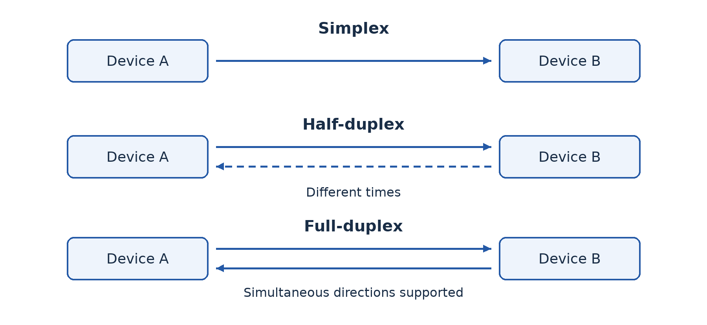
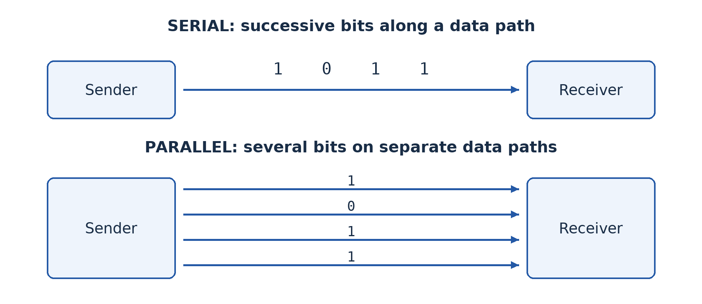
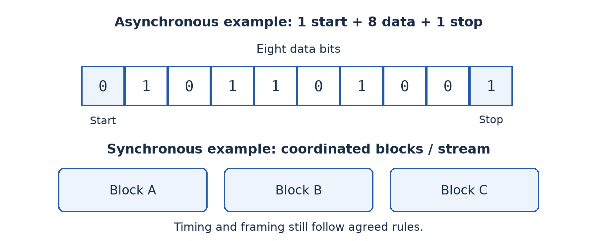
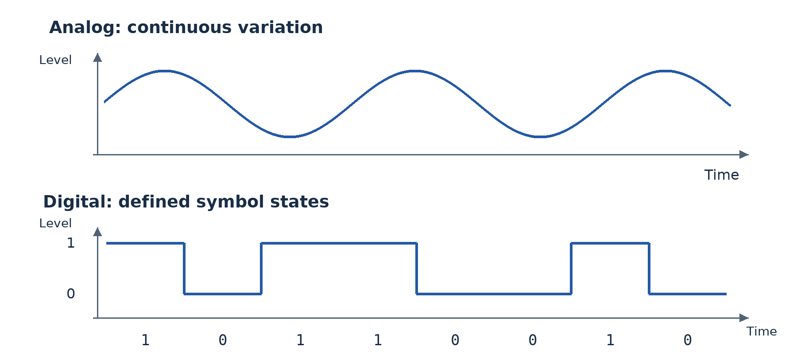
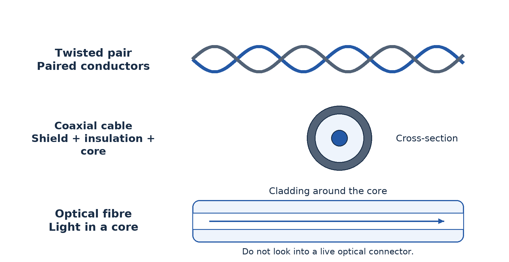
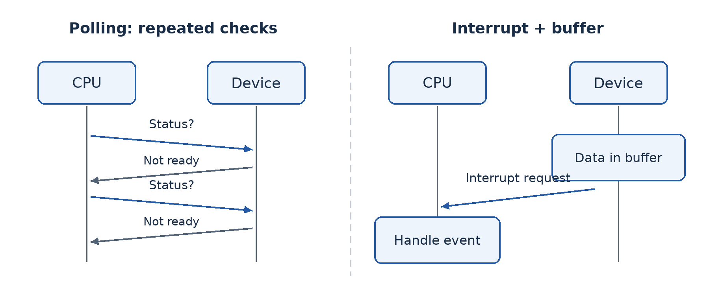
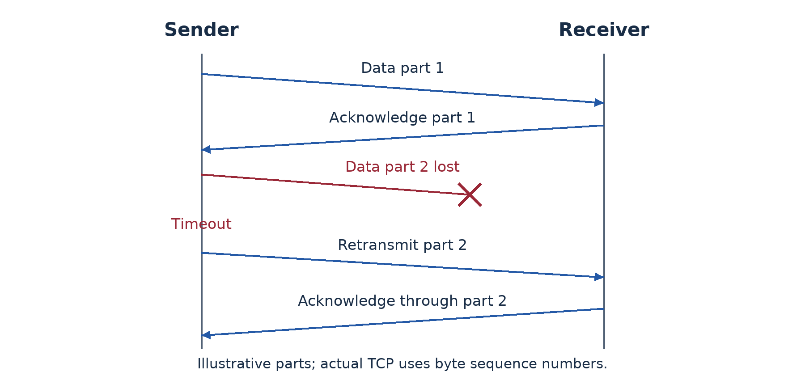
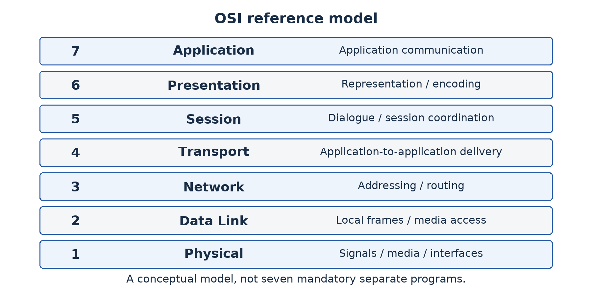
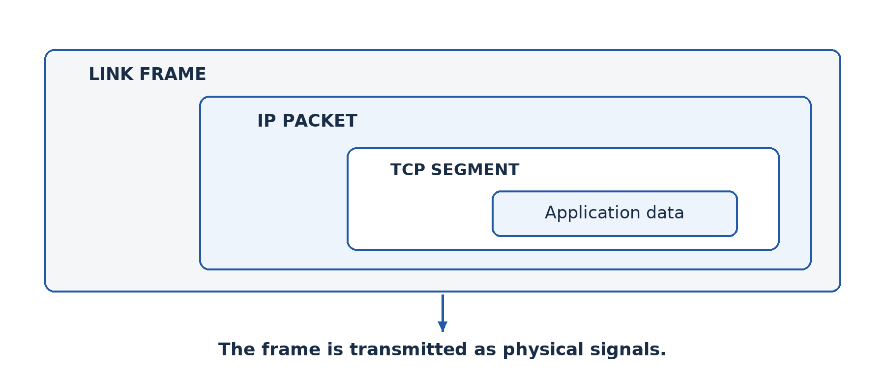
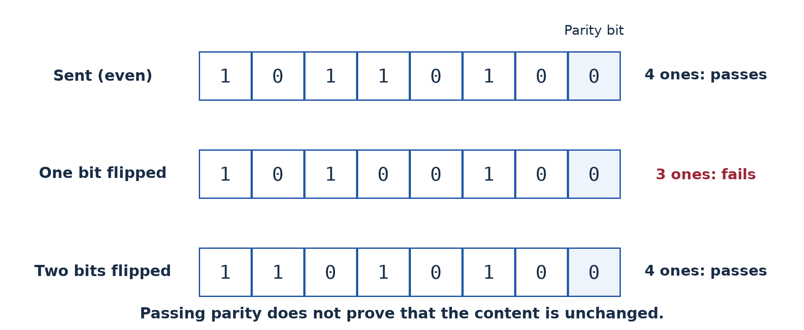

# Part 4 — Transmitting data reliably

## Lesson 27 — Modes of data transmission

### Separate two questions

A walkie-talkie lets each user speak, but normally not both at once. A telephone conversation allows both parties to speak at the same time. These are differences in **direction of communication**. Another question asks how devices share a communication medium without interfering with each other. The progression places both under this lesson, but they are not the same classification.

### 27.1 Simplex, half-duplex and full-duplex

**Simplex** communication carries information in one direction only for the connection being described. Traditional radio broadcasting sends from a station to listeners without a return path on that broadcast channel. A separate phone-in line does not make the broadcast channel itself duplex. Always define the connection being classified.

**Half-duplex** communication permits both directions, but not simultaneously on the shared channel. With a simple walkie-talkie, one user presses to talk while the other listens; they exchange roles afterwards. Both parties can send, so half-duplex is not the same as simplex.

**Full-duplex** communication permits simultaneous transmission in both directions. A modern switched Ethernet link normally supports this, as does the conversational service of a telephone connection. Separate channels or signal techniques may support simultaneous directions. It does not mean that a user must actually speak or send data continuously.

### 27.2 Sharing a medium: CSMA/CD

**Carrier Sense Multiple Access with Collision Detection (CSMA/CD)** was used by shared, half-duplex Ethernet. “Carrier sense” means listening to determine whether the medium appears busy. “Multiple access” means several stations can use the same shared medium. A station transmits when permitted by the method, but propagation delay means two stations can start before each hears the other's transmission.

If a collision is detected, the stations stop and wait for different randomly selected backoff intervals before retrying. The random delays reduce repeated simultaneous attempts. Listening first reduces some conflicts but cannot guarantee none will occur. This explanation concerns shared half-duplex Ethernet, not the normal full-duplex switched Ethernet links of a new laboratory.

### 27.3 Sharing a medium: CSMA/CA

**Carrier Sense Multiple Access with Collision Avoidance (CSMA/CA)** is associated with Wi-Fi. A wireless station cannot rely on detecting a collision while transmitting in the same way as shared wired Ethernet. It listens, follows timing rules and uses a random backoff before transmitting when appropriate. Acknowledgements help determine whether a frame was received successfully; optional coordination mechanisms can reduce some hidden-station problems.

“Avoidance” does not mean collisions are impossible. Two stations can still choose conflicting times, and interference can corrupt a frame. Retries may be required. In typical shared-channel Wi-Fi operation, devices take turns using the radio channel rather than each receiving a dedicated full-duplex channel like an Ethernet switch port.

The sheet describes these as logical-topology methods. More precisely, they are **media-access methods**: rules about how devices use a shared medium. The physical layout, logical flow, access method and duplex mode are related descriptions but should not be used as synonyms.

### Worked example — Classify carefully

A room has laptops connected to one Wi-Fi access point and desktops connected by full-duplex Ethernet to a switch. Both sets belong to a local network. Typical Wi-Fi access uses CSMA/CA and shared-channel turn-taking. The full-duplex switched Ethernet links do not use CSMA/CD to handle collisions during ordinary operation. “All LANs use collision detection” would therefore be wrong.

### Guided activity

Use two learners and message cards to demonstrate simplex, half-duplex and full-duplex. Then let four learners share one speaking channel. First model listen-and-detect with teacher-controlled simultaneous starts; then model listen-and-wait with random number cards. Discuss why a classroom role-play is an analogy, not a literal electrical or radio implementation. Draw arrow diagrams for each duplex mode.

### Check your understanding

1. Distinguish simplex, half-duplex and full-duplex with a labelled example of each.
2. Explain why listening before sending cannot guarantee no collision on a shared medium.
3. Compare the purpose of CSMA/CD and CSMA/CA and identify their usual teaching contexts.
4. Why is a star drawing insufficient to determine a network's access method?

### Answer guidance

1. Show one direction, alternating two-way communication and simultaneous two-way communication respectively. Classify a specified channel, not every possible service used by the devices.
2. Signals take time to propagate, so two stations may both observe an apparently idle medium before either transmission reaches the other.
3. Both organise access to a shared medium. Collision detection belongs to shared half-duplex Ethernet; avoidance is used in Wi-Fi. Modern switched full-duplex Ethernet does not need CSMA/CD on each link.
4. A physical star may contain different central devices and technologies. The connection pattern alone does not specify the rules used by the links.

## Lesson 28 — Broadband and narrowband transmission

### Capacity must match the task

A sensor sends a short temperature reading every hour. A clinic wants a clear live video consultation. Both transfer data, but the required rate and timing differ greatly. Buying the highest advertised capacity for every task can waste money; buying too little can make a service unusable.

### 28.1 Meaning in context

**Narrowband** describes communication using a relatively limited channel bandwidth and generally supporting modest data rates for the context. It can be appropriate for short messages, low-rate telemetry and some voice or control applications. **Broadband** describes a wider-capacity communication service or channel arrangement supporting higher data rates and richer or multiple services in that context.

In everyday Internet use, broadband refers to high-capacity access rather than a universal physical threshold. Definitions and regulatory minimum rates can change. In signal engineering, bandwidth is measured in hertz and refers to a range of frequencies; **data rate** is measured in bits per second. The quantities are related by the technology and signal conditions, but they are not identical units.

Do not confuse broadband versus narrowband with **baseband versus broadband signalling** as used in some engineering discussions. The first-term objective is to distinguish communication needs and appropriate capacity, not to assume that every use of the word broadband means exactly the same modulation method.

### 28.2 Capacity, throughput and delay

A service may advertise a maximum capacity of 20 megabits per second (20 Mb/s or Mbps). **Throughput** is the useful rate actually achieved under given conditions. Contention, signal quality, server limits and protocol overhead can reduce it. **Latency** is delay, which affects interactive work even when capacity is high.

A byte contains eight bits. A 10 megabyte file contains about 80 megabits under decimal units. At an ideal, fully available 4 Mb/s, the minimum transfer time is 80 ÷ 4 = **20 seconds**. Real transfer takes longer when overhead, changing rate or other users are involved. Confusing MB/s with Mb/s leads to a factor-of-eight error.

A short sensor message may tolerate low capacity and some delay while benefiting from low power use and wide coverage. A live video call needs sustained capacity in both required directions and acceptable delay and variation. High download capacity alone does not establish that the upload path will support the clinic's outgoing video.

### Worked example — Recommend without overbuying

A cooperative has battery-powered soil sensors and an office receiving training videos. Low-rate, low-power communication may be suitable for periodic sensor readings because messages are small. The office needs a higher-capacity connection for video downloads and several users. The two services can coexist. The recommendation links the capacity to the task rather than declaring narrowband obsolete or broadband automatically necessary everywhere.

### Guided activity

Calculate ideal transfer times for a 12 MB teaching file at 2 Mb/s and 8 Mb/s using decimal units. Then explain why measured times could be longer. Rank four applications—hourly sensor reading, text message, web research and multi-user live video—by likely capacity demand, stating assumptions. With equipment, time an authorised local file transfer and report the file size, elapsed time and limitations of the measurement.

### Check your understanding

1. Distinguish bandwidth in hertz from data rate in bits per second.
2. Explain broadband and narrowband without claiming a timeless universal speed boundary.
3. Calculate the ideal transfer time for 12 MB at 8 Mb/s.
4. Why might a lower-capacity service be appropriate for a remote sensor but inadequate for interactive video?

### Answer guidance

1. Frequency bandwidth describes a range of frequencies; data rate describes transferred bits per unit time. Technology and signal conditions connect them.
2. They describe relatively wider- and narrower-capacity arrangements in a specified context. Current service definitions must be checked rather than assumed.
3. 12 × 8 = 96 megabits; 96 ÷ 8 = **12 seconds**, before overhead and contention. At 2 Mb/s, the same ideal calculation gives 48 seconds.
4. Small infrequent readings need little data capacity and may prioritise power and coverage. Video requires sustained traffic and acceptable interactive delay.

## Lesson 29 — Types of data transmission

### Several classifications can apply at once

“Serial”, “synchronous” and “digital” do not answer the same question. Serial versus parallel concerns how bits are arranged across paths. Synchronous versus asynchronous concerns timing and framing. Analog versus digital concerns signal representation. One communication system can therefore be serial, synchronous and digital without contradiction.

### 29.1 Serial and parallel

**Serial transmission** sends successive bits along a communication path in sequence. A simplified drawing shows one bit after another on one data path. Real systems may use differential pairs or several serial lanes, so “serial means exactly one physical wire” is too literal. USB and many modern high-speed links use serial signalling.

**Parallel transmission** sends several bits at the same time across multiple data paths, often representing parts of a word together. It can transfer several bits per timing event, but requires more conductors and coordination. Over increasing distance or higher rates, differences in arrival time (**skew**), interference and cable complexity become important.

It is wrong to conclude that parallel is always faster. Modern serial links can operate at very high signalling rates and avoid some parallel coordination problems. Compare actual technologies, distance and cost. Parallel communication remains useful in appropriate short internal connections, while serial methods are common for external and long-distance communication.

### 29.2 Synchronous and asynchronous timing

In **synchronous transmission**, sender and receiver coordinate timing so that bits can be interpreted as an organised stream or blocks. Timing may be supplied explicitly or recovered from the signal. Block framing and other control information may still be present; synchronous does not mean “no overhead at all”. It is efficient for sustained transfers when the method is designed appropriately.

In common **asynchronous serial transmission**, a character can be sent after an irregular gap. A start bit tells the receiver when the character begins, and agreed timing allows the receiver to sample the following bits. One or more stop bits mark the end or provide separation. Optional parity may be included. The devices still need compatible rates and framing settings; asynchronous does not mean “no timing”.

For an illustrative frame with one start bit, eight data bits and one stop bit, 10 transmitted bits carry 8 data bits. The useful-data proportion is 8 ÷ 10 × 100 = **80%**, ignoring other overhead. If a parity bit is added, the frame becomes 11 bits under these assumptions. State the format before calculating; real systems differ.

### 29.3 Analog and digital signals

An **analog signal** varies continuously over a range to represent information. A microphone's electrical representation of changing sound pressure is a familiar example. A **digital signal** represents information using a finite set of symbol states, commonly interpreted as binary 0 and 1. Physical voltages are never perfect mathematical squares, but the receiver decides which symbol state was intended within allowed ranges.

Noise can alter both kinds of physical signal. Digital interpretation can tolerate limited disturbance and allow regeneration and error detection, but it is not immune to error. Conversion from analog measurements to digital data involves sampling and quantisation. A device may process digital data and transmit it using a modulated physical waveform, so avoid assuming that the underlying radio wave itself becomes a row of literal square bits.

### Worked example — Explain all three descriptions

A simplified sensor link sends eight-bit readings one bit at a time, uses a start and stop bit for each reading and interprets two electrical levels as binary symbols. It is serial in bit arrangement, asynchronous in character framing and digital in representation. Whether it is simplex or duplex is a separate question about permitted communication directions.

### Guided activity

Use eight cards to represent one byte. Move them through a single path, then through eight parallel paths. Introduce different delays on parallel paths and discuss skew. Next build an asynchronous frame with start, data and stop cards. Sketch one analog and one digital signal and label the axes and intended information states. No powered equipment is required for this conceptual activity.

### Check your understanding

1. Compare serial and parallel on arrangement, wiring and distance-related difficulties.
2. Explain how an asynchronous receiver knows when to begin reading a character.
3. Calculate the useful-data proportion for one start bit, seven data bits, one parity bit and one stop bit.
4. Why is “digital signals cannot be affected by noise” incorrect?

### Answer guidance

1. Serial sends successive bits along a path; parallel uses multiple paths simultaneously. Parallel adds conductors and timing coordination; actual speed depends on technology.
2. A start bit indicates a character boundary, and agreed rate and format determine subsequent sampling. Compatible timing is still required.
3. The frame contains 10 bits, of which 7 are data: 7 ÷ 10 × 100 = **70%**.
4. Physical disturbances can cause a receiver to misinterpret a symbol. Defined states and checking improve robustness but do not make error impossible.

## Lesson 30 — Guided and unguided transmission media

### A medium carries the signal

A **transmission medium** is the physical means by which a communication signal travels. **Guided media** constrain signals along a physical path, such as a cable. **Unguided media** carry electromagnetic signals through space rather than along a cable. Select a medium using distance, capacity, environment, mobility, installation, security and cost.

### 30.1 Twisted pair, coaxial cable and optical fibre

**Twisted-pair copper cable** uses pairs of insulated conductors twisted to reduce interference effects. Unshielded and shielded forms exist. It is widely used for Ethernet endpoints because appropriate equipment and installation are accessible. Correct category, connectors, termination and route length matter. For common copper Ethernet installations, the normal channel limit is 100 m; check the actual standard and complete installed channel rather than assuming every copper link has unlimited reach.

**Coaxial cable** has a central conductor, insulation and an outer conductive shield. Its structure supports suitable radio-frequency transmission and provides shielding. It is used in services such as cable television and some broadband access arrangements, and historically in bus Ethernet. Do not conclude that it is only historical or that any coaxial cable supports any required network service.

**Optical fibre** carries light through a core surrounded by cladding. Suitable fibre links offer high capacity and long reach and are not affected by electromagnetic interference in the same way as copper. Fibre also avoids an electrically conductive data path between buildings. It needs compatible optical interfaces and careful installation, termination and handling. Never look into an optical connector or laser source.

### 30.2 Wireless options

**Wi-Fi** provides local wireless access using radio. It supports mobility and can reduce endpoint cabling, but coverage, interference, shared capacity and security configuration affect results. Walls and distance can reduce signal quality. An access point still commonly needs an upstream wired or other suitable connection.

**Bluetooth** is commonly used for short-range personal-device communication and some low-power applications. It is not simply a lower-cost replacement for every campus Wi-Fi network. **Microwave point-to-point links** can connect sites using directional radio equipment; line of sight, alignment, weather effects at relevant frequencies, licensing and local rules may matter. **Infrared** can serve short-range line-of-sight or reflected-light applications but is blocked by obstacles and is not suitable for every room layout.

**Satellite communication** uses a satellite relay to connect distant or difficult-to-reach locations. Coverage can be valuable where terrestrial services are unavailable. Equipment, subscription cost, unobstructed view and the particular satellite system's delay and capacity matter. Geostationary and lower-orbit systems have different characteristics, so avoid a single absolute claim about all satellite latency.

### 30.3 Choose for the actual route

Fixed computers within a room often suit wired Ethernet, while mobile learners or staff may need Wi-Fi. Between buildings 300 m apart, an ordinary single copper Ethernet run is not suitable under the common 100 m channel limit. Fibre or a correctly designed point-to-point wireless solution may be considered, with permissions, route, power, security and maintenance assessed.

Wireless is not automatically insecure and wired is not automatically secure. Wireless needs strong supported authentication and encryption, while cables and ports need physical protection and network access controls. A link's medium does not decide who is authorised to see an application record.

### Worked example — Compare two inter-building options

Mboa's library is 300 m from the office. A protected fibre route offers stable high-capacity connectivity and electrical isolation but costs money to install and terminate. A directional wireless link may avoid trenching but requires appropriate mounting, line of sight, permissions, power and environmental assessment. A good recommendation states which site facts favour one option and what must be surveyed before purchase. It does not invent a guaranteed rate from distance alone.

### Guided activity

Inspect safe cable samples or photographs and sketch their structure. Never cut or handle live cables. For a classroom, two campus buildings and a remote mobile worker, propose a medium and explain two reasons and one limitation. In a supervised lab, observe wireless signal changes at approved positions without disrupting other users or treating a signal-strength display as a complete performance test.

### Check your understanding

1. Distinguish guided from unguided media and give two examples of each.
2. Explain two reasons fibre may suit an inter-building link and one installation drawback.
3. Why is a standard 300 m copper Ethernet channel a poor proposal for the example?
4. Compare Wi-Fi and Bluetooth by intended local use rather than only naming both as wireless.

### Answer guidance

1. Guided signals follow a cable; unguided signals travel through space. Twisted pair/fibre and Wi-Fi/microwave are suitable examples.
2. Distance capability, capacity and electrical isolation can favour fibre; specialist installation and compatible optics add cost. Connect the reason to the route.
3. It exceeds the common 100 m channel limit for the specified ordinary copper Ethernet arrangement. A different engineered technology would need separate justification.
4. Wi-Fi commonly provides LAN access; Bluetooth commonly links nearby personal or low-power devices. Actual range and capacity depend on versions and conditions.

## Lesson 31 — Peripheral device control mechanisms

### The processor and the device work at different rates

A computer can prepare print data much faster than a printer produces paper. It can also perform other work while waiting for a key press. **Peripheral control mechanisms** coordinate these unequal speeds and notify the processor when attention is needed. They can operate together rather than being mutually exclusive alternatives.

### 31.1 Buffers

A **buffer** is a temporary storage area used while data moves between components with different rates or timing. A network interface may receive data into a buffer so the processor can handle it shortly afterwards. A printer buffer holds incoming data while the printing mechanism works. Buffering smooths short differences in rate; it cannot make a permanently slow device process unlimited data.

If incoming data continues faster than it can be removed, a buffer can fill. The system then needs flow control, waiting or another defined response. Buffer size and management affect performance and data loss. **Spooling** commonly stores queued jobs, often on secondary storage, so they can be processed later; it is related to temporary holding but is not simply another name for every small hardware buffer.

### 31.2 Polling and interrupts

With **polling**, the processor or controlling software checks a device's status repeatedly or at intervals. It might ask whether input is ready or a transfer has completed. Polling can be simple and predictable, but frequent checks can waste processing effort when nothing has changed. In some high-rate or specialised situations, carefully designed polling is useful, so “polling is always bad” is too simplistic.

An **interrupt** is a signal or event requesting processor attention. A device can indicate that data is ready or an operation has completed. The processor responds according to its architecture and current state, saves relevant context, runs an interrupt-handling routine and then resumes appropriate work. The exact hardware sequence varies, but the central idea is notification rather than repeatedly asking every idle device.

**Interrupt priority** determines which requests should receive attention first when several compete, subject to the system's rules. A time-sensitive event may need faster handling than a routine completion notice. Priority is not simply “the first device connected” or “the most expensive device”. Poor handling can delay other work, so interrupt routines are normally designed to do necessary immediate work efficiently.

### 31.3 Handshaking and flow control

**Handshaking** is an exchange of control information to coordinate communication. A sender may indicate that data is ready, and a receiver may indicate readiness or acknowledge receipt according to the method. Hardware signals or protocol messages can provide this coordination. Its purpose is to agree conditions or control progress, not necessarily to authenticate a human user.

A device may therefore use a buffer to hold data, an interrupt to request processing and handshaking or flow control to avoid overrun. These terms describe different functions. In a network scenario, an interface can buffer received data, notify the processor and cooperate with protocol rules that regulate sending. Do not force the entire scenario into only one category when several mechanisms are described.

### Worked example — Identify the evidence

“The processor checks the printer's status every few milliseconds” describes polling. “The interface signals that a receive buffer has data” describes an interrupt plus buffering. “The receiver tells the sender to wait until space is available” describes handshaking or flow-control coordination. The key is the action performed, not the device's name.

### Guided activity

Use one learner as processor, two as devices and cards as buffer slots. First let the processor ask each device repeatedly. Repeat with devices raising a request card only when data is ready. Add a priority rule and show how it changes the response order. Finally let a receiver display “ready” or “wait” to model coordination. Explain which parts of the analogy correspond to storage, notification and control.

### Check your understanding

1. Explain why buffering helps a fast sender communicate with a slower device, and why it has limits.
2. Compare polling and interrupts by who initiates the status exchange and how processing time is used.
3. What does interrupt priority control?
4. Can buffering and interrupts be used together? Explain with a network-interface example.

### Answer guidance

1. Temporary storage absorbs short timing differences, but a finite buffer fills if the long-term input rate exceeds the removal rate.
2. Polling repeatedly asks for status; an interrupt requests attention when an event occurs. Either still requires actual data handling.
3. It helps determine service order for competing requests under system rules. It is not a measure of stored data size.
4. Yes. The interface can store received data in a buffer and interrupt the processor to arrange handling. The mechanisms solve different parts of the problem.

## Lesson 32 — Network protocols and their roles

### Common rules make communication meaningful

Two people speaking different languages may hear each other without understanding. Likewise, a signal reaching another computer is not enough: devices must agree on addressing, message structure, meaning, timing and error handling. A **network protocol** is a set of rules governing communication between network entities.

### 32.1 IP, TCP and UDP

**Internet Protocol (IP)** provides addressing and packet delivery across interconnected networks. Routers examine destination addressing and choose appropriate next steps according to routing information. IP offers a best-effort service; it does not itself guarantee that every packet arrives once, in order or within a deadline.

**Transmission Control Protocol (TCP)** provides a reliable, ordered byte-stream service between applications over IP. It establishes a connection, uses sequence information and acknowledgements to track delivery, retransmits when required and manages flow and congestion. The receiver can put received data into order and avoid presenting duplicate bytes to the application. TCP does not automatically encrypt data or guarantee a particular response time.

**User Datagram Protocol (UDP)** sends datagrams with relatively little transport-layer control. It does not itself establish the same connection state or provide TCP-style ordered reliable delivery. This can suit applications where timeliness matters and the application manages its own needs. It is not correct to say every UDP application is unreliable in the broad sense: an application can add reliability mechanisms on top. Likewise, UDP is not automatically the fastest choice in every workload.

### 32.2 Application and support protocols

**HTTP** defines requests and responses for web resources. **HTTPS** uses protected web communication with appropriate cryptographic transport protection and server authentication. HTTP/1.1 and HTTP/2 commonly use TCP; HTTP/3 uses QUIC over UDP. The last detail is useful context, not a demand to learn advanced QUIC internals in this lesson.

**Domain Name System (DNS)** resolves names to relevant records, including addresses. A user can type a memorable host name rather than manually maintaining its current address. **Dynamic Host Configuration Protocol (DHCP)** can assign hosts IP configuration such as an address, subnet information and gateway details. DNS finds information about names; DHCP supplies configuration. Confusing them makes troubleshooting difficult.

**SMTP** transfers outgoing e-mail between relevant systems; **IMAP** commonly lets a client access and synchronise mailbox content. **FTP** is a traditional file-transfer protocol whose basic form does not protect credentials or content. Use approved secure transfer methods for real sensitive work; **SFTP** is a different protocol operating over SSH, not merely an encrypted mode of FTP. **ICMP** carries IP-related control and diagnostic messages; tools such as ping use selected ICMP messages.

### 32.3 Why a suite is needed

No single protocol does everything. When opening a web page, a device may first obtain configuration, resolve a name, establish protected transport and exchange a web request. Each step addresses a different requirement. **TCP/IP** names a family or suite of cooperating protocols, not just two magic rules that replace all others.

Efficiency and reliability require trade-offs. Acknowledgements and retransmissions add traffic but help recover from loss. Flow control protects a receiver from being overwhelmed; congestion control responds to network conditions. The application should use appropriate services for its task rather than demand that every lower layer independently repeat the same work.

### Worked example — Find the role, not just the acronym

A computer has no valid local configuration, so first investigate addressing and DHCP or the approved static plan. If it reaches an address but a host name fails, DNS becomes a useful area to test. If the name resolves but a page fails, the web service, route, protected connection or access rules may be involved. These observations narrow possibilities; they do not prove a single cause without further testing.

### Guided activity

Use a teacher-approved network to inspect configuration and resolve an approved host using the available system tools, such as `ipconfig` and `nslookup`. Record the role tested and avoid scanning other hosts. Without connectivity, arrange cards for address configuration, name resolution, transport and web request, explaining the protocol function at each stage.

### Check your understanding

1. Explain how IP and TCP contribute different functions to reliable application communication.
2. Distinguish DNS from DHCP.
3. Compare TCP and UDP using an appropriate application requirement.
4. Why does using TCP not automatically make a connection confidential?

### Answer guidance

1. IP handles addressing and best-effort packet forwarding; TCP supplies ordered stream delivery with detection and recovery mechanisms above IP.
2. DNS resolves names to records; DHCP supplies host configuration. Explain the different questions answered.
3. TCP's ordered reliable stream suits complete file delivery; a time-sensitive application may use UDP with appropriate application-level handling. Avoid claiming a universal speed rule.
4. TCP reliability concerns delivery, not secrecy. Appropriate encryption and authentication, such as protected web transport, are separate requirements.

## Lesson 33 — Protocol suites and the OSI reference model

### Why use layers?

Sending a document involves application meaning, data representation, delivery between applications, routing, local links and physical signals. A layered model separates these responsibilities so they can be discussed and designed systematically. A **protocol suite** is a set of cooperating protocols. A **reference model** is a conceptual framework; it is not itself a cable, a software product or a guarantee that every real protocol fits one neat box.

### 33.1 The seven OSI layers

The **Open Systems Interconnection (OSI)** model has seven layers. Read from the user-facing end downwards when explaining how data is prepared for sending.

**Layer 7, Application**, provides communication functions used by applications. HTTP, SMTP and DNS are commonly mapped here. This does not mean the entire word processor or browser interface is the layer; the model concerns communication services and protocols.

**Layer 6, Presentation**, concerns representation such as encoding, format conversion, compression and aspects of encryption. Systems must agree how received bits represent meaningful data. **Layer 5, Session**, concerns establishing, managing and ending logical communication sessions and coordinating an ongoing dialogue. In many practical Internet applications these responsibilities are handled within application protocols and libraries rather than separate visible OSI programs.

**Layer 4, Transport**, provides end-to-end transport services between applications, including segmentation and reassembly as appropriate. TCP and UDP are commonly mapped here. Port numbers help identify application endpoints. **Layer 3, Network**, handles logical addressing and routing between networks; IP is the central Internet example. Routers principally operate on this forwarding responsibility.

**Layer 2, Data Link**, concerns frames and local-link delivery, including MAC addressing and media-access functions as appropriate. Ethernet and Wi-Fi include link-layer functions, and switches commonly forward at this level. **Layer 1, Physical**, concerns sending physical signals through the medium: electrical, optical or radio characteristics, interfaces and bit transmission. Ethernet and Wi-Fi standards include physical as well as link-layer specifications.

### 33.2 Encapsulation and decapsulation

**Encapsulation** adds the relevant control information as data passes towards lower-layer transmission. An application's data may be carried within a TCP segment, which is carried within an IP packet, which is carried within a local-link frame and transmitted as signals. Each enclosing unit supports a different part of delivery.

At the receiving end, **decapsulation** interprets and removes the appropriate enclosing information so that data reaches the intended application. A router forwards based on network-layer information and uses appropriate link framing on each hop; the same physical frame does not necessarily travel unchanged across the entire Internet.

The common protocol data unit names are **data** at the upper layers, **segment** for TCP or **datagram** for UDP, **packet** for IP, **frame** for the link and **bits/signals** for physical transmission. Terminology can vary by protocol; learn the role rather than forcing every transport unit to be called a TCP segment.

### 33.3 OSI and TCP/IP

A common four-layer TCP/IP teaching model groups responsibilities into application, transport, Internet and link. Its application layer covers much of OSI Layers 5–7; transport broadly corresponds to Layer 4; Internet to Layer 3; and link to Layers 1–2. Some textbooks use a five-layer form that separates physical and data-link responsibilities. These are modelling choices, not evidence that one network secretly has two different numbers of physical layers.

Mappings are useful approximations. TLS, for example, sits between application use and transport in common implementations and is often discussed with presentation-related protection. ARP operates at the link/Internet boundary for local address resolution. Recognising such boundaries is more accurate than insisting every real protocol has an undisputed single OSI label.

### Worked example — Use the model to investigate

A computer shows no physical link: examine Layer 1 concerns such as cable, interface and power. It has a link but no appropriate address: investigate configuration and network-layer reachability. It reaches a server address but cannot resolve its name: inspect the application-support DNS service and configuration. The model guides questions; real faults can involve several layers, so use evidence rather than announcing a layer as the final diagnosis.

### Guided activity

Draw the seven-layer model and place cards for HTTP, DNS, TCP, UDP, IP, Ethernet MAC and an optical signal at appropriate positions. Then explain a document transfer down one stack and up another. With approved lab access, identify one physical observation, one IP configuration observation and one application-service test. Never treat a memorised layer mnemonic as a substitute for explaining functions.

### Check your understanding

1. State the seven OSI layers in order and explain the function of each.
2. Explain encapsulation using data, segment, packet and frame.
3. Map HTTP, TCP, IP and Ethernet MAC to their usual OSI layers.
4. Why is OSI called a reference model rather than the literal software architecture of every Internet device?

### Answer guidance

1. Use the sequence Application, Presentation, Session, Transport, Network, Data Link, Physical, or its correct reverse. Functions matter as well as names.
2. Application data is carried within transport control information, then IP information, then local-link framing. The receiver interprets the appropriate enclosing information in reverse.
3. HTTP: 7; TCP: 4; IP: 3; Ethernet MAC: 2. Explain the responsibility rather than giving numbers alone.
4. It is a conceptual organisation of functions. Real suites combine functions and some protocols sit across conceptual boundaries.

## Lesson 34 — Integration: Analyse a data-transmission problem

### The situation

A fictional college links two buildings 300 m apart. The proposed plan uses one ordinary copper Ethernet channel for the full distance, says all modern Ethernet needs collision detection, calls Wi-Fi full-duplex because users can both upload and download, and claims a VPN will make a slow connection fast. Your team must review the plan before installation.

### Required analysis

Identify and correct each unsupported claim. Explain the relevant distinction: medium and distance, shared versus switched full-duplex Ethernet, alternating versus simultaneous directions, and confidentiality versus capacity. Recommend at least two feasible inter-building options and explain which site facts must be checked before choosing.

Then trace a learner's web request using application, transport, network, link and physical responsibilities. Identify DNS, TCP or the relevant transport, IP and the local transmission medium at suitable points. Explain one role for buffering or interrupt notification in the receiving computer. Do not claim that the OSI model is itself installed as seven separate programs.

### Evidence and demonstration

Submit a corrected annotated diagram and a short technical review. Use arrow cards to demonstrate duplex directions and nested envelopes to demonstrate encapsulation. If a teacher-approved lab is available, inspect a link, IP settings and one application service. Describe the test actually performed; do not infer an entire network's quality from one successful ping.

A peer group should challenge one recommendation by asking about cost, maintenance or failure. Revise the proposal to acknowledge a real trade-off rather than describing the selected medium as perfect. The integration scenario is locally authored to combine Lessons 27–33.

### Assessment criteria — 20 marks

Use **8 marks** for correcting the four misconceptions with reasons; **4 marks** for a feasible media comparison; **4 marks** for correct protocol/layer and peripheral-control explanations; and **4 marks** for a labelled diagram, honest evidence and a defended revision. A correction earns more credit when it explains why the original claim fails.

### Individual follow-up

Write a short answer to this question: “How can one network be a physical star, use full-duplex Ethernet links, carry serial digital transmission and support client/server services?” Explain what different question each description answers. If you can do so without treating the terms as competitors, you understand the main classifications in this part.

## Evaluation 2 — Security and data transmission

### Instructions

This locally authored Week 10 evaluation is placed before Lesson 35, following the supplied progression. Suggested conditions are 75 minutes and **50 marks**. It covers Lessons 18–34 and assumes the earlier network foundations. It does not assess parity before parity has been taught.

1. Two lab computers have a physical link. Describe a safe sequence to configure and test a controlled shared folder. Distinguish connectivity from permission. **[8]**
2. Explain confidentiality, integrity and availability using a school records service. Give one suitable control for each. **[9]**
3. Contrast validation and verification. Explain a range check, a format check and independent double entry. **[8]**
4. Draw simplex, half-duplex and full-duplex signal directions. Explain why modern switched full-duplex Ethernet does not need CSMA/CD on each link. **[7]**
5. Compare suitable media for a 300 m inter-building connection and make a justified recommendation under stated assumptions. **[6]**
6. Explain the separate roles of DNS, IP and TCP in retrieving a web resource. **[6]**
7. Explain encapsulation and name the usual OSI layers for HTTP, TCP, IP and Ethernet MAC. **[6]**

### Marking guidance

For Question 1, allow **2 marks each** for authorised preparation and addressing, meaningful reachability testing, controlled sharing with suitable permissions, and an actual service/permission test without disabling security. For Question 2, use **3 marks per goal**: accurate meaning, contextual harm and a matched control.

For Question 3, allow **2 marks** for the contrast and **2 marks each** for the three explained techniques. For Question 4, allow **1 mark per correct arrow diagram**, **2 marks** for describing the shared-half-duplex collision context and **2 marks** for explaining its absence on separate full-duplex switch links. For Question 5, allow **2 marks per developed option** and **2 marks** for a conclusion tied to assumptions. For Question 6, allow **2 marks per protocol role**. For Question 7, allow **2 marks** for encapsulation and **1 mark per appropriate mapping**.

### Remediation 2

Sort wrong answers by cause: confused terminology, missing explanation, inaccurate diagram or unsupported recommendation. Redraw one failed diagram, perform or simulate one missing test, and rewrite one answer as “fact → consequence → justified choice”. Then attempt a fresh scenario. For example, replace the school records service with a clinic and choose controls again rather than merely memorising the previous wording.

## Lesson 35 — Error detection and data-transfer checks

### Detecting an error is not the same as correcting it

A sender transmits a binary message, but noise causes a receiver to interpret one bit incorrectly. A **transmission error** occurs when received data differs from what was sent. Detection mechanisms add or use information that helps recognise some errors. Recovery may then involve retransmission. No simple checking method should be described as proving that every possible error has been removed.

### 35.1 Types and causes of error

A **single-bit error** changes one bit. A **burst error** affects a sequence spanning multiple bit positions; not every bit inside that span must be changed. Interference, weak signals, damaged media and equipment faults can contribute to corrupted data. Packet-based communication can also suffer loss, duplication or reordering, which requires mechanisms beyond merely checking an individual bit's value.

A checking method has limitations determined by its design. It may detect some patterns but miss others. It is therefore important to distinguish “an error was not detected” from “the data is certainly correct”. Reliability usually combines checking, sequence information, acknowledgements and recovery rather than relying on one parity bit.

### 35.2 Parity step by step

A **parity bit** is added so that the total number of 1s in the protected group is even or odd according to the agreed rule. For **even parity**, choose the bit that makes the total count even. For **odd parity**, choose the bit that makes it odd. Sender and receiver must use the same convention and agree which bits are protected.

Take data `1011010`. Count the 1s: positions 1, 3, 4 and 6 give **four**. Four is already even, so the even-parity bit is **0**. Appending it on the right gives `10110100`. For odd parity, append **1**, giving `10110101`, with five 1s. The parity bit does not mean “0 for correct” or “1 for wrong”; it enforces the chosen count.

Suppose the even-parity message becomes `10100100` after one bit changes. It now contains three 1s, so the receiver detects a parity failure. But if two data bits change and the received message is `11010100`, it still contains four 1s. Even parity passes despite the altered data.

A single parity check detects any odd number of bit flips in the protected group, including a parity-bit flip, but it can miss even numbers of flips. It does not identify which bit is wrong and generally cannot correct the message by itself. A passed parity test is limited evidence, not proof of correctness.

### 35.3 Other checking and recovery methods

A **checksum** is a calculated summary transmitted with data and recomputed by the receiver. A simple classroom illustration adds byte values modulo a fixed range. If data values 12, 25 and 7 give a sum of 44, a changed value may produce a mismatch. However, changing them to 13, 24 and 7 still gives 44, demonstrating why a simple sum can miss compensating changes. Real checksum algorithms have defined rules and different strengths.

A **cyclic redundancy check (CRC)** uses a specified binary calculation to produce check information. Appropriate CRCs detect many important error patterns, including specified classes of burst errors. CRCs are widely useful for accidental corruption but are not cryptographic authentication: a deliberate attacker may be able to alter data and recompute an unprotected CRC.

An **echo check** returns received data for comparison with the original. It adds traffic and relies on the return process; it is not universal proof against every possible corruption. **Automatic repeat request (ARQ)** combines checking with feedback, timeouts and retransmission. A sender resends when an expected acknowledgement is missing or the receiver reports failure, according to the protocol. Sequence numbers help distinguish a repeated transmission from new data.

### Worked example — Solve and interpret

For `1001001`, there are three 1s. The even-parity bit is **1**, giving four in total; the odd-parity bit is **0**, leaving three. If a receiver reports a parity mismatch, request retransmission under the agreed recovery method. Do not “correct the last bit” simply because the last bit is parity: the error could be elsewhere.

### Guided activity

Write five seven-bit messages and calculate both parity bits. A partner secretly flips one or two bits in selected protected groups. Check parity, then compare with the original to identify cases the check missed. Next role-play acknowledgement loss: the sender times out and resends, so the receiver needs sequence information to avoid treating duplicate data as new. No computer or real network traffic is required.

### Check your understanding

1. Explain single-bit and burst errors and distinguish detection from correction.
2. Find even- and odd-parity bits for `1001001` and `1111000`.
3. Why can two flipped bits escape a simple parity check?
4. Explain how a checksum or CRC differs from retransmission under ARQ.

### Answer guidance

1. A single-bit error changes one bit; a burst spans a sequence of affected positions. Detecting a mismatch does not determine the correct original data.
2. `1001001` has three 1s: even bit 1, odd bit 0. `1111000` has four: even bit 0, odd bit 1. State the convention and count before answering.
3. Two flips preserve the odd/even count, even though the content may change. The receiver therefore sees a valid parity relationship.
4. A checksum or CRC supplies evidence of corruption according to its algorithm. ARQ uses feedback and timing to arrange another transmission; it is a recovery procedure, not simply another name for a check value.
