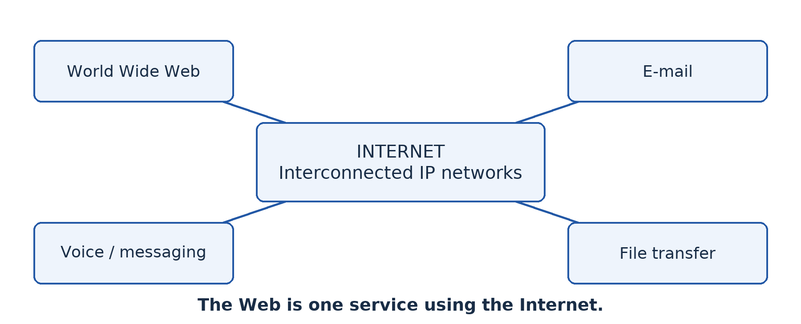
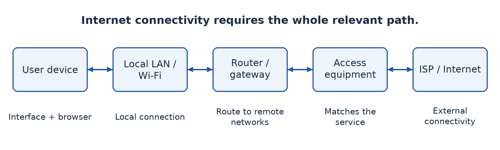
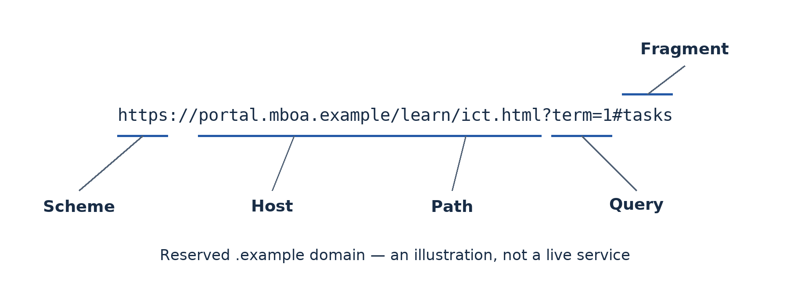
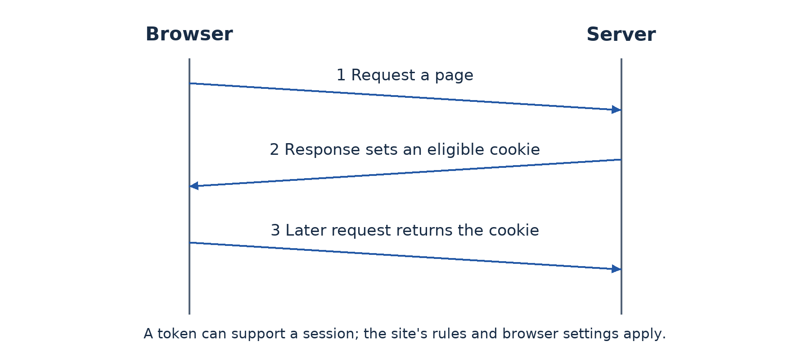

# Part 5 — Using the Internet to communicate and collaborate

## Lesson 36 — History and development of the Internet

### The Internet is not the same as the Web

A learner says, “The Internet was invented when websites appeared.” Websites made Internet use more visible, but network communication existed earlier. The **Internet** is a global interconnection of networks using the Internet protocol suite to exchange data. The **World Wide Web** is one service operating over that infrastructure, using linked resources commonly accessed through browsers.

### 36.1 Purpose and operation

The Internet allows devices on different networks to exchange information and use remote services. A user's local network connects through providers and other networks; routers forward packets towards their destinations. No single company owns the entire Internet. Many organisations operate parts and cooperate through standards and interconnection arrangements.

The Web, e-mail, messaging, file transfer and voice communication can all use Internet connectivity. A browser is an application used to access web content; a search engine is a service that helps find content. These are not synonyms for the Internet itself. A local intranet can use web technology without global connectivity, reinforcing the distinction between a service and its underlying extent.

### 36.2 Important historical steps

In **1969**, ARPANET connected early research sites and helped demonstrate packet-switched networking. **Packet switching** divides communication into units that can be forwarded through a shared network rather than reserving one exclusive circuit for the whole conversation. The Internet grew from several lines of research and collaboration; it did not appear as one person's single finished invention.

During the 1970s, work associated with Vint Cerf, Bob Kahn and others developed the foundations of TCP/IP internetworking. In **1983**, ARPANET's transition to TCP/IP became a major milestone. The Domain Name System developed during the 1980s to support a scalable naming system. Research and education networks helped extend connectivity.

In **1989**, Tim Berners-Lee proposed the Web at CERN. Web technologies and early software became publicly available in the early 1990s, and graphical browsers helped popularise use. Commercial services expanded during the 1990s. Later broadband, mobile networks, Wi-Fi, smartphones, improved fibre infrastructure and online services widened everyday access. These are growth stages, not a reason to replace the Internet's history with a list of social-media launches.

### 36.3 Why use expanded

Shared protocols let diverse devices and networks communicate, reducing the need for every organisation to build an isolated incompatible system. Better physical infrastructure and cheaper computing made access more practical. Useful content and services created demand: research, commerce, communication, education and entertainment gave people reasons to connect.

Mobile devices reduced dependence on a desktop computer and a fixed office line. Yet access remains uneven. Price, electricity, local coverage, language, disability access and digital skills affect whether a nominally connected person can benefit. This **digital divide** concerns effective access and participation, not only the presence of a mobile signal.

### 36.4 Advantages and disadvantages

The Internet can reduce communication delay, widen access to learning materials, support remote work and connect buyers with sellers. A learner can consult several sources rather than rely on one available textbook. A small business can reach distant customers, subject to logistics and trust.

Risks include misinformation, fraud, privacy loss, harassment, malware, distraction and dependence on external services. A message spreading quickly is not evidence that it is true. A service interruption can disrupt work, and requiring online-only procedures can exclude people without affordable access. Evaluate each benefit alongside its conditions and possible harms.

### Worked example — Explain social impact

An online learning service lets a rural learner access a recorded explanation outside school hours. The benefit arises because distance and scheduling barriers are reduced. If data is expensive or the material lacks accessible text, the same service can exclude that learner. A balanced evaluation suggests downloadable low-data resources, school access points or printed alternatives rather than declaring the Internet entirely beneficial or entirely harmful.

### Guided activity

Create a five-event timeline distinguishing networking milestones from Web milestones. Then choose education, business or family communication and write one developed benefit, one risk and one practical response. Without Internet access, use teacher-provided source cards. With access, compare a historical claim against a reliable source and record its publication context.

### Check your understanding

1. Define the Internet and distinguish it from the Web.
2. Explain the importance of packet switching and TCP/IP in the history of interconnected networks.
3. Give three factors that encouraged growth and explain how each helped.
4. Evaluate one Internet application for a community with intermittent power and costly mobile data.

### Answer guidance

1. The Internet interconnects networks using shared protocols; the Web provides linked resources over that infrastructure. E-mail supplies a useful non-Web example.
2. Packet switching supports shared forwarding of data units; TCP/IP supports communication across different networks. Neither is just another name for a browser.
3. Appropriate infrastructure, lower device costs, useful services and interoperable standards all help when the causal connection is explained.
4. Discuss the application benefit, actual access constraints and a realistic alternative or mitigation. Do not assume a service is inclusive merely because it is online.

## Lesson 37 — Internet connectivity technologies and requirements

### The connection has several parts

The school buys a Wi-Fi router but has no Internet service. Learners can connect to the wireless network yet cannot open external sites. The local access device is working in one role; the external path is missing. Internet connectivity needs a suitable access service, compatible equipment, correct configuration and an application capable of using the service.

### 37.1 Connection technologies

**Dial-up** uses a modem and a telephone connection, historically offering low data rates and often occupying the phone line. It is mainly useful here as a historical comparison. **Digital subscriber line (DSL)** carries data over suitable telephone copper using compatible provider equipment. Capacity depends on the service and line conditions, including distance to relevant equipment.

**Cable broadband** uses a provider's cable network with appropriate access equipment and shared capacity. **Fibre access** brings optical connectivity to a location or nearby distribution point; an ONT and compatible gateway equipment commonly provide the customer connection. Actual service rates, installation requirements and local availability must be checked.

**Mobile data** uses a cellular service through a phone, cellular router or other compatible device. A SIM or equivalent subscription identity, coverage and a suitable data plan are typically required. Tethering can share a phone's connection with a laptop, subject to policy, capacity and data cost. Mobile signal bars alone do not establish dependable throughput.

**Fixed wireless** and **satellite** can serve places where wired access is difficult. The precise system determines antenna placement, coverage, capacity, delay and cost. Choose after checking the actual location rather than assuming an entire town or rural area has the same service quality.

### 37.2 Device roles and configuration

A host needs an appropriate network interface. A local switch or access point connects it to the LAN. A router or gateway forwards external traffic; compatible modem, ONT or other provider-access equipment connects to the access service. The host needs an address, suitable subnet information, a gateway for remote networks and usually DNS configuration for host-name use. DHCP can provide much of this automatically.

The **Internet service provider (ISP)** supplies access under an agreed service plan. Compare installation, recurring cost, data allowance, upload and download capacity, delay, reliability, support and coverage. A fast connection at a provider's office does not prove performance at the school's site. Essential local services should be planned to survive an external outage where possible.

### 37.3 Use core browser features

A **web browser** retrieves and displays web resources. The **address bar** accepts a URL or search query; distinguish it from a search field embedded in a page. **Tabs** hold multiple pages, while **back**, **forward** and **reload** control navigation. A **bookmark** stores a useful location. **History** records browsing activity according to settings; a **download manager** tracks files saved from the Web.

Privacy and security controls include site permissions, cookie controls, certificate information, password-management settings and handling of suspicious downloads. **Extensions** add functionality but may request sensitive permissions, so install only approved ones. Private-browsing mode generally limits some local session storage; it does not make activity invisible to every website, employer, school network or provider.

A secure-connection indicator supports that the connection is protected and associated with the validated host under the browser's checks. It does not prove that the site's claims or business are honest. Read the actual domain and evaluate the source. Keep the browser updated and do not ignore certificate warnings simply to complete a task.

### Worked example — Separate access from application failure

If a laptop reaches a local file server but no external site, the local network may be functioning while the provider route, gateway or external configuration fails. If one site alone fails, it is premature to declare that the entire Internet connection is down. Compare a small set of teacher-approved tests and inspect configuration before drawing a conclusion.

### Guided practical

Open a teacher-approved local page or safe external page. Identify its address, open a second tab, follow a link, return, reload, bookmark the original page and locate the bookmark. Inspect site permissions and clear only the test site's data if instructed. Save a permitted document and locate the file afterwards. With no connection, perform the navigation tasks on the supplied offline HTML example; external-service testing remains separate.

### Check your understanding

1. Explain why joining Wi-Fi does not prove that Internet access is available.
2. Compare fibre, mobile data and satellite for a specified school site using availability, cost and performance needs.
3. Explain the different roles of a browser, a search engine and an ISP.
4. What does private-browsing mode fail to guarantee?

### Answer guidance

1. Wi-Fi may provide only local access; the provider service, gateway route or external configuration may be absent or faulty.
2. The answer must depend on surveyed availability and the school's needs. State assumptions rather than declaring one technology universally best.
3. A browser accesses resources, a search engine helps find information and an ISP supplies connectivity. One does not replace the others.
4. It does not provide universal anonymity or hide all network activity. Its main effects concern selected local browsing data and session handling.

## Lesson 38 — Social networks and collaborative environments

### Communication and collaboration overlap but differ

A class group exchanges short messages about homework. Another group jointly edits a project report, assigns tasks and reviews changes. Both communicate online, but the second has a structured shared-work process. **Social media** allows users to create, share and interact with content and communities. A **collaborative environment** provides tools for people to work together on shared tasks or resources.

### 38.1 Features and examples

Social platforms commonly offer profiles, posts, comments, groups, messaging, sharing and recommendation feeds. Examples include social-network services, discussion communities, video-sharing platforms and group-messaging tools. Their features and suitability change; choose according to the task and school policy rather than assume that popularity makes a service appropriate.

Collaborative tools can provide shared documents, calendars, task boards, version history, comments and controlled file storage. Examples include school-managed Google Workspace or Microsoft 365 environments, learning platforms and other approved shared editors. A messaging group may support teamwork, but message history alone may be poor at managing document versions or assigning responsibilities.

### 38.2 Positive and negative impacts

Social networks can distribute useful announcements, connect distant family members, help community organisations coordinate and let small businesses reach customers. Learners can exchange explanations and discover educational material. The value comes from the quality and purpose of interaction, not the quantity of messages.

Risks include misinformation, harassment, exposure of personal information, fraud, unwanted contact, distraction and exclusion. Recommendation systems may amplify engaging material whether or not it is accurate. A forwarded screenshot can lose its original date and context. Do not share another person's photograph, number or private message without appropriate permission.

Responsible use includes verifying claims before forwarding, using respectful language, setting suitable privacy controls, limiting unnecessary personal details and reporting abuse through approved routes. Block or report harmful contact rather than escalating a public argument. For threats or safeguarding concerns, involve a trusted adult or the school's designated support person. Avoid publicly reposting harmful material as a supposed warning.

### 38.3 Make collaborative work traceable

Start with a clear goal, roles, deadlines and a shared storage location. Set sharing rights deliberately: some members need editing, others only viewing or commenting. “Anyone with the link” may expose work more widely than intended. Test access with the actual intended accounts and remove unnecessary permission after the project.

Use comments to discuss a specific passage and suggestions or tracked changes when available to propose revisions. **Version history** helps inspect earlier states and recover selected changes, subject to the tool's capabilities. Agree file names and ownership so that the group does not create a confusing chain of “final-final” copies. A collaborative document still needs source acknowledgement and honest individual contribution.

### Worked example — Repair a group's process

Four learners send separate report copies through a chat group. One corrects the introduction while another edits an older copy. Their problem is not lack of messages but poor version control. An approved shared document with named contributors, comment rules and a final reviewer can reduce conflicting copies. If connectivity is limited, assign offline sections and nominate one controlled merge process; do not pretend simultaneous online editing is always practical.

### Guided practical

Using school-approved accounts, create a harmless group document with a title and task list. Share it only with named group members. Each learner contributes a paragraph, comments constructively on another paragraph and checks version history or an equivalent change log. Test a view-only account if available. Remove test access afterwards according to policy. Without accounts or connectivity, use a paper master document and coloured change slips, then complete the online procedure later.

### Check your understanding

1. Distinguish social media from a collaborative environment and explain an area of overlap.
2. Explain two positive community effects and two risks of social networks.
3. Why can “anyone with the link can edit” be unsuitable for a school report?
4. Explain how comments, permissions and version history support different aspects of teamwork.

### Answer guidance

1. Social media centres on content and interaction; collaborative environments support shared tasks and resources. A group can use both, but the functions differ.
2. Develop each effect through an example, such as rapid announcements or rapid false-rumour spread. Mere lists do not explain impact.
3. The link may be forwarded, allowing unintended readers or editors. Named access can better match the intended team and accountability needs.
4. Comments support discussion, permissions control actions and version history records or recovers changes. None alone replaces an agreed working process.

## Lesson 39 — Internet services and information retrieval

### Choose the service that fits the job

The Internet carries many services. The **Web** supports linked pages and applications; **e-mail** supports addressed messages that need not be read immediately; **instant messaging** supports rapid exchanges; **voice over IP (VoIP)** carries voice over IP networks; and file-transfer services move files. Some cloud services provide storage and applications through remote systems. A browser may provide access to several services without making them all identical.

### 39.1 How e-mail works at a useful level

An e-mail account has an address, commonly in the form `name@domain`. A sender composes a message, and relevant mail servers accept, route and store it for the recipient. The recipient can use webmail or an e-mail client. SMTP is involved in sending and server transfer; IMAP commonly supports mailbox access and synchronisation. A message is not guaranteed to arrive or be read merely because the sender clicked Send.

The **To** field names principal recipients. **Cc** copies additional visible recipients. **Bcc** conceals listed recipients from the other recipients in the usual message display and can help avoid exposing a group's addresses. A **subject** describes the purpose; the body provides context; an **attachment** carries a separate file. Check the actual recipient and attachment before sending because a follow-up apology may not undo disclosure.

### 39.2 Guided practical — Create an account and send an attachment

The teacher must select an age-appropriate, school-approved service and explain privacy, recovery and school policy. Use a school-managed training account where available. Account creation may require the provider's eligibility and verification steps; do not bypass them, use false recovery details or collect learners' passwords. If the school creates accounts centrally, the learner should understand the process while using the assigned account for the practical.

1. Open the verified service address and choose account creation where authorised. Provide only required, approved information, create a strong unique password privately and configure recovery or multi-factor protection according to policy. Store recovery information through the approved method, not in a public notebook or screenshot.
2. Sign in and identify the inbox, sent folder and compose control. Create a small fictional report locally and confirm its filename and location. Avoid personal records or a file containing hidden sensitive information.
3. Compose a message to the teacher-designated recipient. Use a subject such as “Upper Sixth ICT — attachment practice”. Add a greeting, explain what is attached and sign with the approved classroom identifier.
4. Attach the intended file, wait for upload and check its name. Review the recipient and message before sending. Do not send to an invented real address; use only the teacher's confirmed recipient or paired test account.
5. Check the sent folder and any error notification. The recipient should confirm receipt and open the attachment safely. Record completion without exposing credentials or unrelated messages. Sign out on a shared computer and follow the school's local-data cleanup policy.

If no approved account can be created, practise composition with a paper or offline draft and label the sending component incomplete. An unsent draft is not evidence of delivery.

### 39.3 Retrieve information effectively

Begin with a focused question and useful keywords. “Network” is broad; “difference switch router school LAN” is more targeted. Quotation marks can search an exact phrase, and operators such as `site:` can restrict a search where the service supports them. Search features vary, so verify how the selected engine interprets an operator.

Evaluate **authority**, **evidence**, **date**, **purpose** and **relevance**. Prefer an original official document for an official requirement. An attractive page or top ranking is not proof of accuracy. Compare independent sources, distinguish advertisements from results and check whether a copied document still matches current requirements. Record the title, publisher, URL and access date so another person can locate what you used.

### Worked example — A syllabus search

A learner needs the current school's first-term ICT objectives. A decade-old exam-preparation blog may explain useful ideas but cannot by itself establish this year's teaching sequence. The supplied current progression sheet is the primary source for that sequence. An official Board page can establish general examination information, while a mirrored older syllabus should be labelled with its age and source limitations. The answer matches the claim to an appropriate source.

### Guided retrieval task

Research one teacher-approved question about network safety. Write a precise query, compare two sources, identify one claim each supports and explain which is stronger for your purpose. Do not copy whole pages. With no Internet, evaluate printed extracts that include publisher and date, then complete the search step when connected.

### Check your understanding

1. Explain three Internet services and choose an appropriate task for each.
2. Describe the steps and evidence needed to send a safe attachment successfully.
3. Distinguish Cc from Bcc and give a privacy-related use for Bcc.
4. Explain why a high search ranking and a recent-looking page design are not sufficient evidence of reliability.

### Answer guidance

1. Relate the service to its function: asynchronous message, shared web resource, live voice or file transfer. Do not treat a provider name as the definition.
2. Use an approved account and recipient, correct file, clear message, checked attachment and delivery evidence. A sent-folder entry alone does not prove it was read.
3. Cc recipients are normally visible; Bcc recipients are concealed from other recipients' usual view. It can avoid publishing a mailing list to everyone.
4. Ranking and design are influenced by factors other than truth. Assess the publisher, evidence, date of the actual material and suitability for the question.

## Lesson 40 — Internet communication and teleworking

### Work is an activity, not always a location

**Teleworking** means doing work away from the usual workplace using ICT to communicate and access resources. **Telecommuting** is often used for working remotely instead of travelling to the normal workplace, particularly from home; usage overlaps with teleworking. **Videoconferencing** provides live audio and video communication among participants at different locations. It is one tool for remote work, not a complete remote-working system.

### 40.1 Opportunities and limits

Remote work can reduce commuting, widen access to expertise and support flexible arrangements. It requires suitable connectivity, equipment, access to work resources, clear communication and secure handling of information. Isolation, poor home conditions, interruptions, unequal access and blurred work boundaries can limit its benefits. Not every practical or customer-facing task can move online.

Videoconferencing can support a lesson, meeting or specialist consultation. Audio quality, upload capacity, delay, lighting and participant access affect usefulness. A telephone or audio-only connection may be more inclusive than insisting on video when data is expensive. Recording can help absent participants but requires appropriate permission and secure storage.

### 40.2 Understand URLs

A **uniform resource locator (URL)** identifies the location and access method of a resource. In the fictional example `https://portal.mboa.example/learn/ict.html?term=1#tasks`, `https` is the scheme, `portal.mboa.example` is the host, `/learn/ict.html` is the path, `term=1` is a query component and `tasks` is a fragment identifying a location within the resource. The reserved `.example` domain makes clear that this is not a live school service.

Read host names carefully. In a name such as `school.example.attacker.invalid`, the appearance of “school” at the beginning does not make the host the school's real domain. Do not infer trust from a familiar word buried in a long URL. The protected-connection scheme also does not prove the site's business is honest. Obtain sensitive service addresses through independently trusted sources.

### 40.3 Understand cookies

A **cookie** is a small item of state stored by a browser for a site according to applicable rules and settings. The browser can send relevant cookies with later requests so that the service can maintain a session, remember preferences or perform other functions. Because ordinary HTTP requests do not inherently remember all previous interactions, session state is useful for a logged-in service.

A cookie may contain a session identifier rather than the user's full details. Advertising or analytics uses can raise tracking and consent concerns, particularly across services. Cookies are not inherently executable viruses, and deleting them may sign a user out or remove preferences. Websites use other storage and identification methods too, so blocking cookies does not guarantee that no tracking occurs.

### 40.4 Guided practical — Hold a controlled online meeting

Use an approved platform and teacher-managed accounts or guest access permitted by the service. The host creates a meeting, sets the time and agenda, and applies appropriate entry controls such as a passcode, waiting room or named invitations. Share the link only with intended participants and avoid publishing credentials in public groups.

Before joining, test microphone and camera permissions and use headphones if available to reduce feedback. Join with the approved identity, follow turn-taking rules and mute when not speaking. The host admits expected participants and limits screen sharing to the necessary people. Share only the selected application or document, not an entire desktop containing private information. Obtain permission before recording; if recording is unnecessary, leave it off.

Each learner should join, contribute a short statement and locate the leave control. A designated learner demonstrates screen sharing of a harmless slide under host control. At the end, the host ends the meeting for all participants, checks any saved files and removes temporary access as required. With no connection, role-play host and participant actions and complete the actual meeting later.

### Worked example — Choose an inclusive meeting plan

A group has one stable connection and three expensive mobile connections. Send a short agenda and downloadable document beforehand, allow audio-only participation and provide a written action summary afterwards. This reduces data demand and excludes fewer people. A high-resolution video requirement might look impressive while making the meeting less useful.

### Check your understanding

1. Explain teleworking, telecommuting and videoconferencing without treating them as identical terms.
2. Label the components of the fictional URL and explain why host-name checking matters.
3. Give two useful cookie functions and one privacy concern.
4. Describe four controls for a safe and inclusive classroom video meeting.

### Answer guidance

1. Teleworking is remote work supported by ICT; telecommuting commonly emphasises replacing the journey to work; videoconferencing is a live communication tool used for many activities.
2. Identify scheme, host, path, query and fragment. A familiar word elsewhere in the address does not establish the actual host's identity.
3. Session continuity and preferences are useful; tracking can raise privacy concerns. Cookies are stored state, not automatically malicious programs.
4. Suitable entry controls, limited sharing, consent-based recording, private invitations and low-data alternatives are appropriate when their purpose is explained.

## Lesson 41 — Integration: Connect, collaborate and communicate

### The situation

Learners at the fictional school and a partner class in another town must prepare a joint report about safe Internet use. Connectivity is uneven, and a public chat link has already attracted an unexpected participant. Your group must organise the project with appropriate communication, source evaluation and access control.

### Required work

Choose a communication plan that includes asynchronous work as well as a short live meeting if practical. Explain which Internet services support each task and why. Create an approved shared document with named access, a clear task list and a source section. Each learner contributes an explained point and reviews another member's work using comments or the platform's equivalent.

Find and evaluate two sources for a specific safety claim. Record enough publication information to locate them and explain why one is more authoritative for the claim. Send the completed permitted file to the teacher-designated recipient with a clear subject and correct attachment. Do not expose the group's addresses unnecessarily or send real personal records.

Set up a controlled meeting using the procedure from Lesson 40. Include an agenda, entry controls, limited screen sharing and an audio or offline alternative. Explain a fictional URL and a cookie-based session to demonstrate that the group understands how access differs from trust.

### Evidence and equipment constraints

Submit the report, contribution or version evidence, an access-setting observation, source evaluation and the permitted e-mail or meeting completion evidence. Redact credentials, unrelated messages and personal details. If some online components cannot be performed, identify exactly what was simulated and arrange supervised completion rather than claiming a draft proves delivery.

### Assessment criteria — 20 marks

Use **4 marks** for suitable service and connectivity decisions; **6 marks** for controlled collaboration and source evaluation; **6 marks** for safe e-mail and meeting performance or later practical completion; and **4 marks** for inclusive alternatives, honest evidence and individual explanation. These are local teaching criteria for the integration lesson.

### Review guidance

A strong plan does not use a public editable link merely because it is easy. It addresses the unexpected participant by removing inappropriate access and reviewing sharing settings, not by publishing more personal information. Finish individually by explaining which project step would fail first during an Internet outage and how the group could continue useful work safely.
