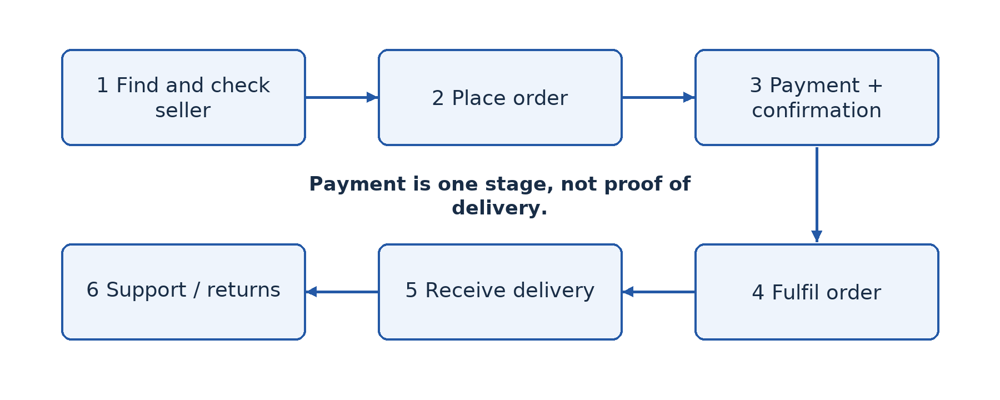
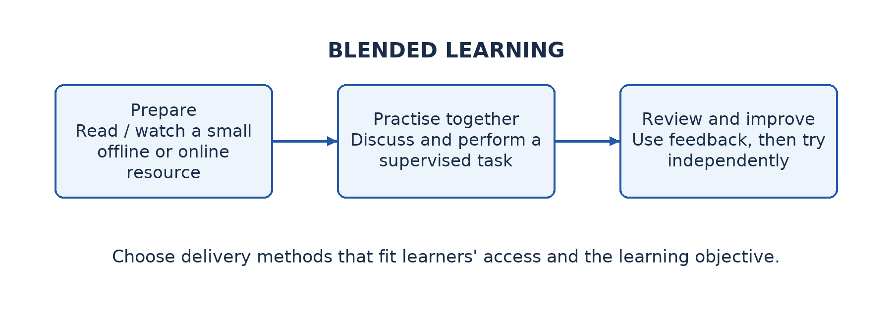
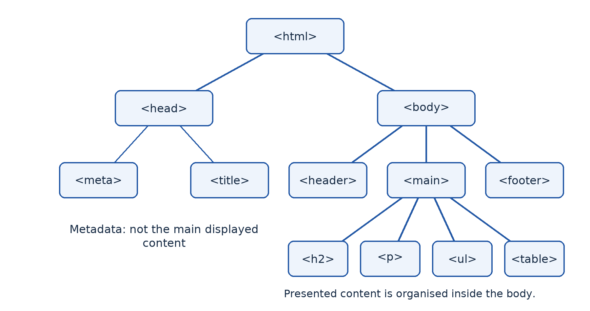

# Part 6 — Digital services, learning and HTML

## Lesson 42 — Electronic services: E-commerce, e-health and e-government

### A service is more than a page on a screen

A trader displays goods online, a clinic offers remote consultations and a public office lets users submit a form electronically. These are **electronic services (e-services)**: services delivered or supported through electronic systems and communication networks. The important question is what useful service the user receives, not merely whether an organisation has a website.

### 42.1 E-commerce

**E-commerce** is buying and selling goods or services through electronic networks, together with the related ordering and transaction processes. A typical purchase involves finding a product, checking the seller and terms, placing an order, arranging payment, receiving confirmation, obtaining delivery and using after-sales support if needed. A digital catalogue without online ordering may support commerce without providing the whole transaction electronically.

Common relationships include **business-to-consumer (B2C)**, such as a shop selling to an individual; **business-to-business (B2B)**, such as a wholesaler supplying a retailer; and **consumer-to-consumer (C2C)**, such as individuals trading through a marketplace. The relationship describes the participants, not a guarantee of trust or a particular payment method.

Benefits include reaching distant customers, comparing offers and reducing some travel. Risks include fraudulent sellers, misleading descriptions, exposed payment details, delivery failures and limited remedies. A protected connection is useful but does not establish the seller's honesty. Check independently verified contact details, total cost, delivery terms and return arrangements. Never make a real classroom purchase or disclose a personal payment code to demonstrate the process.



### 42.2 E-health

**E-health** uses ICT to support health services and health-related information. Examples include electronic records, appointment systems, digital public-health reporting and remote consultation. **Telemedicine** specifically concerns clinical services delivered at a distance, such as a clinician consulting another professional through a secure video link. A remote consultation does not automatically involve AI.

E-health can reduce travel and improve access to information or specialist support. It also raises confidentiality, accuracy, availability and inclusion concerns. Poor connectivity can interrupt a consultation, and some examinations require physical attendance. An online symptom page is not automatically qualified medical advice. Real treatment decisions belong with appropriately qualified professionals and approved services.

### 42.3 E-government

**E-government** is the use of ICT by public bodies to provide information, administration and services and support interaction with citizens or other organisations. Examples include access to public forms, electronic applications, tax-related services and examination administration. Some services only publish information; others support complete transactions. Do not assume that every stage of a public procedure can be completed online.

Benefits can include reduced travel, clearer status tracking and more convenient access. Limitations include unequal connectivity, complex forms, identity-verification requirements, language barriers, inaccessible design and service outages. An online-only process can shift costs to citizens rather than remove them. Assisted and offline channels may remain necessary.

### 42.4 Compare the three services

E-commerce primarily supports commercial exchange, e-health supports health needs and e-government supports public administration and services. All can use accounts, databases, secure communication and electronic forms. The consequences of error differ: an incorrect shopping item, a disclosed clinical record and an incorrectly processed public application create different harms. Select safeguards and user support accordingly.

### Worked example — Follow the whole service

A fictional learner orders a textbook online. Finding the title is information retrieval; placing the order is part of e-commerce; a payment notification is evidence of one stage, not proof of delivery. If the book is not delivered, the learner needs a documented order and a support or refund route. The explanation follows the service outcome rather than treating a checkout button as the end of the process.

### Guided activity

Use teacher-provided demonstration pages or a paper service flow. Follow a product enquiry, a fictional appointment request and a public-form search. Identify the user, requested information, processing, output and follow-up. Stop before submitting personal data, making payments or booking a real appointment. Compare which steps could work asynchronously and which might require immediate communication. Record the practical as a demonstration, not a real transaction.

### Check your understanding

1. Define e-service, e-commerce, e-health and e-government with one accurate example each.
2. Explain why payment confirmation is not the same as successful delivery.
3. Give one developed benefit and one limitation for each of the three main services.
4. Why are telemedicine and AI-assisted diagnosis not synonyms?

### Answer guidance

1. Link each definition to its purpose and service outcome. A product or institution name alone is not an explanation.
2. It concerns the payment stage. Fulfilment and delivery remain separate stages requiring their own evidence.
3. Connect convenience, access or efficiency to the particular users, then identify a realistic constraint and its consequence.
4. Telemedicine delivers clinical services at a distance; AI concerns intelligent processing such as pattern recognition. One can exist without the other.

## Lesson 43 — Applications, benefits and challenges of electronic services

### Match the service to the community problem

A village committee wants a digital solution for three difficulties: travelling to obtain a public form, finding a specialist appointment and selling surplus produce. One application is unlikely to solve all three. Choose the appropriate service, then evaluate whether intended users can actually complete the task.

### 43.1 Compare applications in everyday life

For the public form, an official e-government information or application service is relevant. For a specialist appointment, an approved e-health booking or referral service fits. For produce sales, an e-commerce listing and ordering process may help, but transport, pricing and payment still need arrangements. The electronic interface does not remove the real-world service behind it.

Different stakeholders experience different benefits and costs. A citizen may save travel time but pay for data or assistance. A business may reach more customers but need to manage returns and delivery. A public body may reduce repeated data entry but must fund secure systems, staff training and accessible support. A balanced answer considers these perspectives instead of assuming that moving a form online eliminates all work.

### 43.2 Identify authentic public platforms

The Cameroon **Direction Générale des Impôts (DGI)** provides an official e-services directory at `https://www.impots.cm/fr/e-services`, listing tax-related services such as registration and declarations [S4]. This is an example to identify and inspect, not an instruction for learners to register as taxpayers or submit a declaration. Specific service labels and procedures can change.

The **GCE Board's official site**, `https://camgceb.org/`, provides examination information and public examination-related resources [S5]. It is another relevant public-service environment, but it should not be assumed that every candidate procedure is performed personally online or that this classroom exercise verifies a current registration process. Follow official school and Board instructions for real examination matters.

Obtain a service address from a trusted official source, inspect the actual host and read the purpose and publication information. A search advertisement, forwarded message or copied logo is insufficient evidence of authenticity. If a service redirects to another host, the teacher should verify that destination through official guidance before learners enter any information. Do not bypass certificate warnings or send identity documents to an unverified contact.

### 43.3 Evaluate usability and accessibility

**Usability** concerns whether intended users can complete tasks effectively and with reasonable effort. Look for clear navigation, understandable instructions, helpful errors, confirmation and support. **Accessibility** concerns use by people with varied abilities and assistive technologies. Text alternatives, keyboard access, readable structure and appropriate language support can make a practical difference.

Also consider low-bandwidth use, mobile screens and intermittent power. A large scanned form may be hard to download and unusable with a screen reader. A time-limited form may lose all progress during an interruption. An accessible downloadable alternative or an assisted service point can improve inclusion. Do not claim a complete accessibility audit from a quick classroom inspection; report the specific observations and their limits.

### Worked example — Evaluate rather than praise

A public form can be downloaded without travelling to town, saving a journey for a connected user. However, if it requires a long high-quality scan upload and provides no clear error explanation, a user with costly mobile data may fail repeatedly. A reasoned recommendation suggests smaller accessible files, clear requirements, progress saving where appropriate and a supported alternative. “Online is faster” alone ignores the user's conditions.

### Guided practical — Inspect, do not transact

The teacher verifies one official public-service page in advance or supplies a dated offline capture. State a harmless task such as locating instructions or a blank public form. Record the page title, host, date inspected and the steps used. Test keyboard navigation and mobile readability where equipment permits. Identify one strength, one observed barrier and one improvement tied to a user need. Do not create a real government account, submit personal data or make a payment.

### Check your understanding

1. Select suitable e-services for the three community problems and justify each.
2. Identify two official public-service platforms discussed here and state their different purposes.
3. Distinguish usability from accessibility using a form example.
4. Explain why a service can save the administration time while still creating difficulties for citizens.

### Answer guidance

1. Match public administration, health support and commercial exchange to the actual need. Include the non-digital arrangements needed to complete the outcome.
2. DGI provides tax-related public services; the GCE Board provides examination information and related public resources. Do not invent a specific live transaction that you have not verified.
3. Clear instructions improve usability; a labelled, keyboard-operable form can improve accessibility. The concepts overlap but are not identical.
4. Data costs, inaccessible formats, identity requirements and reduced offline assistance can shift burdens to users. Evaluate the whole process and affected people.

## Lesson 44 — Computer-assisted learning and e-learning

### A computer should support learning, not merely display pages

A learner watches a recorded explanation, answers practice questions and receives feedback. Another reads an e-book offline. Both can use ICT to support learning without participating in a live online lesson. **Computer-assisted learning (CAL)** uses computer-based resources or activities to support the learning process. **E-learning** uses electronic technologies and resources for learning, often but not always through a network; the exact breadth of the term varies by institution.

### 44.1 Forms of learning support

A tutorial explains a topic in a planned sequence. Drill-and-practice provides repeated exercises. A simulation lets learners explore a model of a process that may be expensive, dangerous or impractical to reproduce physically. An educational game can provide purposeful practice, but entertainment alone does not establish a learning benefit. Feedback helps a learner identify and correct a misunderstanding rather than merely see a score.

Earlier computer-based learning was often distributed on local machines or removable media. Networked platforms later made updating, communication and remote access easier. Mobile devices and downloadable resources widened delivery options. The important principle is choosing a resource for a learning objective and context, not assuming the newest delivery method is automatically more effective.

### 44.2 Delivery through servers, removable media and e-books

A **learning management system (LMS)** can organise courses, resources, assignments, quizzes and progress records. It may run on an Internet server or a local school server. A local LMS can serve computers over a LAN without external Internet access, though remote learners would need another access arrangement. Accounts and permissions protect learner work and records.

**CD-ROMs and DVDs** can distribute fixed resources without a live connection, where compatible drives exist. They can be useful in older installations but are harder to update and depend on available hardware. Files can also be distributed through other approved storage; the key distinction is offline availability rather than the assumption that every modern laptop has an optical drive.

An **e-book** provides digital text and may include navigation, search, illustrations, audio or interactive features depending on format. A downloadable PDF is not necessarily interactive or accessible; its structure matters. A platform may provide streaming video, downloadable recordings, text transcripts and quizzes. Offer low-data and accessible formats where feasible.

### 44.3 Synchronous, asynchronous and blended learning

**Synchronous learning** involves participants interacting at the same time, such as a scheduled live online lesson. **Asynchronous learning** allows participation at different times, such as reading notes and submitting work later. These terms describe timing, not whether the activity uses a computer. A recorded video viewed later is asynchronous even if it originally came from a live lesson.

**Blended learning** combines face-to-face teaching with appropriate electronic or online activities. The parts should support each other: a learner might read an offline explanation, perform a supervised practical and then complete feedback questions. Blended does not mean assigning a large unconnected online workload on top of normal teaching.



### 44.4 Benefits and limitations

Electronic resources can support self-paced review, repeated practice, remote access and varied media. A simulation can make an invisible process easier to investigate. Teachers may obtain useful evidence from quizzes or submissions. These benefits depend on suitable content, meaningful tasks and feedback.

Limitations include device cost, power, connectivity, inaccessible design, reduced social contact, distraction and the need for self-management. A learner can click through every page without understanding. Teachers still need to identify misconceptions, support motivation and assess actual competence. Practical tasks may require supervised equipment rather than a video alone.

### Worked example — Plan for intermittent connectivity

Mboa's learners can connect at school twice a week but not reliably at home. Provide downloadable text and a small recorded explanation, ask for an offline task, then use school time for discussion and practical testing. A short later quiz provides feedback. Requiring daily live high-resolution video would ignore the stated constraint and might exclude the learners who most need support.

### Guided activity

Design a one-week lesson package for a younger class learning file management. State the objective, resource, delivery method, activity, feedback and evidence of success. Include a learner without home Internet and a learner who needs readable text rather than audio alone. If an approved LMS exists, upload a fictional resource and submit a test response; otherwise organise the package as an offline folder and explain the remaining platform steps.

### Check your understanding

1. Define CAL and explain two ways a computer can support learning beyond displaying text.
2. Compare delivery through an Internet LMS, local server and offline e-book.
3. Distinguish synchronous, asynchronous and blended learning with examples.
4. Evaluate e-learning for learners with shared devices and intermittent power.

### Answer guidance

1. Simulations, purposeful practice and useful feedback can support understanding. Explain the learning mechanism rather than merely listing media.
2. Discuss access, updating, interaction and offline availability. A local server need not have public Internet access, while a downloaded e-book may be used independently.
3. Same-time interaction, different-time participation and a purposeful combination of face-to-face and electronic work answer different design questions.
4. Weigh access and flexibility against resource constraints, then propose downloadable materials, school access and suitable non-digital support. Avoid an absolute verdict without context.

## Lesson 45 — Integration: Design a digital services and learning programme

### The situation

A fictional community centre wants to help residents locate public information, understand safe online shopping and access learning resources. It has three shared computers, a printer, limited weekly Internet data and volunteers with different levels of confidence. Some users need language or accessibility support.

### Your proposal

Design a small service programme combining Lessons 42–44. Choose one public-information task, one commercial-literacy activity and one learning resource. Explain the service purpose, users, necessary equipment and actual outcome for each. Do not propose that volunteers make real payments, submit identity documents or give medical advice on behalf of visitors without proper authority.

Show how volunteers will verify official addresses and explain transaction stages. Include a rule for handling uncertainty or suspected fraud. Plan low-data or offline resources, private handling of information and a practical way to assist users without learning their passwords. State what the centre can do and what requires referral to an authorised institution or professional.

Prepare a simple learning session that combines an explanation, supervised practice and feedback. Include a resident without a personal device and a user who cannot comfortably read a small-screen scanned document. Explain why each adaptation improves participation. A programme that only names three websites does not meet the task.

### Demonstration and evidence

Use fictional records and teacher-approved demonstration pages. Show how to locate a public instruction, trace an online order without paying, and open a downloadable learning resource. Submit the programme, a service-flow sketch, an accessibility observation and a short evaluation of the resource limits. If a live page is unavailable, use a dated offline capture and state that current functionality has not been tested.

### Assessment criteria — 20 marks

Use **6 marks** for appropriate services linked to community needs; **6 marks** for realistic delivery, privacy and safety arrangements; **4 marks** for a coherent learning activity and inclusion measures; and **4 marks** for clear demonstration, evidence and reflective improvement. These are locally authored criteria for the integration lesson.

### Review guidance

A strong programme distinguishes finding information from completing a regulated transaction. It allows a resident to retain control of credentials and provides an escalation route when volunteers cannot help safely. After another group's review, explain one change that makes the programme more usable for a person with limited connectivity or a disability. The improvement should address an observed or clearly described barrier, not a vague claim that the programme is “user friendly”.

## Lesson 46 — Developing simple web pages using HTML

### Begin with structure, not decoration

The ICT club wants a small offline website explaining its activities. A browser needs to know which text is a heading, which items form a list and where links lead. **Hypertext Markup Language (HTML)** describes the structure and meaning of web content. It is a markup language, not a general-purpose programming language for calculations and control logic. Styling with CSS and interactivity with JavaScript are later-term topics, not requirements of this lesson.

### 46.1 Tags, elements and attributes

A **tag** is markup such as `<p>` or `</p>`. An **element** includes its markup and content, such as `<p>Welcome to our club.</p>`. Many elements have an opening tag, content and closing tag. **Attributes** supply additional information in the opening tag. In `<a href="about.html">About the club</a>`, the `href` attribute specifies the link destination.

Some elements, including ``, `<br>` and `<meta>`, are **void elements** and do not have closing tags in HTML. Nest elements properly: an inner element should close before the surrounding element closes. HTML indentation helps a human reader see structure, even though the browser does not display the indentation as page layout.

`<!doctype html>` identifies a modern HTML document. The `<html>` element contains the document; `lang="en"` declares its language. The `<head>` contains metadata such as character encoding and the page title. The `<body>` contains the content presented to the user. `<title>` supplies a browser-tab title; it is different from the visible `<h1>` heading in the body.



### 46.2 Basic content elements

Use `<h1>` for the main page heading and appropriate lower-level headings such as `<h2>` for sections. A heading level describes structure, not merely desired text size. Use `<p>` for a paragraph, `<strong>` for strong importance and `<em>` for emphasis. Ordinary repeated spaces do not create reliable page layout; HTML normally collapses such whitespace in normal text.

An unordered list uses `<ul>` and an ordered list uses `<ol>`, each containing `<li>` items. An anchor `<a>` uses `href` to link to another resource or a page fragment. An image uses `src` for its location and `alt` for an appropriate text alternative. A meaningful image needs a useful description; a purely decorative image should normally have empty alternative text, `alt=""`, so assistive technology can ignore it.

A data table uses `<table>`, rows `<tr>`, heading cells `<th>` and data cells `<td>`. A `<caption>` explains the table's purpose, and `scope` can clarify header relationships. Tables are for genuinely tabular data, not a substitute for writing explanations or laying out an entire page. The browser may show a simple table without decorative borders; appearance can be styled in the next term.

A **relative path**, such as `about.html` or `images/club.svg`, is interpreted from the relevant document location. An **absolute URL**, such as an approved `https://` address, includes the access scheme and destination. A fragment link such as `#activities` refers to an element with the corresponding `id` in the page. Filenames and letter case can matter when files move between systems.

### 46.3 Full worked page — index.html

Create the following page in a plain-text editor. The same source and a matching image are supplied in `examples/upper-sixth-ict/site/`. The page is fictional and works locally without an Internet connection.

```html index.html
<!doctype html>
<html lang="en">
<head>
  <meta charset="utf-8">
  <meta name="viewport"
        content="width=device-width, initial-scale=1">
  <title>Mboa ICT Club — Home</title>
</head>
<body>
  <header>
    <h1>Mboa ICT Club</h1>
    <p>Learning to use technology responsibly.</p>
    <nav aria-label="Main navigation">
      <a href="index.html">Home</a>
      <a href="about.html">About</a>
      <a href="#activities">Activities</a>
    </nav>
  </header>
  <main>
    
    <section id="activities">
      <h2>Our activities</h2>
      <p>We practise <strong>safe</strong> computing
         and explain our choices <em>clearly</em>.</p>
      <ul>
        <li>Build simple web pages.</li>
        <li>Share files with permission.</li>
        <li>Check information before forwarding it.</li>
      </ul>
    </section>
    <section>
      <h2>How to join a practice session</h2>
      <ol>
        <li>Ask the teacher for the approved timetable.</li>
        <li>Bring your ICT notebook.</li>
        <li>Use only the assigned test account.</li>
      </ol>
    </section>
    <section>
      <h2>Practice timetable</h2>
      <table>
        <caption>Fictional club sessions</caption>
        <tr>
          <th scope="col">Day</th>
          <th scope="col">Activity</th>
        </tr>
        <tr><td>Tuesday</td><td>HTML practice</td></tr>
        <tr><td>Thursday</td><td>Network diagrams</td></tr>
      </table>
    </section>
  </main>
  <footer>
    <p>Classroom example — not a real public service.</p>
  </footer>
</body>
</html>
```

The heading appears in the page because it is in the body; the title appears in the browser tab because it is metadata. The image path looks in an `images` folder beside `index.html`. The Activities link finds the section with `id="activities"`. The table is appropriate because days and activities have a row-and-column relationship. These connections explain what the source means rather than asking you to copy mysterious tags.

### 46.4 A second linked page — about.html

Save the following in the same folder. Its link back to the home page makes navigation work in both directions.

```html about.html
<!doctype html>
<html lang="en">
<head>
  <meta charset="utf-8">
  <meta name="viewport"
        content="width=device-width, initial-scale=1">
  <title>Mboa ICT Club — About</title>
</head>
<body>
  <header>
    <h1>About the ICT club</h1>
    <nav aria-label="Main navigation">
      <a href="index.html">Home</a>
      <a href="about.html">About</a>
    </nav>
  </header>
  <main>
    <h2>Our purpose</h2>
    <p>We learn by explaining, practising and reviewing.</p>
    <h2>Our safety rule</h2>
    <p>Use fictional data and ask before sharing.</p>
  </main>
  <footer>
    <p>This is a fictional classroom website.</p>
  </footer>
</body>
</html>
```

### 46.5 Guided practical — Edit, save, open and test

1. Create a folder named `ict-club`, an `images` subfolder and the two HTML files. Copy the supplied `club.svg` image into `images`. Use a plain-text editor, not a word processor that adds document formatting.
2. Save the pages as UTF-8 text with `.html` extensions. Check that the editor has not silently added `.txt`. Open `index.html` in a browser using the file manager or the browser's open-file control.
3. Compare source with output. Locate the main heading, paragraphs, lists, image and table. Follow About, return Home and test the Activities fragment. Check that the image still loads when the folder is copied to another location.
4. Change one sentence in the editor, save, then reload the browser. If nothing changes, check that you edited the file the browser actually opened. Saving and reloading are different actions.
5. Inspect and correct a teacher-provided harmless error, such as a misspelt filename, missing closing tag or wrong image path. Record the symptom, cause and correction. If an approved validator is available, use its feedback; a page appearing in a browser does not prove that its markup is fully correct.
6. Ask a partner to navigate using the keyboard and explain whether the headings, links and image alternative communicate their purpose. Keep content fictional and do not publish it as a real school service. No CSS, JavaScript or hosting is needed for this first-term practical.

Without a computer, annotate the source and draw the expected page structure on paper, then complete actual editing and browser testing later. Keep the entire folder when submitting: a page that depends on a missing image or second file is incomplete.

### Worked example — Debug a missing image

The page contains `src="image/club.svg"`, but the folder is named `images`. The browser cannot find the referenced file. Correct the relative path to `images/club.svg`, save and reload. Replacing the computer or adding an Internet connection would not solve this local path error. If the image cannot be shown, its appropriate `alt` text still communicates its meaning.

### Check your understanding

1. Distinguish a tag, an element and an attribute with an example of each.
2. Explain the roles of `head`, `title`, `body`, `href`, `src` and `alt`.
3. Write a paragraph, a three-item ordered list and a link to `about.html`.
4. Explain why a page may open successfully yet contain invalid markup or broken links.
5. Describe the edit–save–reload cycle and three checks for a file that seems not to update.

### Answer guidance

1. `<p>` is a tag, `<p>Hello.</p>` is an element, and `href="about.html"` supplies a link attribute. Preserve the distinction between markup token and complete element.
2. The head holds metadata, title labels the tab, body holds presented content, href gives a link target, src identifies an embedded resource and alt provides an image text alternative appropriate to its purpose.
3. Use properly nested `<p>`, `<ol>` with three `<li>` elements, and `<a href="about.html">About</a>`. Link text should communicate the destination.
4. Browsers recover from some errors and do not automatically prove that every link or resource works. Test the files and use validation where available.
5. Edit the intended source, save it and reload the displayed page. Check the open path, extension and saved contents; also consider caching only after confirming the correct file is in use.

### Independent assignment

Adapt the two-page example into a fictional learning-club site. Include meaningful headings, connected explanations, one useful image with appropriate alternative text, a list, navigation in both directions and a small genuine data table. Submit the complete folder and a short debugging record. You are assessed on clear structure and working content, not decoration from later-term technologies.
